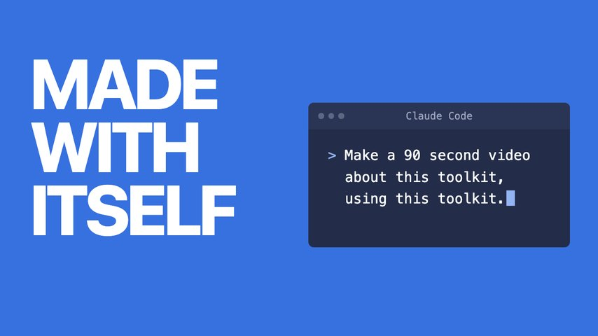
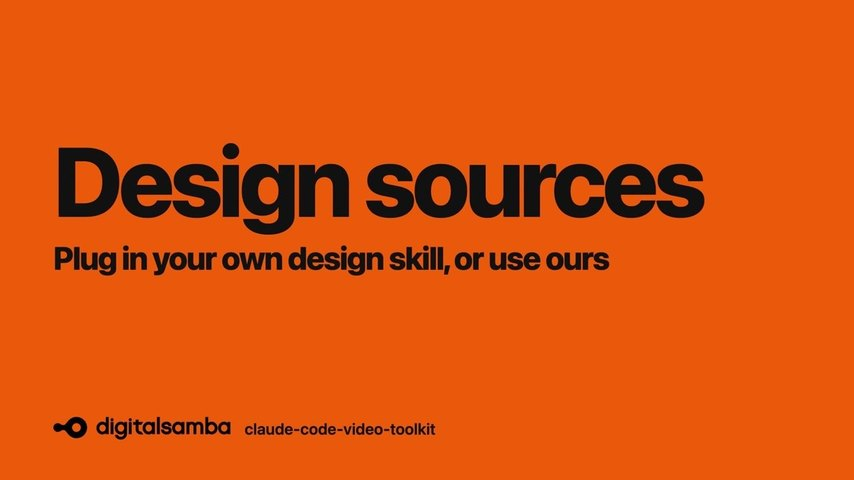
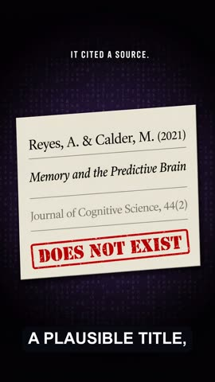
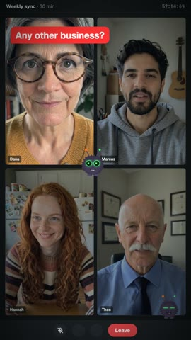

# claude-code-video-toolkit

<p align="center">
  
</p>

[](https://github.com/digitalsamba/claude-code-video-toolkit/releases) [](LICENSE) [](https://github.com/digitalsamba/claude-code-video-toolkit/stargazers)

Tell [Claude Code](https://claude.ai/code) what video you want — it writes the script, generates the voiceover, music, and visuals, and renders the MP4. An AI-native video production workspace: the skills, commands, templates, and tools your AI agent needs to take a video from concept to final render, on open-source models that cost cents (voiceover ~$0.01, AI video clips ~$0.23).

## See What It Makes

Every frame below was generated in this workspace. Click one to watch it.

<a href="https://www.youtube.com/watch?v=3HjPatdeal4"></a><br>
**Made with itself**: this toolkit in 90 seconds, made with this toolkit. Every terminal line on screen is the real
output of the command that made that part, and the bill is measured ($0.33).

| | |
|:--:|:--:|
| <a href="https://demos.digitalsamba.com/video/ds-release-650.mp4"></a> | <a href="https://www.youtube.com/watch?v=AQLzseZ2aAY"></a> |
| **Release-notes video**<br>product UI rebuilt from source,<br>no screen recording | **Design sources**<br>one chart in three design skills,<br>plug in your own or use ours |

| | | |
|:--:|:--:|:--:|
| <a href="https://demos.digitalsamba.com/video/ds-free-schedule-demo.mp4"></a> | <a href="https://demos.digitalsamba.com/video/hallucinations_short.mp4"></a> | <a href="https://youtube.com/shorts/1hyDgC5Qg_o"></a> |
| **Product demo**<br>scripted cursor and camera,<br>AI narrator tile | **AI hallucinations explainer**<br>9:16 Short: Ideogram 4 cards,<br>cloned voice, burned captions | **You're On Mute**<br>every video call ever, as a horror trailer;<br>invented cast, `parody-short` skill |

More in the [showcase table](#templates) below. Made one yourself? Post it in [Show and tell](https://github.com/digitalsamba/claude-code-video-toolkit/discussions/categories/show-and-tell).

## Quick Start

```bash
git clone https://github.com/digitalsamba/claude-code-video-toolkit.git
cd claude-code-video-toolkit
uv sync   # Optional: AI voiceover, image gen, music, moviepy examples
claude    # Open Claude Code in the toolkit
```

> Python dependencies are managed with [uv](https://docs.astral.sh/uv/) — `uv sync` creates `.venv/` and installs everything from the lockfile in seconds. No uv yet? `curl -LsSf https://astral.sh/uv/install.sh | sh` (macOS/Linux) or `powershell -c "irm https://astral.sh/uv/install.ps1 | iex"` (Windows).

Then in Claude Code:

```
/setup                    # Configure cloud GPU, storage, voice (~5 min, mostly free)
/video                    # Create your first video
```

**That's it.** `/setup` walks you through everything interactively — cloud GPU provider, file transfer, voice config. `/video` creates a project from a template and guides you through the whole workflow.

**What's free:** The toolkit leans heavily on open-source AI models — voiceovers (Qwen3-TTS), image generation (FLUX.2), music (ACE-Step), and more. You deploy them to your own cloud GPU account and run them at cost. Cloudflare R2 has a generous free tier (10GB, zero egress), and Modal gives $30/month free compute on the Starter plan — more than enough for a few 5-minute videos a month.

**Requirements:** [Node.js](https://nodejs.org/) 22+ (24 LTS recommended) and [Claude Code](https://docs.anthropic.com/en/docs/claude-code). [uv](https://docs.astral.sh/uv/) recommended for the AI tools (it installs Python 3.10+ for you). FFmpeg optional.

> **Want to skip setup and just render something?**
> ```bash
> cd examples/hello-world && npm install && npm run render
> ```
> No API keys needed — outputs an MP4 immediately.

---

## A Note from the Author *(not AI-generated)*

> I've spent months painstakingly putting this toolkit together and plan to keep iterating on it. AI makes things easier, but hard work still has huge value. Every video I create is a chance for improvement — every skill, template, tool, and workflow here has been refined through that cycle. It would be wonderful if others wanted to get involved with that: use it, refine it, and feed back into the repo via an issue or PR what you learn.
>
> My own use case is fairly specific: creating sprint review videos for the AI mobile development arm of [Digital Samba](https://www.digitalsamba.com/). But the idea behind this project is a reusable toolkit for using Claude Code to autonomously generate any kind of "explainer" style video — product demos, walkthroughs, presentations, whatever you need. Autonomous video creation is a lofty ideal for such a subjective field, but we can try :)
>
> What makes this work is that Claude Code is fantastically resourceful and flexible — give it the framing and tooling that this toolkit provides and it will adapt it to create templates and videos based on your prompting. The skills, templates, and tools here are building blocks. Claude Code is the builder. You are the director, editor, and designer.
>
> **If you're getting started**, run `/setup` then `/video` and let Claude Code guide you. Or start with `/template` to create a template for your own use case.
>
> **Cloud GPU** — I recommend [Modal](https://modal.com/) for running the toolkit's AI tools. The Starter plan gives you $30/month free compute, which is more than enough. [RunPod](https://runpod.io/) is also supported as an alternative. Run `/setup` to deploy the tools you need.
>
> My motto: **Be brave. Experiment.** And please share any videos you create or ideas you have back with the project — it helps me keep improving this toolkit for everyone.

## Features

### Skills

Claude Code has deep knowledge in:

| Skill | Description |
|-------|-------------|
| **remotion** | React-based video framework — compositions, animations, rendering |
| **elevenlabs** | AI audio — text-to-speech, voice cloning, music, sound effects |
| **ffmpeg** | Media processing — format conversion, compression, resizing |
| **playwright-recording** | Browser automation — record demos as video |
| **video-design** | Visual design for video: colour by act, one data accent, type steps, a contact-sheet critique; takes direction from any design skill ([design sources](#design-sources)) |
| **qwen-edit** | AI image editing — prompting patterns and best practices |
| **ideogram4** | AI image generation with best-in-class in-image text — title cards, thumbnails, exact brand colors |
| **acestep** | AI music generation — prompts, lyrics, scene presets, video integration |
| **ltx2** | AI video generation — text-to-video, image-to-video clips, prompting guide |
| **parody-short** | Comedy shorts about a group's own life or a shared topic, in a borrowed genre: in-jokes from the group's own chat and docs, costumed and animated photos or an invented cast, sound placed on the movement, vertical cuts |
| **blender** *(experimental, optional)* | 3D from a JSON shot spec: a rigged cartoon cast acting on cue, a scene that turns out to be on a laptop, an app on a phone or a 3D model on a studio stage; every camera checked before the render; as a film or as clips in any video. Needs [Blender](docs/blender.md) |
| **moviepy** | Python video composition — overlay text on LTX-2/SadTalker output, build.py-style projects |
| **runpod** | Cloud GPU — setup, Docker images, endpoint management, costs |

> The always-current catalog of skills, commands, tools, and templates lives in [`_internal/toolkit-registry.json`](_internal/toolkit-registry.json).

### Commands

| Command | Description |
|---------|-------------|
| `/setup` | First-time setup — cloud GPU, file transfer, voice, prerequisites |
| `/video` | Video projects — list, resume, or create new |
| `/scene-review` | Scene-by-scene review in Remotion Studio |
| `/design` | Set a video's design direction (design.md) from a design source, refine a scene, or critique the render |
| `/brand` | Brand profiles — list, edit, or create new |
| `/template` | List available templates or create new ones |
| `/skills` | List installed skills or create new ones |
| `/contribute` | Share improvements — issues, PRs, examples |
| `/record-demo` | Record browser interactions with Playwright |
| `/generate-voiceover` | Generate AI voiceover from a script |
| `/redub` | Redub existing video with a different voice |
| `/voice-clone` | Record, test, and save a cloned voice to a brand |
| `/thumbnail` | Generate a YouTube thumbnail with Ideogram 4 (hook phrase + brand colours) |
| `/publish` | Publish a finished video to YouTube (metadata auto-filled from `project.json`) |
| `/versions` | Check dependency versions and toolkit updates |

> **Note:** After creating or modifying commands/skills, restart Claude Code to load changes.

### Templates

Pre-built video structures in `templates/`:

- **sprint-review** — Sprint review videos with demos, stats, and voiceover
- **sprint-review-v2** — Composable scene-based sprint review with modular architecture
- **product-demo** — Marketing videos with dark tech aesthetic, stats, CTA
- **concept-explainer-short** — 9:16 vertical TikTok/Reels/Shorts explainers (Python/moviepy, no Remotion)
- **ds-release-notes** — Synthetic release-notes videos: product screens rebuilt from source, scripted cursor and camera, sentence-level cloned narration (ships as the Digital Samba 650 build)

See `examples/` for finished projects you can learn from (newest first — scroll down to watch the toolkit evolve in reverse):

| Date | Demo | Description |
|------|------|-------------|
| 2026-11-12 | [made-with-itself](https://www.youtube.com/watch?v=3HjPatdeal4) | 93s video about the toolkit, made in the toolkit from one sentence typed into Claude Code: each stage (narrate, score, generate, compose, check) is the real command in the new `Terminal` component, every line its saved output, then what it made; narrated by Marilyn from the ElevenLabs voice library through the new `brands/video-toolkit`; the bill is measured ($0.33) and the Check scene shows what `qc.py` really found in the draft (`examples/toolkit-made-itself`) |
| 2026-11-09 | [design-sources](https://www.youtube.com/watch?v=AQLzseZ2aAY) | 46s: one chart designed three ways (the toolkit's own palettes, taste-skill, and a house style of your own), the page turning between them on the narration with `PageTurns`, then the render checked one frame per scene with `contact_sheet.py` |
| 2026-11-07 | [the-great-return](https://www.youtube.com/watch?v=YUqkQydQDh4) | 98s wildlife documentary about the return to the office, made with the `parody-short` skill and the same invented cast: mock-Latin lower thirds, a designed narrator voice, LTX clips lengthened with `ltx_extend.py` instead of frozen, every sound effect placed on its movement with `sync_check.py` ([vertical cut](https://youtube.com/shorts/e4HW-tvi8-8)) |
| 2026-11-07 | [youre-on-mute](https://www.youtube.com/watch?v=73JNiOJgx5k) | 76s horror trailer about the video call that never ends, from the `parody-short` skill: an invented cast of four (FLUX portraits animated with LTX through `LivingPhoto`), a call UI built in Remotion that misbehaves, a stinger after the title ([vertical cut](https://youtube.com/shorts/1hyDgC5Qg_o)) |
| 2026-11-04 | [data-chart-stars](https://demos.digitalsamba.com/video/data-chart-stars.mp4) | 31s chart video of the toolkit's GitHub star history, drawn as SVG by the new `LineChart` and `BarChart` components: the line is drawn while Lugh narrates each stretch, and the March spike's band and the monthly bars light on the words that name them, timed with `cue()` (`examples/data-chart-stars`) |
| 2026-11-01 | [the-agent-handoff](https://demos.digitalsamba.com/video/the-agent-handoff.mp4) | *An experiment in agent-first, one-prompt video, kept for the record rather than as a showcase.* 57s an agent made unattended from one Discord message: the agent wrote the script and the shot list, `video_job.py` voiced it with a cloned voice, generated four LTX-2 clips and a diagram card, built and QC'd it, and the Discord bot posted the link when it went live; $0.47, the fourth take after three pipeline fixes (`docs/agent-video-jobs.md`) |
| 2026-10-28 | [ds-release-650](https://demos.digitalsamba.com/video/ds-release-650.mp4) | 87s release-notes video built from the `ds-release-notes` template: six items across the room and account center, Lugh's cloned voice made livelier with `voice_prosody.py`, checked with `qc.py --render --layout` (`templates/ds-release-notes`) |
| 2026-10-21 | [ds-release-649](https://demos.digitalsamba.com/video/ds-release-649.mp4) | Release-notes video with no screen recording: three product UIs rebuilt from their source code, driven by a scripted cursor and camera, narrated by Lugh; re-rendered 2026-11-09 in the DS act palette from `video-design` (`examples/ds-release-649`) |
| 2026-10-21 | [ds-free-schedule-demo](https://demos.digitalsamba.com/video/ds-free-schedule-demo.mp4) | 26s synthetic product demo of scheduling a call, with a SoulX talking-head narrator tile (`examples/ds-free-schedule-demo`) |
| 2026-06-09 | [hallucinations-short](https://demos.digitalsamba.com/video/hallucinations_short.mp4) | 3:41 vertical explainer on AI hallucinations — Ideogram 4 cards, LTX-2 b-roll, burned karaoke captions, Qwen3-TTS voice *clone* (reference sample from [Pixabay](https://pixabay.com/sound-effects/search/voice%20overs/)) |
| 2026-06-09 | [sky-blue-short](https://demos.digitalsamba.com/video/short-blue-sky.mp4) | 52s "Why is the sky blue?" — concept-explainer-short template showcase (`examples/sky-blue-short`), stock Qwen3-TTS voice |
| 2026-04-08 | [q2-townhall-stars](https://demos.digitalsamba.com/video/q2-townhall-stars.mp4) | GitHub star history time-lapse with animated chart and deadpan-to-excited commentary |
| 2026-04-08 | [q2-townhall-longarm-ad](https://demos.digitalsamba.com/video/q2-townhall-longarm-ad.mp4) | Super Bowl-style launch ad with dramatic Qwen3-TTS announcer and LTX-2 animated Lugh cameo |
| 2026-03-15 | [the-space-between](https://demos.digitalsamba.com/video/the-space-between.mp4) | AI-generated video essay — flux2 avatar, Qwen3-TTS voice, SadTalker animation |
| 2026-02-23 | [cortina](https://demos.digitalsamba.com/video/sprint-review.mp4) | Mobile platforms sprint review |
| 2026-01-25 | [schlumbergera](https://demos.digitalsamba.com/video/schlumbergera.mp4) | Android sprint review video |
| 2026-01-22 | [ds-remote-mcp](https://demos.digitalsamba.com/video/ds-remote-mcp.mp4) | Remote MCP server demo *(the jazz background music is a joke)* |
| 2025-12-10 | [digital-samba-skill-demo](https://demos.digitalsamba.com/video/digital-samba-skill-demo.mp4) | Product demo showcasing Claude Code skill |
| 2025-12-05 | [sprint-review-cho-oyu](https://demos.digitalsamba.com/sprint-review-cho-oyu.mp4) | iOS sprint review with demos |

Videos other people have made with the toolkit are in [Show and tell](https://github.com/digitalsamba/claude-code-video-toolkit/discussions/categories/show-and-tell). Share yours there: a link, the template or tools you used, and what it cost.

### Scene Transitions

The toolkit includes a transitions library for scene-to-scene effects:

| Transition | Description |
|------------|-------------|
| `glitch()` | Digital distortion with RGB shift |
| `rgbSplit()` | Chromatic aberration effect |
| `zoomBlur()` | Radial motion blur |
| `lightLeak()` | Cinematic lens flare |
| `clockWipe()` | Radial sweep reveal |
| `pixelate()` | Digital mosaic dissolution |
| `checkerboard()` | Grid-based reveal (9 patterns) |

Plus official Remotion transitions: `slide()`, `fade()`, `wipe()`, `flip()`

Preview all transitions:
```bash
cd showcase/transitions && npm install && npm run studio
```

See [lib/transitions/README.md](lib/transitions/README.md) for full documentation.

### Brand Profiles

Define visual identity in `brands/`. When you create a project with `/video`, the brand's colors, fonts, and styling are automatically applied.

```
brands/my-brand/
├── brand.json    # Colors, fonts, typography
├── voice.json    # ElevenLabs voice settings
└── assets/       # Logo, backgrounds
```

Included brands: `default`, `digital-samba`

Create your own with `/brand`.

### Project Management System

Video projects are tracked through a multi-session lifecycle:

```
planning → assets → review → audio → editing → rendering → complete
```

Each project has a `project.json` that tracks:
- **Scenes** — What to show, asset status, visual types
- **Audio** — Voiceover and music status
- **Sessions** — Work history across Claude Code sessions
- **Phase** — Current stage in the workflow

The system automatically reconciles intent (what you planned) with reality (what files exist), and generates a `CLAUDE.md` per project for instant context when resuming.

See [lib/project/README.md](lib/project/README.md) for schema details, scene status tracking, and filesystem reconciliation logic.

### Python Tools

Audio, video, and image tools in `tools/`:

```bash
# AI voiceover — ElevenLabs or self-hosted Qwen3-TTS (9 voices + cloning)
uv run tools/voiceover.py --provider qwen3 --speaker Ryan --scene-dir public/audio/scenes --json

# AI music (ACE-Step — free cloud API)
uv run tools/music_gen.py --preset corporate-bg --duration 120 --output music.mp3

# AI image generation (FLUX.2) and editing (Qwen-Image)
uv run tools/flux2.py --preset title-bg --brand digital-samba --cloud modal
uv run tools/image_edit.py --input photo.jpg --prompt "Add sunglasses" --cloud modal

# AI video generation (LTX-2.3 — text-to-video, image-to-video)
uv run tools/ltx2.py --prompt "A sunset over the ocean, cinematic" --cloud modal

# Talking head from a portrait + audio (SoulX-FlashHead)
uv run tools/soulx.py --image portrait.png --audio voiceover.mp3 --output talking.mp4
```

<details>
<summary><strong>All tools</strong> — sound effects, redub, upscaling, watermark removal, NotebookLM rebranding, in-image text…</summary>

```bash
# Generate voiceover (ElevenLabs)
uv run tools/voiceover.py --script script.md --output voiceover.mp3

# Generate voiceover (Qwen3-TTS — self-hosted, cheaper alternative)
uv run tools/voiceover.py --provider qwen3 --speaker Ryan --scene-dir public/audio/scenes --json
uv run tools/qwen3_tts.py --text "Hello world" --tone warm --output hello.mp3

# Generate background music (ElevenLabs)
uv run tools/music.py --prompt "Upbeat corporate" --duration 120 --output music.mp3

# Generate background music (ACE-Step — free cloud API, XL Turbo 4B model)
uv run tools/music_gen.py --preset corporate-bg --duration 120 --output music.mp3
uv run tools/music_gen.py --prompt "Dramatic cinematic" --duration 30 --bpm 90 --key "D Minor" --output reveal.mp3
uv run tools/music_gen.py --prompt "Upbeat indie rock" --duration 60 --variations 4 --output intro.mp3

# Generate sound effects
uv run tools/sfx.py --preset whoosh --output sfx.mp3

# Find real recorded sound effects (Creative Commons, free, no API key)
uv run tools/sfx_search.py --query "whoosh" --output sfx.mp3

# Redub video with different voice
uv run tools/redub.py --input video.mp4 --voice-id VOICE_ID --output dubbed.mp4

# Add background music to existing video
uv run tools/addmusic.py --input video.mp4 --prompt "Subtle ambient" --output output.mp4

# Rebrand NotebookLM videos (trim outro, add your logo/URL)
uv run tools/notebooklm_brand.py --input video.mp4 --logo logo.png --url "mysite.com" --output branded.mp4

# AI image editing (style transfer, backgrounds, custom prompts)
uv run tools/image_edit.py --input photo.jpg --style cyberpunk --cloud modal
uv run tools/image_edit.py --input photo.jpg --prompt "Add sunglasses" --cloud modal

# AI image upscaling (2x/4x)
uv run tools/upscale.py --input photo.jpg --output photo_4x.png --cloud modal

# Remove watermarks (requires cloud GPU)
uv run tools/dewatermark.py --input video.mp4 --preset sora --output clean.mp4 --cloud modal

# Locate watermark coordinates
uv run tools/locate_watermark.py --input video.mp4 --grid --output-dir ./review/

# Generate talking head video from image + audio (SoulX-FlashHead)
uv run tools/soulx.py --image portrait.png --audio voiceover.mp3 --output talking.mp4

# AI image generation (FLUX.2 klein 4B; klein-9B is a non-commercial Modal opt-in)
uv run tools/flux2.py --prompt "A sunset over mountains" --cloud modal
uv run tools/flux2.py --preset title-bg --brand digital-samba --cloud modal
uv run tools/flux2.py --list-presets

# AI video generation (LTX-2.3 22B — text-to-video + image-to-video)
uv run tools/ltx2.py --prompt "A sunset over the ocean, cinematic" --cloud modal
uv run tools/ltx2.py --prompt "Gentle camera drift" --input photo.jpg --cloud modal

# 3D shots from a JSON spec (experimental; needs Blender 4.2+, see docs/blender.md)
uv run tools/blender_render.py doctor                                    # is Blender here, and how fast is it?
uv run tools/blender_render.py check examples/blender-disk-panic/spec.json    # cameras verified, contact sheet, ~5 s
uv run tools/blender_render.py render spec.json --clips --alpha --to projects/my-video/public/blender

# Publish a finished render to YouTube (OAuth 2.0 + Data API v3) — contributed by @dascope (#29)
uv run tools/youtube_upload.py --auth                                   # one-time browser login
uv run tools/youtube_upload.py --video out/video.mp4 --title "My video" --privacy private --json-out
```
</details>


**Tool Categories:**

| Type | Tools | Purpose |
|------|-------|---------|
| **Project** | voiceover, music, music_gen, sfx, sfx_search | Used during video creation workflow |
| **Utility** | redub, addmusic, notebooklm_brand, locate_watermark | Quick transformations, no project needed |
| **Cloud GPU** | image_edit, upscale, dewatermark, sadtalker, soulx, qwen3_tts, flux2, music_gen, ltx2 | AI processing via Modal or RunPod |
| **Checks** | qc, sync_check, contact_sheet | Before showing a render: freezes and motion that stops dead, loudness, layout, sound effects on their movement |
| **Publishing** | youtube_upload | Upload a finished render to YouTube (or use `/publish`) |
| **3D (optional)** | blender_render | Character acting, 3D reveals and product shots from a shot spec; does nothing unless Blender is installed |

### Cloud GPU (Modal + RunPod)

8 AI tools run on cloud GPUs. Use `--cloud modal` (recommended) or `--cloud runpod` on any tool.

| Tool | What It Does | Est. Cost |
|------|--------------|-----------|
| `qwen3_tts` | AI text-to-speech (9 speakers, voice cloning) | ~$0.01 |
| `flux2` | AI image generation & editing | ~$0.02 |
| `image_edit` | AI image editing & style transfer | ~$0.03 |
| `upscale` | AI image upscaling (2x/4x) | ~$0.01 |
| `music_gen` | AI music generation (8 scene presets) | Free (acemusic) / ~$0.05 (self-hosted) |
| `soulx` | Talking head video from portrait + audio — holds identity over long takes | ~$0.0024/sec |
| `sadtalker` | Talking head video, warp-based — fast, cheap drafts | ~$0.10 |
| `ltx2` | AI video generation (text-to-video, image-to-video) | ~$0.23 |
| `ltx_extend` | Lengthen an LTX clip by continuing it from its last good frame, instead of holding or looping it | ~$0.08 per extension |
| `dewatermark` | Video watermark removal | ~$0.10 |

**Modal (recommended):** Each tool deploys from `docker/modal-*/app.py` — Modal builds and hosts the containers. $30/month free compute on the Starter plan, typical usage is $1-2/month. Run `/setup` to deploy all tools automatically.

**RunPod (alternative):** Uses pre-built Docker images from `ghcr.io/conalmullan/video-toolkit-*`. Pay-per-second, no minimums. Run `uv run tools/<tool>.py --setup` to create endpoints.

See [docs/modal-setup.md](docs/modal-setup.md) and [docs/runpod-setup.md](docs/runpod-setup.md) for details.

## Project Structure

```
claude-code-video-toolkit/
├── .claude/
│   ├── skills/          # Domain knowledge for Claude
│   └── commands/        # Slash commands (/video, /brand, etc.)
├── lib/                 # Shared components, theme system, utilities
│   ├── components/      # Reusable video components (11 components)
│   ├── transitions/     # Scene transition effects (7 custom + 4 official)
│   ├── theme/           # ThemeProvider, useTheme
│   └── project/         # Multi-session project system
├── tools/               # Python CLI tools
├── templates/           # Video templates
├── brands/              # Brand profiles
├── projects/            # Your video projects (gitignored)
├── examples/            # Curated showcase projects with finished videos
├── assets/              # Shared assets
├── playwright/          # Recording infrastructure
├── docs/                # Documentation
└── _internal/           # Toolkit metadata & roadmap
```

## Documentation

- [Getting Started](docs/getting-started.md)
- [Modal Setup](docs/modal-setup.md) — Cloud GPU with Modal (recommended)
- [RunPod Setup](docs/runpod-setup.md) — Cloud GPU with RunPod (alternative)
- [Creating Templates](docs/creating-templates.md)
- [Creating Brands](docs/creating-brands.md)
- [Project System](lib/project/README.md) — Multi-session lifecycle, schema, reconciliation
- [Optional Components](docs/optional-components.md) — Local GPU tools setup
- [Blender](docs/blender.md): 3D shot specs (experimental): setup, timings, what it has been run on
- [Agent Video Jobs](docs/agent-video-jobs.md) — Brief in, MP4 out for any agent: `video_job.py` submit/status/result, the MCP server, and the `skills/video-toolkit/` skill for OpenClaw, Codex, Hermes and friends
- [Toolkit Development](_internal/ROADMAP.md) — Roadmap, backlog, changelog

## Video Workflow

```
/video → Script → Assets → Scene Review → Design → Audio → Preview → Render → Publish
```

1. **Create project** — Run `/video`, choose template and brand
2. **Review script** — Edit `VOICEOVER-SCRIPT.md` to plan content and assets
3. **Gather assets** — Record demos with `/record-demo` or add external videos
4. **Scene review** — Run `/scene-review` to verify visuals in Remotion Studio
5. **Design** — `/video` sets the design direction before scenes are built; `/design` changes it, refines a scene with `video-design`, or critiques the render
6. **Generate audio** — AI voiceover with `/generate-voiceover`
7. **Configure** — Update config file with asset paths and timing
8. **Preview** — `npm run studio` for live preview
9. **Iterate** — Work with Claude Code to adjust timing, styling, content
10. **Render** — `npm run render` for final MP4

## Using with Codex

The toolkit is built for Claude Code, but an experimental migration script installs its skills and workflows for [Codex](https://openai.com/codex/) and generates an `AGENTS.md` block from `CLAUDE.md`:

```bash
uv run scripts/migrate_to_codex.py --force
```

See [docs/codex.md](docs/codex.md) for what it installs, how the `AGENTS.md` block is managed, and how to remove it. Contributed by [@kimhoontae-gogo](https://github.com/kimhoontae-gogo) in [#16](https://github.com/digitalsamba/claude-code-video-toolkit/pull/16).

## Using with Kiro CLI

A sibling migration script installs the toolkit's skills and workflows for [Kiro CLI](https://kiro.dev/) — `/video`, `/setup`, etc. work as slash commands, from any directory:

```bash
uv run scripts/migrate_to_kiro.py --force
```

See [docs/kiro.md](docs/kiro.md) for what it installs, how it achieves Claude Code-parity, and how to remove it.

## Design sources

**Plug in your own design skill, or use ours.** `/design` and `/scene-review` take their visual direction from the
source you choose, then apply the toolkit's own video rules (`video-design`) and critique the render from a contact
sheet. The choice is saved per project; nothing here depends on one particular skill.

| Source | What it's good for | Install |
|--------|--------------------|---------|
| Ours (default) | `video-design`'s act palettes and rules, with your brand's colours and fonts | Nothing to install |
| [taste-skill](https://github.com/Leonxlnx/taste-skill) (recommended plug-in) | Dealt directions and palettes from 247 studied sites, measured house rules, a juror's critique (MIT) | `/plugin marketplace add Leonxlnx/taste-skill` then `/plugin install taste-skill@taste-skill` |
| [frontend-design](https://github.com/anthropics/skills) | Anthropic's general visual direction for interfaces (written for web pages) | See the anthropics/skills README |

Bring your own: any design skill works if it can fill `design.md` (palette per act, ink, one accent, type).
To list one here, open an issue with a link, its licence, and a contact sheet of `examples/data-chart-stars`
restyled with it. See [`.claude/skills/video-design/sources.md`](.claude/skills/video-design/sources.md).

## Community add-ons

Projects built on or around the toolkit that live in their own repos — typically because they need
software or a service we can't bundle. We haven't reviewed them; check each project's README.

| Add-on | What it does | Needs |
|--------|--------------|-------|
| [VOICEPEAK for voiceover.py](https://github.com/fialuxe/claude-code-video-toolkit-expand-ja-voicepeak/) | Offline Japanese TTS provider (patches `voiceover.py`) | VOICEPEAK (paid, local) |
| [arkiv](https://github.com/vulture-s/arkiv) | Natural-language search (EN/中文/日本語) over your own footage archive, returning scenes with start/end timecodes to use as a template's `videoFile` | A local arkiv instance (source-available, PolyForm Perimeter) |
| [Upload-Post publishing](https://github.com/Upload-Post/claude-code-video-toolkit-upload-post) | Publish a rendered video to TikTok, Instagram, YouTube, LinkedIn, Facebook, X, Threads, Pinterest and Bluesky via a `/publish-social` command | An Upload-Post account and API key (hosted, free plan available) |
| [CommentKeyword comment-to-DM](https://github.com/commentkeyword/agent-toolkit/tree/main/integrations/claude-code-video-toolkit) | Sets up the Instagram auto-DM behind a video's "Comment KEYWORD" CTA, armed for the next post, via a `/comment-dm` command | A CommentKeyword account and API token (hosted, free plan available; Instagram only) |
| [easybrandkit](https://github.com/EminBudak/easybrandkit) | Reads a live site's logo, colors and fonts into a BRAND.md that `/brand` can start from | Node 22 and Chrome, Chromium, Edge or Brave |

To be listed, open an issue with a link and a one-line description. Integrations that need a
hosted third-party service live here rather than in the toolkit itself — see
[CONTRIBUTING.md](CONTRIBUTING.md) for why, and for how the few exceptions came about.

## Contributing

Contributions welcome! See [CONTRIBUTING.md](CONTRIBUTING.md) for guidelines.

## License

MIT License — see [LICENSE](LICENSE) for details.

---

Built for use with [Claude Code](https://claude.ai/code) by Anthropic.
