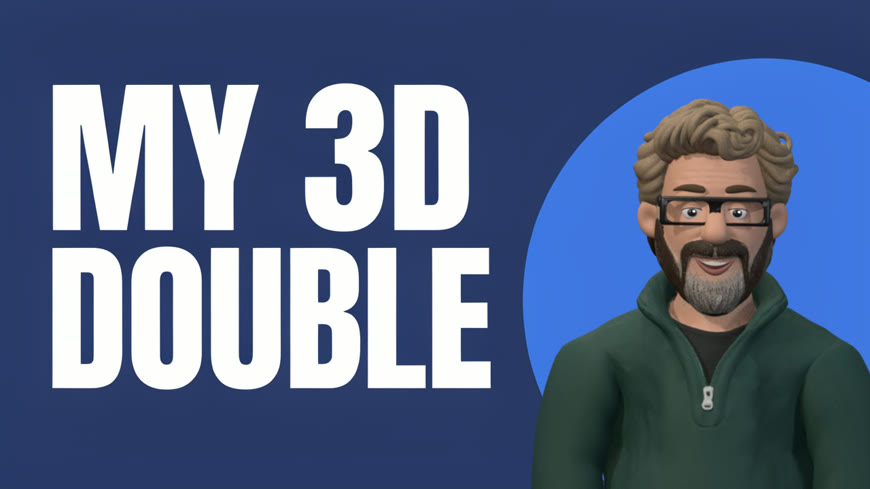
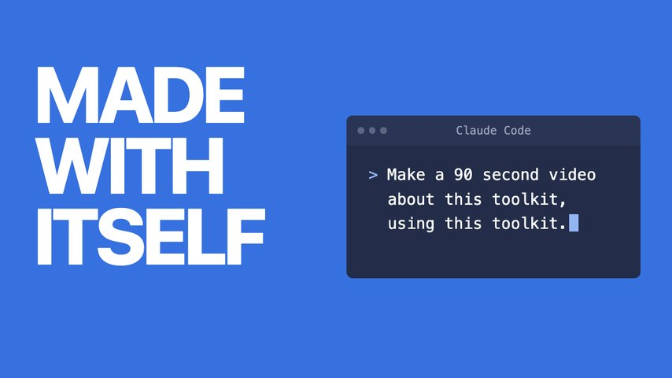

# claude-code-video-toolkit

<p align="center">
  
</p>

[](https://github.com/digitalsamba/claude-code-video-toolkit/releases) [](LICENSE) [](https://github.com/digitalsamba/claude-code-video-toolkit/stargazers) [](https://www.youtube.com/@claudecodevideotoolkit?sub_confirmation=1)

Tell [Claude Code](https://claude.ai/code) what video you want, and it makes the whole thing: the script, the voice, the pictures and the render.

- **It makes finished videos.** Sprint reviews, product demos, release notes, explainers and Shorts, from a template or from a sentence. The one below is presented by a 3D model of its author, and nobody animated it.
- **It is mostly free, and it runs on your accounts.** Voice, images, music and video clips come from open models on your own cloud GPU account, for cents: the 90-second video about the toolkit cost $0.33, measured.
- **It learns, and you can teach it.** When an agent works out how to do something here, the method is written into the docs in the same change, so the next agent starts from it. What you work out can go in the same way.

## See What It Makes

Every frame below was generated in this workspace. Click one to watch it.

<a href="https://www.youtube.com/watch?v=DnsaPJOhHT8"></a><br>
**Blender support, presented by a 3D model**: the hall, the light and every move come from one JSON file, checked
before Blender renders a frame. Blender is optional: nothing else in the toolkit needs it.
[How it works](docs/blender.md), and what your machine needs.

| | | |
|:--:|:--:|:--:|
| <a href="https://www.youtube.com/watch?v=3HjPatdeal4"></a> | <a href="https://demos.digitalsamba.com/video/ds-release-650.mp4"></a> | <a href="https://www.youtube.com/watch?v=CgxzhKQ0Afg"></a> |
| **Made with itself**<br>the toolkit in 90 seconds,<br>with its measured bill | **Release-notes video**<br>product UI rebuilt from source,<br>no screen recording | **Just a Quick One**<br>the trailer: a 3D character<br>acting from a JSON spec |

Every finished example is in the [showcase table](docs/features.md#templates), and new ones land on the [YouTube channel](https://www.youtube.com/@claudecodevideotoolkit) first ([subscribe](https://www.youtube.com/@claudecodevideotoolkit?sub_confirmation=1)).

## Quick Start

```bash
git clone https://github.com/digitalsamba/claude-code-video-toolkit.git
cd claude-code-video-toolkit
uv sync   # Optional: AI voiceover, image gen, music, moviepy examples
claude    # Open Claude Code in the toolkit
```

> Python dependencies are managed with [uv](https://docs.astral.sh/uv/) — `uv sync` creates `.venv/` and installs everything from the lockfile in seconds. No uv yet? `curl -LsSf https://astral.sh/uv/install.sh | sh` (macOS/Linux) or `powershell -c "irm https://astral.sh/uv/install.ps1 | iex"` (Windows).

Then in Claude Code:

```
/setup                    # Configure cloud GPU, storage, voice (~5 min, mostly free)
/video                    # Create your first video
```

**That's it.** `/setup` walks you through everything interactively — cloud GPU provider, file transfer, voice config. `/video` creates a project from a template and guides you through the whole workflow.

**What's free:** The toolkit leans heavily on open-source AI models — voiceovers (Qwen3-TTS), image generation (FLUX.2), music (ACE-Step), and more. You deploy them to your own cloud GPU account and run them at cost. Cloudflare R2 has a generous free tier (10GB, zero egress), and Modal gives $30/month free compute on the Starter plan — more than enough for a few 5-minute videos a month.

**Requirements:** [Node.js](https://nodejs.org/) 22+ (24 LTS recommended) and [Claude Code](https://docs.anthropic.com/en/docs/claude-code). [uv](https://docs.astral.sh/uv/) recommended for the AI tools (it installs Python 3.10+ for you). FFmpeg optional.

> **Want to skip setup and just render something?**
> ```bash
> cd examples/hello-world && npm install && npm run render
> ```
> No API keys needed — outputs an MP4 immediately.

---

## What's in it

- **Templates** for sprint reviews, product demos, release notes, tutorials, vertical explainers and a presenter at a chalkboard.
- **Skills** that teach the agent each craft: Remotion, voice, music, image and video models, design for video, 3D in Blender.
- **Tools** for voiceover, music, images, captions, loudness and picture checks, vertical cut-downs and publishing to YouTube.
- **Brands** that carry your colours, fonts and voice into every video.

The full list, with every command, tool and example, is in [docs/features.md](docs/features.md).

## A Note from the Author *(not AI-generated)*

> I've spent months painstakingly putting this toolkit together and plan to keep iterating on it. AI makes things easier, but hard work still has huge value. Every video I create is a chance for improvement — every skill, template, tool, and workflow here has been refined through that cycle. It would be wonderful if others wanted to get involved with that: use it, refine it, and feed back into the repo via an issue or PR what you learn.
>
> My own use case is fairly specific: creating sprint review videos for the AI mobile development arm of [Digital Samba](https://www.digitalsamba.com/). But the idea behind this project is a reusable toolkit for using Claude Code to autonomously generate any kind of "explainer" style video — product demos, walkthroughs, presentations, whatever you need. Autonomous video creation is a lofty ideal for such a subjective field, but we can try :)
>
> What makes this work is that Claude Code is fantastically resourceful and flexible — give it the framing and tooling that this toolkit provides and it will adapt it to create templates and videos based on your prompting. The skills, templates, and tools here are building blocks. Claude Code is the builder. You are the director, editor, and designer.
>
> **If you're getting started**, run `/setup` then `/video` and let Claude Code guide you. Or start with `/template` to create a template for your own use case.
>
> **Cloud GPU** — I recommend [Modal](https://modal.com/) for running the toolkit's AI tools. The Starter plan gives you $30/month free compute, which is more than enough. [RunPod](https://runpod.io/) is also supported as an alternative. Run `/setup` to deploy the tools you need.
>
> My motto: **Be brave. Experiment.** And please share any videos you create or ideas you have back with the project — it helps me keep improving this toolkit for everyone.

## Documentation

- [Everything in the toolkit](docs/features.md): skills, commands, templates, tools, the showcase table and the project layout
- [Getting Started](docs/getting-started.md)
- [Modal Setup](docs/modal-setup.md) — Cloud GPU with Modal (recommended)
- [RunPod Setup](docs/runpod-setup.md) — Cloud GPU with RunPod (alternative)
- [Creating Templates](docs/creating-templates.md)
- [Creating Brands](docs/creating-brands.md)
- [Project System](lib/project/README.md) — Multi-session lifecycle, schema, reconciliation
- [Optional Components](docs/optional-components.md) — Local GPU tools setup
- [Blender](docs/blender.md): 3D shot specs (optional): setup, what your machine needs, timings, what it has been run on, and how a character film is made over several sessions
- [Voiceover](docs/voiceover.md): ElevenLabs, Qwen3-TTS and 60db, and fixing a cloned voice that is flat or rushed
- [Timing](docs/timing.md): word budgets, scene durations, TTS drift and audio-anchored timelines
- [QC](docs/qc.md): what `qc.py` checks before and after a render, loudness, and sound effects placed on movement
- [Captions](docs/captions.md): burned word captions, SRT and VTT
- [Image Tools](docs/image-tools.md): cloud GPU providers, FLUX.2 or Ideogram 4, image editing, upscaling, watermark removal
- [Music and Sound](docs/music-and-sound.md): ACE-Step music, choosing a take, ducking under speech, stock sound effects
- [Reusing a Video](docs/repurposing.md): cut-downs to 9:16 and 1:1, transcript highlights, redub, NotebookLM branding
- [Agent Video Jobs](docs/agent-video-jobs.md) — Brief in, MP4 out for any agent: `video_job.py` submit/status/result, the MCP server, and the `skills/video-toolkit/` skill for OpenClaw, Codex, Hermes and friends
- [Toolkit Development](_internal/ROADMAP.md) — Roadmap, backlog, changelog

## Video Workflow

```
/video → Script → Assets → Scene Review → Design → Audio → Preview → Render → Publish
```

1. **Create project** — Run `/video`, choose template and brand
2. **Review script** — Edit `VOICEOVER-SCRIPT.md` to plan content and assets
3. **Gather assets** — Record demos with `/record-demo` or add external videos
4. **Scene review** — Run `/scene-review` to verify visuals in Remotion Studio
5. **Design** — `/video` sets the design direction before scenes are built; `/design` changes it, refines a scene with `video-design`, or critiques the render
6. **Generate audio** — AI voiceover with `/generate-voiceover`
7. **Configure** — Update config file with asset paths and timing
8. **Preview** — `npm run studio` for live preview
9. **Iterate** — Work with Claude Code to adjust timing, styling, content
10. **Render** — `npm run render` for final MP4

## Using with Codex

The toolkit is built for Claude Code, but an experimental migration script installs its skills and workflows for [Codex](https://openai.com/codex/) and generates an `AGENTS.md` block from `CLAUDE.md`:

```bash
uv run scripts/migrate_to_codex.py --force
```

See [docs/codex.md](docs/codex.md) for what it installs, how the `AGENTS.md` block is managed, and how to remove it. Contributed by [@kimhoontae-gogo](https://github.com/kimhoontae-gogo) in [#16](https://github.com/digitalsamba/claude-code-video-toolkit/pull/16).

## Using with Kiro CLI

A sibling migration script installs the toolkit's skills and workflows for [Kiro CLI](https://kiro.dev/) — `/video`, `/setup`, etc. work as slash commands, from any directory:

```bash
uv run scripts/migrate_to_kiro.py --force
```

See [docs/kiro.md](docs/kiro.md) for what it installs, how it achieves Claude Code-parity, and how to remove it.

## Design sources

**Plug in your own design skill, or use ours.** `/design` and `/scene-review` take their visual direction from the
source you choose, then apply the toolkit's own video rules (`video-design`) and critique the render from a contact
sheet. The choice is saved per project; nothing here depends on one particular skill.

| Source | What it's good for | Install |
|--------|--------------------|---------|
| Ours (default) | `video-design`'s act palettes and rules, with your brand's colours and fonts | Nothing to install |
| [taste-skill](https://github.com/Leonxlnx/taste-skill) (recommended plug-in) | Dealt directions and palettes from 247 studied sites, measured house rules, a juror's critique (MIT) | `/plugin marketplace add Leonxlnx/taste-skill` then `/plugin install taste-skill@taste-skill` |
| [frontend-design](https://github.com/anthropics/skills) | Anthropic's general visual direction for interfaces (written for web pages) | See the anthropics/skills README |

Bring your own: any design skill works if it can fill `design.md` (palette per act, ink, one accent, type).
To list one here, open an issue with a link, its licence, and a contact sheet of `examples/data-chart-stars`
restyled with it. See [`.claude/skills/video-design/sources.md`](.claude/skills/video-design/sources.md).

## Community add-ons

Projects built on or around the toolkit that live in their own repos — typically because they need
software or a service we can't bundle. We haven't reviewed them; check each project's README.

| Add-on | What it does | Needs |
|--------|--------------|-------|
| [VOICEPEAK for voiceover.py](https://github.com/fialuxe/claude-code-video-toolkit-expand-ja-voicepeak/) | Offline Japanese TTS provider (patches `voiceover.py`) | VOICEPEAK (paid, local) |
| [arkiv](https://github.com/vulture-s/arkiv) | Natural-language search (EN/中文/日本語) over your own footage archive, returning scenes with start/end timecodes to use as a template's `videoFile` | A local arkiv instance (source-available, PolyForm Perimeter) |
| [Upload-Post publishing](https://github.com/Upload-Post/claude-code-video-toolkit-upload-post) | Publish a rendered video to TikTok, Instagram, YouTube, LinkedIn, Facebook, X, Threads, Pinterest and Bluesky via a `/publish-social` command | An Upload-Post account and API key (hosted, free plan available) |
| [CommentKeyword comment-to-DM](https://github.com/commentkeyword/agent-toolkit/tree/main/integrations/claude-code-video-toolkit) | Sets up the Instagram auto-DM behind a video's "Comment KEYWORD" CTA, armed for the next post, via a `/comment-dm` command | A CommentKeyword account and API token (hosted, free plan available; Instagram only) |
| [easybrandkit](https://github.com/EminBudak/easybrandkit) | Reads a live site's logo, colors and fonts into a BRAND.md that `/brand` can start from | Node 22 and Chrome, Chromium, Edge or Brave |

To be listed, open an issue with a link and a one-line description. Integrations that need a
hosted third-party service live here rather than in the toolkit itself — see
[CONTRIBUTING.md](CONTRIBUTING.md) for why, and for how the few exceptions came about.

## Contributing

The toolkit gets better by being used. If you work something out (a template, a fix, a Blender set, a way of
prompting a model that holds up), send it in with the method written down beside it, so every user's agent knows
it too. Run `/contribute` in Claude Code, or see [CONTRIBUTING.md](CONTRIBUTING.md). Videos you make are welcome in
[Show and tell](https://github.com/digitalsamba/claude-code-video-toolkit/discussions/categories/show-and-tell).

## License

MIT License — see [LICENSE](LICENSE) for details.

---

Built for use with [Claude Code](https://claude.ai/code) by Anthropic.
