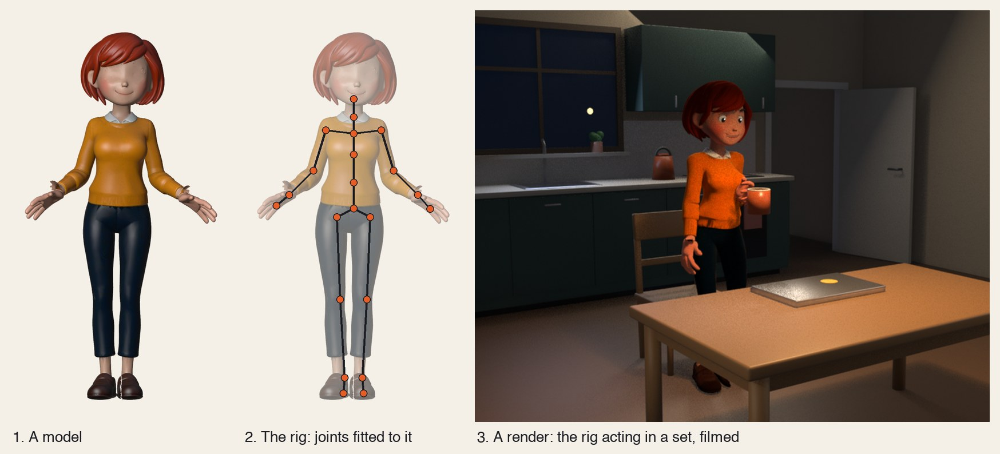

# Blender in the toolkit

Blender is an optional component. Nothing else in the toolkit needs it, and the real limit on using it is your
machine, not the tool: it renders in minutes with a GPU and slowly without one (`doctor` times a frame, and
[How long a render takes](#how-long-a-render-takes) has the numbers). The clay cast, the desk sets, the studio
stage and clips in a Remotion video are the settled part. Characters fitted from a generated 3D model, the
kitchen and the lecture hall are experimental: they have made two finished films on one machine, the fit still
wants its joints read off a picture by hand, and Windows is untested. Their checks also pass on Linux with
Blender 4.2.

**This page is written as the work is done.** When an agent or a person works out how to do something in
Blender here (a cuff that tears, a camera that lands on a board, a hand that will not point), the method goes into
this page or the `blender` skill in the same change as the code, with what was tried and what it measured. The
next agent reads it and starts from there, so nothing is found twice. Your Blender work can go in the same way: a
set, a verb, a fix to the fit, or just what you learned making a film. Run `/contribute`, or open a pull request
with the method written here beside the code.

With it installed, a JSON **shot spec** becomes a 3D scene: a rigged cartoon character acting at a desk, or a product stage with a phone, a floating card
or an imported model. The render is a finished film, a set of clips for another build (a Remotion video, a
moviepy timeline, a video job, an editor), or both from the same spec.

- **How to write a spec:** `.claude/skills/blender/SKILL.md`
- **A film from one spec:** `examples/blender-disk-panic`
- **Blender clips inside a Remotion video:** `examples/blender-in-remotion`
- **A product stage with no character:** `examples/blender-product-shot`
- **A fitted character on her feet in a kitchen (experimental):** `examples/blender-kitchen`
- **A presenter at a chalkboard, a lecture as data (experimental):** `templates/lecture`

## Model, rig and render

Three things that are easy to run together, and most of the work is in the middle one.



1. **A model** is a shape and its colours: a mesh. It cannot move. The clay cast is built from a JSON description;
   a fitted character starts as a model from an image-to-3D service (this one is Mara, the invented character in
   `tests/fixtures/blender-fitted`).
2. **The rig** is what makes a model a character: the joints inside it, how much of the mesh each joint carries,
   a face and fingers, and the verbs that move them (`walk`, `sit_down`, `carry`, `sip`). It lives in
   `lib/blender` and is shared by every character, so a verb written once works on all of them, and a fault
   fixed in it is fixed for every film after. Fitting (`blender_render.py fit`) is the step that seats a model
   on the rig and saves the result as a `.blend` beside the character's JSON.
3. **A render** is one film: a spec puts the rigged character in a set, the verbs act on cue, cameras are placed
   and checked, and Blender draws every frame. Renders are slow (see the times below) and are thrown away and
   made again whenever the spec or the rig changes.

So a note on a film is one of two kinds. "Hold that look a second longer" is the spec: change a number, render
the shot again. "The mug goes through the table" is the rig: fix it in `lib/blender`, prove it on two bodies,
add a check, and then render. Rig work is slower the first time and free ever after.

**The other words, in the order a film uses them.**

- **The shot spec** is one JSON file that describes the film: who is in it, where, what they do and when, and
  how it is filmed. Everything below is named in it, which is why an agent can direct a film and why the same spec
  gives the same film every time.
- **The cast** is the characters. A clay character is a JSON description (build, face, hair, clothes, a seed) and
  needs nothing else; a fitted one starts as a generated model, as above. Both share the one rig.
- **A set** is the place: a desk, a kitchen, a lecture hall, or the studio stage for products. It brings its
  room, furniture and lights, and where people sit or stand.
- **A prop** is a thing in the scene that a character or the camera deals with: a mug, a phone, a floating card
  showing a picture or a video, an imported model.
- **Acting beats** are the verbs on a timeline, in seconds or on a word of the narration (`cue:`).
- **A shot** is a camera by type (`over_shoulder`, `orbit`, `reveal` and more) that takes its framing from the
  people and props in it. `check` proves every shot by geometry before anything is rendered.
- **The engine** draws the frames. EEVEE, the default, is fast and is what the specs are tuned on; Cycles
  (`--engine cycles`) traces light and is about ten times slower (see
  [How long a render takes](#how-long-a-render-takes)).

**What is saved.** Every `check` and `render` writes `scene.blend` in the spec's `out/` folder: the built scene
with its keyed acting, to open and scrub in Blender when a number does not explain what a frame shows. It is
written again on each run, so copy one aside to keep it. A fitted character's `.blend` holds only its body
(`model_body`) and is made again by `fit`. Both kinds are build output and stay out of git.

## Setup

1. Install Blender 4.2 or later. The toolkit is made on 5.3 (see *What it has been run on*, below).

   | Platform | Command |
   |---|---|
   | macOS | `brew install --cask blender` |
   | Windows | `winget install BlenderFoundation.Blender` |
   | Linux | `snap install blender --classic`, or the tarball from [blender.org](https://www.blender.org/download/) |

2. Ask the toolkit whether it can see it, and how fast this machine renders:

   ```bash
   uv run tools/blender_render.py doctor
   ```

   ```
   ok    Blender 5.3.0 at /opt/homebrew/bin/blender
   ok    ffmpeg
   ok    Pillow (contact sheets, exposure)
   ok    test render: 1.62 s/frame at 1920x1080 (BLENDER_EEVEE; the first frame took 1.7 s)
         blender-disk-panic: 540 frames, about 15 min to render here
   ```

   `doctor spec.json` times your own spec. `--no-bench` skips the test render.

Blender is found on `PATH`, in `/Applications/Blender.app`, under `Program Files\Blender Foundation`, or in
`/usr/bin`, `/usr/local/bin`, `/snap/bin` and `/opt/blender`. Anywhere else, set `BLENDER=/path/to/blender`.

Blender runs headless (`blender -b`), so this works over SSH and in CI. No window opens and no add-on is needed.
`ffmpeg` joins the picture and the sound and encodes clips; transparent clips need its `libvpx-vp9` encoder, which
the Homebrew, winget and distro builds include.

## What it has been run on

| System | Blender | Result |
|---|---|---|
| macOS, Apple M4 | 5.3 | Everything: both engines, films, transparent clips, the tests |
| Linux x64, in a container with no GPU | 4.2 LTS | The disk-panic film, the product stage and both kitchen films build and pass `check` under Cycles (the two `blender-in-remotion` specs passed there at v0.28.0 and were not run again), both fitted characters fit and pass their walk-ins and kitchen films (the sleeve measure reads 3.8 and 3.6 there against 4.0 and 3.9 on the Mac, limit 4); the film, the clip and the transparent-clip paths render. EEVEE also runs, on Mesa's software OpenGL, slowly. The test file has not been run there: without a GPU one `check` takes 2 to 8 minutes |
| Windows | | Not run yet. The code finds Blender under `Program Files` and reads and writes UTF-8 throughout; treat it as untested |

Transparent WebM clips have been played in Remotion on the Mac only.

## How long a render takes

Measured on a MacBook with an Apple M4 (10 cores, 24 GB), Blender 5.3, EEVEE, 32 samples:

| What | Time |
|---|---|
| `check` (build the scene, verify every camera, 8 stills, contact sheet) | 5 s |
| `render` at 640x360, a draft to judge motion | 0.35 s a frame |
| `render` at 1280x720 | 0.9 s a frame |
| `render` at 1920x1080 | 1.6 s a frame |
| `render --clips --alpha` at 1920x1080 (no room to light) | 0.75 s a frame |
| `render --engine cycles` at 1920x1080 | 17 s a frame |
| The 22.5 s example film (`blender-disk-panic`, 540 frames) | 15 min |
| All four clips of `blender-in-remotion` (555 frames) | 10 min |
| A fitted character in a lit room at 1920x1080 (a kitchen, 13 clips, 45 s, 1,365 frames) | 2.1 to 2.4 s a frame, 55 min |
| The same clips at 640x360, a draft to judge motion | 0.8 s a frame |

**A character film takes hours, not minutes.** The table is one pass of rendering. A film with a fitted character
acting in a room is rendered more than once (a draft to judge the motion, the full pass, then the shots that
changed after the frames were read), and around the rendering sit the checks, the sound, the Remotion side and
the reading of the result. Measured on a 103 s trailer with 45 s of kitchen: the first build took about three
hours from the brief to the delivered file and the revision about two and a half, each as one unattended session,
with about an hour of each spent in Blender. Plan a film of this kind as an evening or an overnight run, start
the render queue in the background as soon as the specs pass `check`, and render one clip at a time: two renders
at once share the GPU and each frame takes longer. How the work is carried from one session to the next is in
[A film over several sessions](#a-film-over-several-sessions).

So iterate in `check`, which is seconds, and render when the contact sheet reads right. A render prints its
progress and time left every 30 seconds. The first Cycles frame also compiles GPU kernels, which takes minutes
once per machine.

Cycles uses the first GPU backend the machine has: Metal on a Mac, then OptiX, CUDA, HIP and oneAPI. With none, it
renders on the CPU, which gives the same picture more slowly. EEVEE wants a GPU with OpenGL 4.3, Metal or Vulkan.
On a Linux server without one it still runs if Mesa's software renderer is installed, but every frame is drawn on
the CPU, so it is slow; `--engine cycles` is the dependable choice there. Time either with `doctor` before
committing to a long render.

## What you get

```bash
uv run tools/blender_render.py check  spec.json     # checks.json, stills/, contact_sheet.png, scene.blend
uv run tools/blender_render.py render spec.json     # the film: <folder>.mp4 with sound
uv run tools/blender_render.py render spec.json --clips --alpha --to projects/my-video/public/blender
uv run tools/blender_render.py open   spec.json     # the built scene in Blender, to look round
```

`--clips` writes one clip per shot and a `clips.json` manifest instead of one film:

| Flag | Result |
|---|---|
| `--clips` | `<shot>.mp4` per shot (H.264), `<shot>.wav` with that shot's sound effects, `clips.json` |
| `--alpha` | transparent background: `<shot>.webm` (VP9 with alpha), which Chrome and Remotion read |
| `--prores` | also `<shot>.mov` (ProRes 4444) for Premiere, Resolve and Final Cut |
| `--shots A,B` | only these shots, for a re-render after one beat changed |
| `--to DIR` | copy the clips into a project's `public/` folder and add them to its `clips.json`. Several specs can share the folder: each clip records its own `fps`, `resolution` and `spec` |

## In a Remotion video

Set the spec's `fps` to the composition's (30 in the toolkit's templates), render the clips into the project, and
play them with `BlenderClip` from `lib/components`:

```tsx
import manifest from '../public/blender/clips.json';
import { BlenderClip, blenderClip } from '../../../lib/components';

const act = blenderClip(manifest, 'B1_act');
<Sequence from={345} durationInFrames={act.frames}>
  <BlenderClip clip={act} style={{ left: 560, top: 270, width: 1440 }} />
</Sequence>
```

The clip plays once, holds its last frame, and brings its own effects. `act.event('alert')` is the clip frame the
alert lands on, for a caption or a cut that should hit the same moment.

`crop={{ x, y, w, h }}` (the clip's own pixels) shows one part of a clip, scaled to fill the box, and
`background` draws a picture of the clip's backdrop behind it at the same crop: a presenter's head and chest in
a small inset while the camera is on a chart. Nothing draws outside the box. A hand-built inset that scaled a
layer round the clip left the clip at full size outside it, and the frame showed bare board.

What a longer video taught (a nine-minute lecture: six room shots, fourteen presenter clips, a Remotion board):

- **Every frame comes from its source, never from an earlier render.** A clip's start is the timeline's or the
  captions' (`cue()`), its length is `clips.json`'s, a sound's frame is `clip.event(...)`, and the spec generator
  reads the same timeline file the composition does. A room's end frame typed into a generator from the first
  cut put a clip 401 frames out when the script grew. `examples/blender-in-remotion` reads its cut frame from
  the spec's `skip_frames` and its lengths from `clips.json`.
- **Play shots by id, not by `clips.json` order.** A shot rendered again goes to the end of the manifest.
- **Clips that join start and end in the same pose,** head and eyes included, and share a `clock`.
- **Sounds for small props go in the video build.** A cup or a chalk tap that the clip's own WAV does not carry is
  laid on the clip's event frame in the composition and checked with `tools/sync_check.py` (a landing is
  `impact`; something picked up is `onset`).
- **One Blender render at a time.** Rendering is bound by the GPU: 0.69 s a frame alone, 0.9 s with three
  running side by side, so a queue finishes sooner than a fan-out.
- **Check the render, not the parts.** After the full render, on top of `qc.py --render`, tile one frame every
  10 s of the real file and read it: `uv run tools/contact_sheet.py out/video.mp4 --count 57 -o out/every-10s.png`
  (`--count` is the length in seconds over ten). An inset was empty in a render while every still of the board looked right, because the
  stills were of the board and the fault was in the layer over it.

It works in the other direction too. A spec's `set.screen.video` puts a Remotion render on the laptop in the
scene, and a `pull_out` shot starts with that picture covering the frame, so a flat scene can cut to itself in 3D.
`examples/blender-in-remotion` does both.

## A lecture: a presenter at a board (experimental)

`templates/lecture` is a presenter rendered in Blender standing at a chalkboard Remotion draws: the board, the
chalk and the windows the camera goes into are `lib/lecture`, and the presenter is one transparent clip a segment
from `tools/lecture.py`. A lecture is its script, `lecture.json` (per segment: a heading, what is chalked on which
words, the windows, the acting) and the timeline the tool writes from the audio; the template's README is the
walkthrough. It was lifted out of a nine-minute sprint review and made generic in one session; what that took:

- **The hall is sized by its presenter**, as a desk is by whoever sits at it. A fitted model's height over a
  lecturer's (1.75 m) scales the board, the table and the lights (the clay cast, which the hall was built round,
  keeps it as built). In the first lecture the author's body, 2.25 m as fitted, stood in an unscaled hall and hid
  15% of the board from the board camera; Mara, 1.65 m, hid 5%. Scaled, they hide 7.8% and 6.0%, and `check`
  fails a clip over 10% (`board` in `checks.json`: `share`, the `box_px` the presenter ever reaches, `head_px`,
  `outside_window` for a hand that leaves the clip's window). Place things by the board, not in metres:
  `"cam": "board"` frames the board edge to edge, `{"board": [u, v]}` is a board pixel for a target, and a cast
  member's `"at": {"board": [u, out]}` stands them in front of column u, `out` metres from the wall in the hall's
  measure. The same numbers then stage any body.
- **Joins inside a move, not on a stance.** The first lecture's fourteen clips each began and ended in the same
  neutral stance, looking at the lens, so every join read as a reset. Now the turn to the next heading starts in the
  old clip and the new clip starts inside it: both clips key the same beat at the same frames of the film (each
  spec's `clock` is the film's), and the held part of a turn depends only on its target, so both poses agree.
  A character's stance is keyed on a spec's first frame, so a move cannot start before it: a clip that starts
  mid-move has a lead-in shot (`pre`) that is built and not rendered (`render --shots`). `tools/lecture.py check`
  compares every body vertex and the face at each join: 0.2 to 1.2 mm on two bodies. When the next segment opens in a window, the
  carried move is a gesture to the hall (a turn would show the inset a profile), and a gesture says nothing of the
  head: the first lecture to do this left each clip's head where its own earlier beats put it, 72 mm apart. Both
  clips now look at the lens as well, twice (a look aims from where the head is, which the neck moves), the second
  landing on the join's frame, and the join measures 0.0 mm.
- **A free hand turns no further than its cuff takes.** See the next section.

### Opening on the hall

`"opening": {}` in lecture.json makes the lecture start on the whole hall: a fade from black, the door opens, the
presenter walks to their mark, and the camera comes down the hall and lands on the board camera's framing as the
walk ends, then cuts to the board. What it took:

- **A hall worth seeing wide** is the set's `"hall": {}`: deeper (17 m in the hall's measure), rows of desks and
  benches on a rake, a ceiling with lights, windows down one side, slatted panels on the other, all scaled by the
  presenter like the board. Its own lights reach only the hall (light linking: EEVEE honours it in Blender 5.3;
  not yet tried on 4.2 LTS), so the presenter is lit as in every clip.
- **The board camera stands 12 m out**, in the hall's measure (a 108 mm lens framing a 4 m board), so the hall is
  deep enough to hold it, with an aisle down the middle in line with the board. With a 2 m aisle the end panels of
  the front rows showed at the foot of the landed frame (0.6% of the board); at 2.6 m nothing does. The landing
  check casts a grid of rays at the board from the lens on every landed frame and fails on anything but the
  presenter in front of it.
- **A move from one framing to another** (`"type": "move"`) eases out, comes down before it comes in, and arrives
  along the end framing's axis, so the last of it is straight in. Ending on the board camera itself, and not on a
  shorter lens at the same framing, keeps the presenter the size the board clips draw them: a 50 mm lens at the
  same framing makes a presenter a metre off the wall 12% bigger. So the lens does much of the framing change
  (26 to 108 mm) and the move gives the parallax: the rows rising past as it comes down.
- **The cut is a match by construction.** The room shot's spec is the first clip's own (cast, beats, clock), with
  the hall drawn; the first clip keeps the walk in as its lead-in, built and not rendered (`"built_only": true`).
  `tools/lecture.py check` measures the join like any other: 0.0 mm.
- **The arrival is keyed to the walk** (`"start"` and `"arrive"`: `"walk"`). One curved walk from behind the door
  to the mark: a stop inside the door and a second walk into an 80-degree bend took a foot 22 mm past its reach.
- **The later clips start placed on the mark**, so the walk in has to end in a placed stance. Two things did
  not: a walk ends with the knees soft (the hips 12 mm under a placed stance), and the arms came out of the walk
  and the door at another turn of the wrist (the fingers 7 cm off on Mara, 1 cm on the author's body). The opening
  ends with `settle` (they stand up straight and the arms hang as a placed stance's do) and puts the door hand
  back to `loose`; the join after the first clip went from 75 mm to 0.7 mm. (Standing every walk up straight on
  its last step did it too, and changed the clay cast's walk: `settle` keeps it to the specs that ask.)
- The opening walks at Jasmina's stride, 0.8 of a leg, which fitted bodies take cleanly; the clay cast's arms miss
  that swing by 4 to 7 cm (`ik_max_error_m`), so a clay presenter walks at the default 0.5.
- The window panes fought their frames (flicker) in a hall at the clay cast's scale and not at the author's: a
  pane now runs on under its frame, inside its depth.
- The lecture's hidden table (only there for the close) stood on the walk's path, and the body went 3 cm into
  it: with an opening and no close, the clips have no table (`"table": false`).
- With the hall lit from the start (`"lights": "on"` in the opening), the latch clicks on black, before the
  picture: the handle goes down behind the shut door (`open_door`'s `latch`) and the event is keyed on it; the
  door swings once the hall has been still for a second.

#### The hall in the dark

The opening's default since 2026-11-17: the hall fades in dark, lit by its windows; the door opens onto the
presenter in silhouette; they step in, press the switch beside the door, and the ceiling lights come on in three
banks from the board back, each with a fluorescent stutter; then the walk to the mark, the camera coming down
the hall as before. 9 s to the cut. In a spec it is the set's `"lights": "off"` and a `lights` beat
(the `blender` skill has the options). What it took:

- **Lights that change are events.** `kit.Lamps` holds a set's lights (their energy) and glowing materials
  (their strength) in banks; a `lights` beat keys each bank off, through its stutter, to full, as steps (a tube is
  on or off). Each bank's start and hold are events (`lamp_stutter`, `lamp_on`) and the switch is one
  (`switch`), so sounds go on those frames. The hall is split into banks only when it starts dark, so a hall lit
  from the start builds as it did, and the lecture writes the same specs as before with `"lights": "on"`.
- **The dark has to read.** The window light (light-linked to the hall) stays on; the presenter's own lights come
  on with the front bank, more than three seconds before the cut, so the match cut is unchanged. A picture on
  the board glows by itself, so in the dark it is held at 6% (`hall.board_dark`). A check's still is taken once
  the lights hold: on a frame mid-stutter the hall measured 0.06 against the 0.08 floor.
- **Where to stand to press it.** On the door's line the switch was 11 to 16 cm out of reach on every body; a
  fixed spot in front of it put the shoulder 18 cm from it, and the arm could not fold back onto it. A press
  reads with the arm as straight as a point, and arm length against height differs from body to body, so
  `{"switch": "reach"}` is worked out from the walker's own arm: side-on to the wall, a step toward the door
  from the switch (so from the back of the hall they stand in front of the bright doorway, in silhouette).
- **A press is a point that arrives**, not a handle. With the door's grip the hand turned on the forearm and
  stretched the cuff 4.6 to 7.2 times; as a point (`touch`), the cuff stayed at 2.6 to 3.5 on all four bodies.
  The pointing index sits about 14 degrees off the hand's own line, so the hand aims along the line from the
  shoulder and the wrist is moved by what the fingertip missed: aimed from the wrist, each correction turned
  the hand again and the tip stayed 7 cm off.
- **Two walks, not one.** In at the door with one bend to the switch, then a walk to the mark. The stop works
  where it failed before because the second walk's bend is small: arriving at heading -80 left a 72-degree turn
  on the spot in about a second, and a hand brushed the body on Mara and Nell; at -50 all four pass. The second
  walk sets off after the pressing hand is home (0.6 s after the press). The step in is the stroll stride taken
  slowly (1.7 s, five steps on three bodies, seven on the tallest): in 1.2 s it was seven steps 0.15 s apart, a
  shuffle, and a longer stride swung a hand into the body in the bend (3 to 8 cm on three bodies). The camera sets off with the last walk
  (`"start": "last_walk"`), so it holds the whole hall as its lights come on.
- **The doorway.** The corridor light is six times brighter in a dark hall, and a warm panel in the opening
  (`hall.spill`) comes up as the door opens, so the floor inside the door catches the light. At 250 W it
  blew out the open leaf and lit the presenter's front in the doorway by bounce; 120 keeps the silhouette.
- **The shadow pool.** A row of fill lights to a bank, each with its own shadows, ran EEVEE's shadow pool out
  at its 512 MB default: as the camera moved, shadows on the floor and the wall by the door popped between two
  states, 20 to 40 levels from frame to frame (the far still points caught it; it was seen first as noise from
  the bright doorway, and switching the bounce light to ambient occlusion did not clear it on the second body).
  A drawn hall that starts dark sets the pool to 1024 MB, which clears both bodies.
- **Finding a flicker's cause.** Re-render only the flagged frames from the render's own `scene.blend` with one
  setting changed at a time (`blender -b out/<shot>/scene.blend --python ...`, a few minutes each) and read the
  same still points: guessing pointed the wrong way once here. A level that flips between two fixed values
  (113, 90, 113) is a shadow popping (the shadow pool); a level that wanders is noise (EEVEE's screen-space
  bounce light: ray tracing off steadies it). Frames in Blender count from 1 and in a video from 0: Blender's
  frame 133 is the video's frame 132.
- **A place worked out while the set is built** reads an object's `.location`: its world matrix is not updated
  until the view layer is, and a spot taken from it put the walk at the room's middle, 1.9 m off.
- **Orla's hand** was 2 cm short of the handle from the lit opening's start (0.33 m behind the door); the dark
  opening starts them at 0.30.

### Closer shots and a line over the walk in

A lecture filmed by one camera for four minutes reads as a slide deck with a figure in the corner. A segment's
`"closes"` cut to a second camera on the presenter (`closeup` or `medium`) from one phrase to another, and
`"opening": {"voice": ...}` says a line over the walk in. What it took on "Introducing Blender support":

- **A second camera, not a bigger crop.** Zooming the flat frame 2x on the presenter (the board camera is a 108 mm
  lens 12 m out, so a crop is geometrically right) left them at the frame's right edge against half a frame of
  empty board, and soft. A `closeup` 15 degrees round shows the board's edge, the wall and the door's side going
  back behind them: it reads as another shot, and it is the 30 degrees a cut wants between two sizes.
- **The close is the clip's own spec seen by another camera.** `tools/lecture.py specs` copies the segment's
  spec (cast, beats, clock), draws the hall, and gives it three shots: the clip's frames before the close and
  after it as `"built_only"`, and the close between them. So the body is in the same pose either side of the cut
  by construction, as at the opening's match cut, and only the close's own frames render (48 to 193 frames each
  here, 3 to 4 s a frame at 1920x1080 on an Apple M4, 31 minutes for six).
- **They are on the new lens as it cuts in.** A look into the lens is aimed at the camera of the shot the look
  *ends* in. Started on the cut, the head whipped round in the close's first three frames with the eyes shut for
  the blink a turn carries. The turn now starts 0.35 s before the cut, in the frames that are not rendered, and
  ends on the close's first frame.
- **No looks out at the hall in a close.** The clip's look round (every 6.5 s) held the face off the lens through
  half of a five-second close-up. The close's spec leaves out a look at the hall that would be held as it cuts in
  or would start in it; the wide clip keeps its own.
- **The board behind them is the board then.** `tools/lecture.py boards` renders one Remotion still a close (the
  `BoardAt` composition: chalk and panes, no presenter) for that shot's hall to hang on its wall.
- **Where a close cannot go** is refused by `timeline`, with the reason: while the camera is in a window (the
  presenter is the inset there), while the heading goes up (they are turned to the board), past the segment's
  last word (the turn to the next heading), under 1.5 s, or within 2 s of another. Do not put one on a line about
  the presenter being a transparent clip in front of a drawn board: the close is neither.
- **Look at the hands before framing them.** A ten-second spec that holds each hand shape in turn, with stills
  of both hands from four sides, showed this presenter's `open`, `loose` and `relaxed` holding up and `fist`,
  `grip` and `point` rough at the knuckles (the hands are from a second model). So the closes are head and
  shoulders, and the one `medium` is on an open-handed shrug.
- **The first words in the first second.** The opening is nine seconds of hall, door, lights and walk before
  anyone speaks. `"voice": {"id": "00_hook", "at": 0.7}` plays a line over it (the presenter says it on the way
  in, mouth and all, since the room shot and the first clip share their beats), and the first segment was
  reworded so it does not say it twice.
- **Voice one segment again without rendering the rest.** Every clip's `clock` is its place in the film (the
  breathing is in phase with it), so a segment that changes length moves every later clip and they all render
  again. Give the changed segment a `"gap_after"` that puts the next segment back on its old start (old next
  start, less this one's start and new length): `timeline` then prints the same frames for the rest, their specs
  are unchanged, and only the changed clip, the room shot and the closes render.

### The cuff on gestures and points

A fitted model's cuff is one band of skin shared by the forearm and the hand, so any turn of the hand on the
forearm lands in it. A point at the board behind the presenter turned the hand 150 to 180 degrees on the forearm
(its palm kept "to the body's middle") and stretched the cuff 5.5 to 6.7 times on all four bodies, past the check's
4; the gestures took the author's body to 4.8. Measured at rest, by the check's own measure, stretch rises
smoothly with the turn, and each body takes a different amount before it reaches 3: about 68 degrees each way on
the author's, 85 on Mara's and Orla's, 100 on Nell's. So the rig measures that range on each hand of each body
(`twist_range`, once a build) and a hand whose roll is a choice (a gesture, a point) keeps inside it: the way the
fingers point is kept and the palm rolls back toward the forearm's own. A hand that has to sit on a thing (a
handle, a mug, the keys) is left alone. On the lecture screen test (`tests/fixtures/blender-fitted/screen-lecture.json`,
two points at the board, every gesture and a dust) the four bodies went from 5.5 to 6.7 times to 3.2 to 3.9, and
up close the point reads better: the index along the line, where the old one turned its knuckles to the camera.
`skin` in `checks.json` has `wrist_twist` (the range, each hand) and `twist_held` (how often a turn was held back).
A sip is not a free hand, and still stretches a sleeve 4.7 to 7.5 times (below).

**The inside of the cuff.** With the turn held, the first lecture still showed a fault on every open palm: the
far side of the cuff opened toward the camera and showed a light, ragged band round the wrist. The stretch read
3.73, inside the limit, because it was not stretch. Rendered with the sleeve's back faces painted red, the band was
the inside of the sleeve: a generated model's clothes are one sheet of surface, and its inside was drawn lit, in
the cloth's own colour, so the opening read as a torn hole. Two other fixes were tried and dropped. Dual
quaternion skinning changed nothing. A cuff bone that follows the hand's bend but not its turn (the sleeve's hand
weight moved onto it) smoothed the rim a little, and on a point opened a black gap over the wrist. The fix is
in the shading: `line_cloth` draws every face of a fitted model's clothes seen from behind at 0.45 of its colour
(`LINING`), so the inside of a cuff, a collar or a hem reads as the shade inside a real one. The grafted hands are
left as they are. At 0.12 the dark-green cuff was right, but an orange one showed a black notch at the wrist that
read as a hole. It is done after the head is built, since the face finds the model's paint by its link into Base
Color. `skin.lined` in `checks.json` lists each material and whether it is lined. Proof: the four walk-ins and
lecture screen tests give the same checks as before on all four bodies, and the clay cast is unchanged. What it
does not change: the sleeve rim still takes 40 to 85% of the hand's weight past the wrist and 10 to 16% up the
forearm, so it turns with the palm, and on a point the skin between hand and sleeve folds. The weights are the
next piece of rig work.

## In other builds

`render --clips` without `--alpha` writes an ordinary H.264 `.mp4` per shot, so a Blender shot goes wherever a
video file does: `VideoFileClip` in a moviepy build, a `file` scene in a `video_job.py` spec, `cutdown.py` for a
vertical cut. The clip is picture only; the shot's sound effects are the `.wav` beside it. `--prores` adds a
ProRes 4444 `.mov` for Premiere, Resolve and Final Cut (transparent with `--alpha`). `clips.json` lists each
clip's length and the frame of every sound event, for a build that wants to cut on the acting. A whole film
(`render` with no `--clips`) already has its sound, and takes a music bed from `addmusic.py`.

## Timing from the narration

A spec can also take its timing from the narration: list the scene's `.captions.json` under `voice`, and a beat's
time can be `"cue:disk is full"`, the moment those words are said.

A video on a screen (the laptop, a phone or a card) advances one of its frames per scene frame, so it must be
rendered at the spec's `fps`. One at another rate is refused before anything renders: `screen video scene.mp4 is
30 fps and the spec is 24 fps: render it at 24 fps, or set "fps": 30`.

## Characters

A cast member is a description in JSON, not a model file: a build, a face, hair, clothes and accessories, each a
named choice or a hex colour. An agent can write one from a sentence or a photo.

```json
{"id": "maya", "seed": 12,
 "body":    {"build": "slim", "skin": "brown"},
 "face":    {"shape": "oval", "eyes": "brown", "brows": "thin", "nose": "small", "beard": "none"},
 "hair":    {"style": "bob", "color": "grey"},
 "clothes": {"top": "shirt", "top_color": "#2E7D5B"},
 "accessories": ["glasses"]}
```

- Whatever is left out takes the default character's look, or, with a `seed`, is drawn from the seed: `{"id":
  "extra", "seed": 41}` is a whole person, and the same person on every machine.
- A character can live in its own file and be named with `"from"`; fields beside it override the file, so one
  video can change the costume and keep the person. A kit keeps its cast in `kits/<name>/cast/`
  (`kits/example/cast/maya.json`).
- A field that isn't one of its choices is a spec error that lists the choices.
- Every character is built on one rig, so every acting verb works on every character. They are caricatures in one
  cartoon style, not likenesses.

The full table of choices is in the skill.

### On their feet

A character sits at the desk unless the cast entry says `"posture": "stand"`, with `"at": [x, y]` and `"facing"`.
From there the verbs are `walk` (to a spot, turning into it and out of it), `turn`, `sit_down`, `stand_up`, and for
the set `open_door` and `pull_in`. The feet are planted: a foot on the floor stays where it is while the body
moves over it, and the report's `ik_max_error_m` says so (under a centimetre), naming the limb and the second if
a step was too far. Three shot types film someone standing: `full`, `feet` and `tilt_up`; `"follow": true` makes
any character shot travel with a walk (the camera glides: its path is the walker's, smoothed over about a second).
A walk is a straight line with a turn at each end unless it has `"curve": true`, which walks one bend, the body
leaning into it; `"heading"` is the way they are going as they arrive.
The clay cast gets its leg controls only when a spec uses one of these, so a desk-only spec renders exactly as it
did before they existed.

The posture verbs are built from the same few pieces, so they move alike: the eyes and head lead, the weight
shifts before a foot lifts, the chest follows the pelvis and the hands follow the chest, a move lands a little
past its mark and settles, and one side goes before the other. Hands are put on things (the knees, the desk's
edge, a door handle with `"by"` on `open_door`) and stay on them while the body moves.

Contact is measured on every frame and fails the check: a foot under the floor, a hand inside the body, the body
through furniture, a planted foot sliding, a hand off what it holds. The report says which, how far and when
(`body_problems`), and `moves` gives each posture verb's timing spread. The table is in the skill.

Two checks look for flicker. `check` fails a set where two objects of different materials have faces in one
plane that a camera sees (`set_problems`): the renderer draws one or the other from frame to frame. And `render`
reads the finished frames at points of the set that stand still: one that jumps for a frame and comes back, five
times on one object in a shot, fails the render (`render_checks.json`). The level is read at the point's exact
place in the frame, between pixels. Read at the nearest whole pixel, a slow push-in over a board with writing
on it stepped the reading a pixel at a time across the letters, and the lecture hall's board was reported as
flickering on 104 frames with nothing to see; a surface with a picture on it is now read as smoothly as a
plain one, and two faces in one plane are caught as before.

Lights coming on are a jump that comes back: exactly what the render check looks for. The frames where a `lights`
beat changes the light are written beside the still points (`light_changes`), and only those frames, with one
either side, are not read; `render_checks.json` lists them under `not_read`. Everywhere else a stutter still
fails, and a fight between two faces beside them is still caught (`tests/python/test_blender_spec.py`).

A still point is read only where the flat patch round it covers enough of the picture, and from the back of the
lecture hall (16 m, a 26 mm lens) the 2 cm patches cover a fraction of a pixel: the first 203 frames of the
opening had no points at all, lit or dark, so nothing in the wide part was ever read. Big surfaces (half a metre
or more) now also carry far points with a 12 cm patch. Proven on the room shot as rendered: a patch of wall made
to flicker on frames 31 to 91 now fails (it passed before), and the lit opening still passes. They found a real
fault at once (below, the shadow pool).

### A character from a generated 3D model (experimental)

The clay cast is built from a description. A fitted model is a 3D character made elsewhere, put on the same
rig, so the same verbs and shots work on it. The pattern, one step each:

1. **A character sheet.** One front view of the character standing in an A-pose (arms away from the body, legs
   apart), plain background. Draw it, or generate it: `flux2.py` for an invented character, `image_edit.py` then
   `flux2.py --input` to stylise a photo. For a character of a real person, take the photos with
   `uv run tools/reference_capture.py --out projects/my-character/reference`: a local page talks the sitter
   through eight poses (front, both three-quarters, both profiles, a smile, glasses off, full body), counts down
   aloud so they can look away from the screen, and keeps the sharpest frame of a short burst. It needs a browser
   and a camera, the photos stay on the machine, and the person in them decides where they go next: keep them
   out of a public repository.
   To choose a style, make a few first: `image_edit.py` with the full-body photo and a front photo as its two
   inputs (`--input full-body.jpg front.jpg`), one prompt that says "image 2 for the face" and describes the
   person, the clothes and the A-pose, and only the style line changed between runs (an animated feature, a clay
   puppet, a game hero, toon shading), all at one seed. Lay them side by side and let the person pick. Then make
   the side, back and open-hands views from the one they picked with `flux2.py --input picked.png`:
   Qwen-Image-Edit restyles well but cannot turn a figure round. Ask for the feet under the hips, not wide apart:
   a wide stance spreads wide trousers or a skirt with the legs. The rig measures how far a hanging arm has to
   clear the hip with each leg swung in under its hip, as the character stands, but cloth that was generated
   spread out stays wider than it would hang.
2. **A model.** Any image-to-3D service that returns one textured GLB. Through the Blender MCP server's
   `generate_3d` it is one generation, a minute or three, and may cost a credit on that service: check before
   you run it. With MCP for Blender Premium, Premium being on is not enough: tick **Meshy** in its sidebar (N in
   the 3D viewport). Until then `get_addon_status` lists every generator as off and a generation is refused,
   which costs nothing. Start the body and the open-hands model one after the other: they generate side by side.
3. **Fit it.** `uv run tools/blender_render.py fit --model lead.glb --fit fit.json --out lead.blend --preview fit/`
   binds the model to the rig in its own A-pose: nothing is re-posed or stretched. `fit.json`
   holds what the fit can't yet see by itself: the joints (shoulder, elbow, wrist, hip, knee, ankle...), where the
   clothes end and the head starts, and the eyes, brows and mouth, all in metres read off a front view. The
   painted eyes and brows are erased, because the rig's own are placed there and move (unless the painted
   face is kept, below). The face also takes
   `mouth` (where the lips meet: under a moustache, its lower edge), `mouth_width` (corner to corner; under 18%
   of the face's width fails the check as too small to read), `moustache` (true when the upper lip is under
   hair) and `chin` (the height of the chin's underside). From these the fit builds a lower lip, teeth and the
   dark of an open mouth on the model's own lip line, smile, frown and jaw shapes in the head's surface, and
   skin-coloured lids that close for a blink or a wink. A brow hidden under a fringe goes in `brows_hidden` (its
   index in `brows`, the character's right first): the rig still gives it a brow, and nothing is erased there.
   **The painted face.** Before anything is erased the fit reads the face that came painted on the model and
   prints it: each eye's opening, its iris and pupil, how much of the iris the upper lid covers, the lash line,
   the lips. `check` then holds the rig's eyes against the painted ones (`face` in `checks.json`:
   `painted_eye_m`, `painted_lid_over_iris`, `eye_tall`) and fails when the rig's are over 1.5 times as tall,
   which is a stare. A cartoon model passes: its painted eyes are round, wide open and the size the rig makes
   them (two came in at 0.98 and 1.26). A model painted nearer to life does not: one had eyes 32 by 15 mm with
   the lid over 13% of the iris, and the rig put 40 by 30 mm white ovals with a bare iris over them (2.0).
   For that kind of face put `"paint": "keep"` in the fit's `face`. Nothing is erased, so at rest the face is
   the model's own, texel for texel, and only what has to move is cut from the paint:
   - each eye is a thin patch 0.6 mm over the painted one, shaded with the body's own normals. It draws the
     white with the iris painted out, the painted iris as a disc that slides inside the opening for a glance,
     and a lid in the skin's colour that comes down from the painted lid line for a blink or a wink, its lash
     line ending along the whole of the lower lid. The same controls move it that move the rig's eyes, so no
     verb changes;
   - the brows stay painted and ride the skin: two shapes in the head for each lift and tilt the forehead over
     the eye, driven by the brow control;
   - the lips stay painted and smile shut (the head's smile and frown shapes move them), and they are the lips
     of the open mouth too. The fit reads the line where they meet as a curve across the mouth, and the jaw
     takes the whole lower lip down from just under that line, so the painted lips part. Behind them goes only
     the dark of the mouth and a band of upper teeth, lying on the strip of skin the jaw stretches and moved by
     the same shapes as the head, so it covers that strip from any side. `happy` is a closed smile on such a
     face; teeth come into sight once the lips are well apart (`grin`, `shocked`, speech). A round mouth
     (`shocked`, an o in speech) draws the painted lips in with a `pucker` shape in the head.
   What it cannot do: the eyes open no wider than they were painted (`shocked` is brows and mouth); the shut
   lid is one flat skin colour, right for a blink and plain in a held close-up; a soft painted brow cannot be
   lifted off its skin as a part of its own (cut out by colour it took the lid's crease with it on one face
   and half the brow on another), so a brow moves a few millimetres with its skin, not across it. Each brow's
   skin is its own half of the forehead: where the two reached across the middle they added up and the skin
   between the brows moved further than either brow. `face` in `checks.json` has `brow_squeeze`, the shortest
   the brows' furthest tilt makes an edge of the forehead against its length at rest (0.75 on one face; under
   0.5 fails as a crease). The iris is found by the first strong step in brightness going out from its middle,
   not the sharpest: a black liner's outer edge against skin is a sharper step than a brown iris against the
   white, and read by the sharpest an iris came out twice its size. A coloured iris painted in rings (a dark
   rim, a paler band, a dark ring round the pupil) has steps inside it as sharp as its rim: one was read as a
   disc the size of its pupil, a radius too high, with the lid over 68 to 83% of it, and the eye at rest showed
   a crescent of the wrong iris. Where an iris's sides show against the white, the iris is now the circle
   through those points (41% on that eye, and clean). Three more things a hooded eye and a kept mouth showed:
   - **A shut lid is measured column by column.** Against the tallest column alone, the shutting edge kept the
     upper lid's curve all the way down and met the lower lid in the middle only: a blink left the corners open.
   - **Under a hooded lid a patch needs finer cells and more room.** At 1 mm cells and 0.3 mm off the skin, the
     lid's sharp edge came through the shut eye as a row of dark dashes; 0.5 mm cells at 0.6 mm do not.
   - **A wink's brow dips less on a painted face.** The brow is the skin over the eye and the eye's patch does
     not move with it: dipped as far as a separate brow, the skin came down through the shut lid.
   - **A second pair of lips reads as a sticker.** The rig's own lip tubes and a full-width band of white teeth
     over painted lips were a white bar in a grin on one face and pink tubes on another. Opening the painted
     lips themselves, with matt teeth in the mouth's shade, reads as a mouth on both.
   - **The review sheet has to catch a blink shut.** `sheet` took its blink and wink stills 0.3 s after the
     lid shut, half open again, and a blink that closed read as one that did not. A beat's `at` is the moment
     the lid is down.
   For a face you are working on, a loop faster than the whole sheet helps: a 10 s spec of the faces alone,
   `check` to build it, then `lib/blender/sheet.py` on the built `scene.blend` with your own `views.json` of
   close stills (about 20 s a turn; `projects/ireland-in-the-telling/characters/cessair/work/v4/face/loop.sh`
   is one, and it takes any character file, so the same turn runs on a second character). Keep the rig's
   face for cartoon eyes with long painted lashes: the lid line is read between the lashes and a blink comes
   out ragged. The fit refuses `keep` when it finds no painted eye (white beside an iris) where `eyes` says.
   **Hands with fingers** are optional: `"hands": {"model": "lead_open.glb"}` names a second model made from
   the same sheet with the hands open and the fingers apart (one more generation). Only its hands are used.
   The fit finds each by its skin colour up to the cuff, finds the fingers and thumb, uses the better formed
   hand for both arms (mirrored for the other), seats it in the cuff with the palm toward the leg, and gives
   every finger two bones. A generated thumb stands off the palm on a thick wedge (its root about 40% of the
   hand's length out of the palm), so the fit presses what stands in front of the palm in towards it, until the
   thumb's root is 8% of the hand's length out: the wedge thins evenly, the cuff ring and the fingers do not
   move. The fit prints the depth before and after and how far any edge was stretched, and fails if the root
   still stands over 20% out (a hand like that rests on its thumb), or if an edge was stretched over 3x (two
   bodies came in at 1.2x and 1.6x). A thumb that was made near the palm already (16% out) has a thin web and
   no wedge to thin: moved whole, with the skin beside its root hardly moving, it stretched the edges between
   them 5.2x and the web folded over itself, a torn patch at the thumb's root in a close shot. So when any edge
   passes 2x the move is spread over the skin round the thumb, each vertex taking the mean of its neighbours,
   until none does (one round took that hand to 1.5x; the fit prints the rounds). The fingers are listed thumb,
   index, middle, ring, little on either hand.
   **Sleeves near skin's colour.** A hand is found by flooding out from the fingertips over vertices whose hue
   is within 0.1 of theirs, and it stops at the cuff. Brown or tan wool is nearer than that (a peat-brown tunic
   was 0.07 from the skin), so the flood runs up the sleeve: the fit reads the body's hand as 25 cm long, puts
   the wrist joint up the forearm and leaves the model's own hands on the arms beside the new ones. Watch for a
   body's hand over 21 cm in the fit's output. `"hue": 0.05` in `hands` tightens it for both models,
   `"donor_hue"` for the open-hands model alone. A hand read wrongly also reads its skin's colour off the sleeve,
   and the donor's hands are tinted to the body's skin by that colour: a tint over 1.5x on any channel turned one
   pair of hands white, so the fit now refuses a tint that big (`WARN hands`) and leaves the hands as made.
   **Make the open-hands picture close.** In a full-length picture a hand is about 60 pixels long, and the model
   comes back with fingers joined (one came back with four). Crop the front view to the hips up before the edit
   that opens the hands, and ask for the fingers pointing along the arm with the thumb beside the palm: a thumb
   that sticks out sideways is the furthest point of the arm, and the hand is then measured from it. A model
   made from a half figure comes back sized as if it were a whole one (1.8 times the body), so the fit scales a
   hands model to the body's arm span before it looks for the hands, and says so. Keep only the arms of it in a
   repository, cut well above the elbow: a cut inside the forearm is the narrowest slice of the arm, and is
   taken for the wrist.
   A model made from a picture of open hands has the picture's background baked into the sides of the fingers
   and the webbing between them, grey streaks down every finger once the hand is on an arm. The fit paints
   every texel of the hands that is nearer grey than skin's hue as skin, as light or dark as it was, and prints
   the share (0.5% on the hands that showed it, under 0.2% on two that did not).
   A second generation of the same character comes with hands a fifth to a third too long, so the fit makes the
   donor's hand as long as the body's own, cuff to fingertip, and prints both lengths. `"scale": 0.7` in `hands`
   sets the donor's scale by hand instead (the fit then prints what would have matched). The wrist joint is put
   where the hand meets the cuff, whatever `fit.json` says: read off a still it lands some centimetres up the
   sleeve or inside the hand, and then the sleeve folds where there is no joint. A nub the generator left on a
   hand is smoothed flat with `"smooth": [[along, out_of_palm, across, radius]]`, in cm on the fitted hand from
   the middle of the knuckle row (the back of the hand is negative out of the palm).
   **Try the body's own hands first.** When the body's fingers are apart (a cloakless A-pose from Meshy came
   that way), name the body's own model as the hands model: `"hands": {"model": "body.glb"}`. It costs no
   generation, the skin already matches, and the hands are the right size. The fit cuts them off, gives every
   finger its bones and puts them back. If it says it found no fingers, check the tolerance before giving up:
   with a sleeve near skin's hue the hand ran up the arm and the fingers were lost in it (`"hue": 0.05` found
   five on a body that gave none at 0.1).
   **A dark sleeve of skin's own hue.** Dark brown wool was 0.04 from pale skin, nearer than the skin's own
   spread: at a `hue` of 0.05 the hand ran up the sleeve, and at 0.03 it came back in shreds, since parts of
   the skin itself were left out. `"light": 0.6` (or `"donor_light"` for the hands model alone) also leaves out
   any vertex under that share of the fingertips' brightness. Read the colour along the arm before guessing:
   `projects/ireland-in-the-telling/characters/cessair/work/v4/hands/probe_donor.py` prints it every 2 cm from
   the fingertips. An open-hands model with clawed fingers that hang down from the palm is still no use: the
   hand is seated by the way its fingers point, and those came out across the forearm.
   **Fingers that are free keep their own skin.** Weights across the hand are shared by where a vertex lies
   between two fingers, which suits a mitten. On fingers free from the knuckles, the side of the index that
   faces the middle finger went half with the middle finger, and a point left a sheet of the index's skin
   behind with the curled fingers (the check's skin stretch read 4.1x). The free part of each finger, found
   where the hand's surface splits, is now all its own, and the step is spread over the web under it. On a body whose hands came from a second model with
   joined fingers (mitten-like, four fingers read), fitting again with this step took `point` from passing to a
   4.3x stretch: keep such a body's earlier fit, or give it a better open-hands model first.
   **Dark flecks at the cuff and nicks on a finger** are faces painted from between two patches of the texture
   (the cap that closes the wrist, slivers left by the reduction), showing the atlas's unpainted ground.
   Painting texels cannot reach them, so the fit paints each from one texel of plain skin and prints the count.
   **Look at the hands in every shape.** A loop like the face's: a 10 s spec that holds each hand shape in
   turn, `check`, then `sheet.py` on the built scene from four sides and a tile of both hands cut out round
   the wrist joints (`.../cessair/work/v4/hands/loop.sh <name> <cast.json>`, about a minute, any character
   file). `point` is the shape that shows joined or badly weighted fingers; a fist hides them.
   **Measuring.** Read the joints off the model, not the sheet: render orthographic front and side stills of the
   GLB in Workbench (flat light, texture colour) with a centimetre grid over them, and print horizontal slices of
   the mesh every 2 cm (each slice's runs of x, with their y). The slices give what a still hides: the neck is the
   narrowest slice above the shoulders, the chin is where the slice's front jumps forward, an arm is the run that
   splits off the trunk, and its centre slice by slice draws the arm's line down to the hand. In a side still
   seen from +x, the character's front (-y) is on the left. Legs hidden in wide trousers or a long skirt have no
   slice of their own: put the knee on the line from hip to ankle. Slice both arms: a generated model is seldom
   symmetrical, and the joints are written once for the left and mirrored. Where the right side differs by a
   centimetre or more, give it in `"joints_right"`, written the same way (x positive): Nell's right arm hung 3 cm
   nearer her body at the elbow than her left, the mirrored elbow stood outside it, and the inside of the arm
   went to the spine (the fit fails that, below).
4. **Name it.** A character file with `"model": "lead.blend"` beside it, and `"accessories": ["glasses"]` if they
   wear them. Keep the folder in a kit (`kits/<name>/cast/`).
5. **Look at it** before writing beats: a `check` of any spec with the cast entry swapped, and read the contact
   sheet. Arms up, hands on head and sitting show the skin weights at their worst. The walk-in
   (`tests/fixtures/blender-fitted/enter.json`) is the one every fitted character passes. Its cast `at` is set
   per character: shorter arms stand nearer the door (3.46 for Conal, 3.32 for Mara), and the check says how
   far short the hand is. A hand that reaches the handle but strains shows as the IK reach error at the door's
   frame (`ik_worst` in `checks.json` names the frame and limb).

What the fit does for you: legs that touch in the model (shoes generated as one piece) are parted, since a face
joining one leg to the other tears across the gap on the first step; weights come from a clean stand-in body on
the same joints, copied only between
surfaces that face the same way (so a sleeve does not take the chest's weights), and kept inside the sleeve, whose
thickness is measured round the upper arm and round the forearm on the side away from the body; the other way
round, from half way down the upper arm to the wrist a vertex that is half arm or more and far nearer the arm than
the middle of the body keeps none of the body's weight (a forearm hanging by the hips takes some of the hip's, and
typing it sagged 3 cm into the desk), and the fit fails a forearm whose inside moves with the body, counted as
edges running straight from forearm to body (none on a free arm); bends
keep their volume; the seat is as high as the character's knees and the desk comes to its hands, so nobody is
stretched to fit furniture.

The furniture and the reaches come from the body's own measures, so a build the rig was not worked out on still
sits at its desk: the desk's underside stays over the thighs and a hand resting on them (long hands on short arms
hang deep under the wrist, and a desk set by the hands alone came down into the legs); the keys' near edge comes to
the fingertips, a hand's reach from where the wrist is comfortable; two hands on the keys lie 30% of a hand's
breadth apart, measured on the mesh (broad hands on narrow shoulders met in the middle); a hand on a thigh stands
off the leg's skin as it is posed on that frame. A reach is measured from the shoulder joint where the fit put it,
front to back as well as across and up: on a deep chest the joint is some centimetres behind the middle of the
body, and measured from in front of it every reach asked for more arm than there was (a wrist 14 mm short of its
target sitting down, and a hand that strained at the door from a start spot found that way). Pulling in to the desk, a hand takes the desk's edge only if it
can lie flat there in front of the shoulder; otherwise the hands lift off the lap while the desk is still far off
and wait over the keys, held level with the palms down and the fingers out, as they will lie on them (left to
follow the forearm they pointed up off a low elbow, curled, like fists held at the chest; sloped as on the keys
they drooped). Until it lifts, a hand on the lap rides the leg: the chest leans into the pull, and a hand
held to the chest went 2 to 3 cm down into the thigh with it. A hand on its way to or from its own leg is kept
clear of it on every frame: the two ends of the path are each clear, the straight line between them is not
(sitting down, the thigh comes up under a hand that hung beside it, and wide trousers stand further out at the
fingertips than at the wrist), so each fingertip is measured against the leg's skin beside it and the wrist is
moved out by what is short. That took one body's fingertips from 1.4 cm inside the thigh to outside it.

**Reducing a model, in the fit and for a repository.** A generated model's texture is an atlas of hundreds of
small islands. Blender's Decimate collapses edges wherever it likes, and an edge collapsed across the border of
two islands leaves a face with corners in both, painted with whatever lies between them in the atlas: a shard
of the wrong colour by an eye, a notch at the end of a brow, grey down the side of a finger. Welding the seams
first (merge by distance at 0.00001) stops the mesh opening into cracks, but not this. So the vertices on a
seam (those whose face corners do not all carry one UV) are held out of the reduction with a vertex group, and
the faces come off the insides of the islands. The fit does this itself and prints the share of faces left
painted from the wrong place: each face's middle is looked up in the texture where its own corners put it and
where the nearest point of the model as it was had it. Reduced across the seams that share was 1.13% and 0.80%
on two bodies, and seam-safe 0.02% and 0.01%; over 0.2% fails. Before it reduces, the fit also takes off the
stray triangles a generator leaves standing on the surface (an edge shared by three faces) and closes pinholes,
and prints both counts.

To keep a model in a repository use the same reduction:
`uv run tools/blender_render.py reduce --model lead_gen.glb --out lead.glb --faces 60000 --texture 1024`
(`--faces 0` only shrinks the texture). Reduce it no further than the fit's own size (`"faces"` in the fit file,
150,000 by default for a body): a body that passed every check at that size failed the sleeve check at 60,000
faces, because the measure reads the mesh's edges and coarser cloth has longer ones. A character fitted at
60,000 from the start (Mara, Nell) is measured at that size. A model already reduced across its seams keeps its
shards: reduce it again from the original. The printed share reads high on a body far coarser than that: at
20,000 faces Mara reads 0.22% with every seam vertex held in place, because a large face's nearest point on the
model can land in the next island (a lid, a lip) without its colour changing. Held against the same reduction
across the seams (2.48% there, 1.08% at 30,000) the method still works; the number is a guide at the sizes above.

What it does not do: without a `hands` model the hands are whatever the model has (usually fists), on one
bone; generated hands are thick and cupped, so they read as mitts with finger grooves. A typing hand slopes down
from the wrist 20 degrees, as a typist's does, with the fingertips on the keys; a hand laid flat slopes just
enough for the heel of the hand and the fingers to rest together (a generated hand's heel is deep). A hand is
found by its skin colour up to the cuff. On a bare arm (a vest top, a sleeveless dress) the skin runs on to the
shoulder, so the hand is cut at the wrist instead: the narrowest slice of the arm between a hand's length and a
forearm's from the fingertips (the fit prints "a bare arm" and where it cut). With no cuff to hide the join, both
models are cut across with a plane there, not vertex by vertex (which leaves the ragged edge of whatever
triangles ended at the wrist, and shows as shards round it). The hand gets a ring of its own on the arm's plane,
the arm's end is drawn onto that ring and takes the hand's weights there, so the join stays shut when the wrist
bends, and the hand's stub is pulled inside the arm. The skin colour the hand is tinted to is read at the wrist
on both models, not at the fingertips, which are paler. The fit prints how far the two rings stood apart (up to a
centimetre between two generations of one character). Matched in colour, the join still showed as a line: the
arm and the hand are two surfaces there and each shades by its own normals, so the light breaks along the ring.
The vertices of both on the ring are given one normal between them. A forearm can be as narrow for several
centimetres above the wrist as at it, and which slice of that stretch measures narrowest changes with the mesh
(one body's cut moved 4 cm up the arm when its mesh was reduced another way, and its hands came out 18% bigger):
the wrist is the narrow slice nearest the hand. `tests/fixtures/blender-bare` is a worked example with an
invented bare-armed character whose painted face is kept. A likeness
of a real person belongs in your own project folder, not in a repository. `tests/fixtures/blender-fitted` is a worked
example with an invented character: both models, the `fit.json` read off gridded stills, and a README saying how
each was made (her generated hands had the fingers joined, so the hands came from a second model).

How the hands are held is measured, not set: the rig poses the fingers in each shape, reads how far the hand's
underside is below its wrist (on a desk or the keys, the whole hand, heel and all), and holds the wrist that far over the desk, the keys or a thigh. The wrist is
turned from the arm as it is posed on each frame, so a palm faces the leg when the arm hangs and faces down
on a desk whatever the forearm is doing. `check` then measures what a still can't show: a fingertip inside the
body, the two hands into each other, a hand rolled off palm down on a table top, a hand still open on what it
holds (`grip_open`).

Typing hands are put on the keys where they are in the room, measured on each frame, not where the pose says (the
body's lean and how it sits put a pose's wrist a couple of centimetres off). On each beat one finger of one hand
lifts and comes down on the next one; the wrists hardly move. `typing` in `checks.json` says how far the
fingertips are over the keys and how far the fingers move.

A fitted model's arms hang from the shoulder: the elbow bent about 12 degrees, the arm tipped out only as far as
the relaxed hand needs to clear the hip (about a centimetre, measured on the mesh). In a walk the arm swings like
a pendulum, nearly straight behind and bending a little more in front, keyed along its arc so the elbow does not
fold between keys. `walks` in `checks.json` gives each walk's `arms`: the most the elbow bends, how near level
the forearm comes, how far a hand stands off the body (the middle value through the walk: a thigh swings out
from under the hand on every stride, and that is the leg moving, not the arm held out). `snap_m` is the furthest
the chest or a hand moves in one frame when it hardly moves in the frames either side (over 2 cm fails): a key
that landed beside another, or a hand held on one spot and then put on the next.

### Refining a rig: one spec, two bodies

How the fitted rig was worked up, and how to carry on with it or with your own. It was worked up with Claude Fable
5.2 in Claude Code. A third character, from photos to a fitted model and three fixes to the rig, was done with
Claude Opus 5.5.

1. **Two characters, one spec.** Keep a second fitted character of a different build beside the first (the repo
   has Mara) and run every spec on both. A number tuned on one body passes on that body: nearly everything found
   in the session that made Mara pass came from her failing a film the first character passed.
2. **Look, then measure.** Render or `check`, tile every second or third frame of a shot, and look. When
   something is wrong, find the number behind it before changing anything: print it per frame, and compare it on
   both characters. Find out which mesh and which frame a fault belongs to before fixing it: a hand said to go
   "into the chest" was going into the thigh six frames earlier (print each fingertip's nearest body part per
   frame), and a ragged wrist blamed on the arm was the grafted hand's edge (render with one of the two
   materials painted green). A shard beside an eye was first taken for a hole in the mesh, then for a stray
   face, then for stretched texture; rendering the model flat as generated, welded and reduced, side by side,
   showed in one picture that only the reduced one had it.
3. **Turn what was seen into a check.** Each fault becomes a number in `checks.json` with a limit and a test, so
   it cannot come back unseen. Prove a new check on the code as it was (it should fail there). The checks are
   the memory of the work; a note that says "watch the hands" is not.
4. **Fix the cause where it is measured.** A constant that made one character pass is replaced by a measure of
   the body (a length, a thickness, a reach), and the fix is right when both characters pass without a number
   of their own.
5. **Prove nothing else moved.** The clay cast's check stills are compared with a baseline, the tests run, and
   the film is rendered at full size with the flicker check before anyone is shown it.
6. **Carry it across sessions in one status file.** Each session ends by updating one file (what was done, what
   is open and in what order, what was spent) and writing the next session's prompt from it. A fresh session
   reads the file and the checks, not the old conversation. The same bridge carries a film between
   revisions: see [A film over several sessions](#a-film-over-several-sessions).

Things that cost time in Blender itself, worth knowing before building on this:
- An image made in memory (`bpy.data.images.new`, pixels set) is not kept by `pack()`: it comes back blank from
  the saved file. Save it as a PNG, load that as a file, then pack.
- `libraries.load` fills the list you give it in place: `dst.images = names` turns `names` into the loaded
  images. Give it a copy if the names are needed afterwards.
- A driver of type `SUM` with one transform variable needs no script, so it still runs in a file opened with
  scripts off (a proof script opening `scene.blend` in the background). Do the arithmetic in the nodes.
- A glossy patch on the bulge of an eye picks up the room as a grey haze over the pupil that stays put when
  the iris moves. Make the patch matt: a painted eye's shine is its painted glint.
- Two soft masks that meet (the eye's opening and the band over it) leave a seam where each is half: add them,
  do not take the larger, or the paint underneath shows through as a line.
- Read a painted feature's edge by the step in brightness along a line, not by a threshold against skin: the
  white of an eye is shaded pink at its corners and a hazel iris is no darker than a shadow.

A fourth character (Nell, bare arms, in the repo) was fitted in the same session that fixed these, and she
failed the walk-in the other three pass. The next session found three causes, and what finding them taught:
- **A hand on its way to the keys was aimed at the pose, not at the keys.** The midpoint of the move was half
  way to where the pose puts the wrist, before it is raised onto the keys; a desk raised over long thighs (8 to
  10 cm on Mara, Orla and Nell) has its keys well above that, and the fingers went into the laptop on the way.
- **A forearm hanging by the hips takes the hip's weight**, and the fit now clears it (above). Mara's
  desk contact halved with it; Conal's and Orla's did not move.
- **A fault on one side only is a joint.** Nell's typing forearm sagged through the desk and a sheet of skin
  hung from her right arm to her hip; the left was clean. Her right elbow, mirrored from the left, stood 3 cm
  outside the arm. Compare the two sides (edges from forearm straight to body: 29 on her right, none on any
  other arm of four bodies) before reaching for the rig.
- **When a fix moves the number both ways, stop tuning and look.** Seven variations of a weight threshold moved
  her stretch between 4.3x and 5.0x without fixing it; one close still of the elbow, before and after, showed
  the arm's inside going with the hip, and slices of the mesh then showed the arm was not joined to the body
  at all.
- **A fix that removes geometry is measured for what it removes, on every body.** A cut of the faces between
  arm and body helped Nell and took 114 cm² out of the inside of Conal's upper arm and 54 cm² out of Mara's
  chest, with every check still passing: no check sees a hole. It was dropped.

What could be better: the proof scripts (tiled stills, close cameras on a hand or a face, per-frame traces) live
in a project folder and are not yet tools in the toolkit; the fit still wants its joints read off a still by hand;
and two characters is the least that shows a tuned number, where three of different builds would show more.

### Refining a character: a review sheet against the photos

A fitted character that passes every check can still not read as the person, and the person often cannot say
why. Finding what is off is a job of its own, done before any fix. It was run on one character with Claude Fable
5.2; the method, in order:

1. **Make the review sheet.** `uv run tools/blender_render.py sheet kits/acme/cast/lead.json --out sheet/` builds
   the character in even light with no grading (a room's mood light would be compared with the photo instead of
   the paint) and writes `sheet.jpg`: the head and the body from six angles, seven faces (rest, smile, blink,
   glance, wink, grin, shocked), the poses that stretch a body most (arms up, hands on the head, hands behind
   it), then sitting down, sitting and typing at a desk. It prints the model's own proportions (`sheet.json`:
   eye line, eye spacing and head width as shares of the head's height, the glasses' size and where the eye
   sits in them, heads tall, shoulders, arm and leg as shares of the body's height) and whatever the checks
   say of those poses. The poses are the point: a walk-in never lifts an arm over the head, and four bodies
   that passed theirs all failed here (a hand 10 to 12 cm inside the head, skin stretched 5 to 7 times).
2. **Pair it with the photos.** `--photos photos.json` lays each reference photo beside the still from its
   angle, and the two over each other, with the crown and the chin of both on the same two lines. The file
   names the photo for a view and three things read off it in its own pixels:
   `{"head-front": {"file": "front.jpg", "crown": 645, "chin": 1310, "eyes": [[475, 965], [625, 965]]}}`
   (views: `head-front`, `head-threeq-left`, `head-threeq-right`, `head-profile-left`, `head-profile-right`;
   left is the sitter's own left, the side the camera sees). Read them off a crop of the photo with a pixel
   grid drawn over it. The stills are taken from three head heights away, about where a webcam sits.
3. **Compare by number, then by eye.** Proportions as shares of the head's height, from the same grid on photo
   and still: eye line, eye spacing, glasses' width and height, where the pupil sits in the lens, hair width.
   Colours as lightness against the skin beside them, which survives a change of light: hair, beard, the grey
   in it, the top. On the character this was worked out on, every proportion of the head was within a few
   percent, and the colours were not: hair 0.75 of the skin's lightness where the photo has 0.22. That is why
   nobody could say what was wrong. A caricature keeps its style's proportions (a head a quarter of the
   height, short arms): go after what makes the person read (hair, beard, glasses, eyes), not realism.
4. **Write each finding down** with the same five fields: Seen (what, with its tile), Wanted, Layer (model, fit,
   face, rig or spec), Measure (the number that proves it fixed) and Status. Rank by how much each changes
   how the character reads on screen, do the top ones, and say why for the rest. The layer says where the fix
   goes: paint and face marks in the fit file, a part the rig builds (glasses, lids, brows) in the rig, a
   shape only the generator can change in the model.
5. **Fix with the loop above**: measure on every body, add the check, fix from the body's measures, prove.

What the fit file takes for it:

- **`recolour`** shifts parts of the model's own paint to a colour read off a photo. A generated model's hair
  and beard come out a tone or two off, and a re-generation changes the whole body to fix a colour.
  `{"name": "hair and beard", "sample": [x0, x1, z0, z1], "to": "#3A281C", "tolerance": 0.2, "above": 1.3,
  "fill": 5}`: `sample` is a patch on the model's front where the part is (the model's metres, as for the
  clothes), and every texel between `above` and `below` within `tolerance` of the patch's colour takes `to`,
  as much lighter or darker as it was than the patch, so strands keep their shading. `keep` leaves a share of
  the old colour in. `fill` closes gaps up to that many texels across: stubble is painted as dots of hair
  colour on skin, and darkened as dots it reads as pepper. Rules paint in the order given and none repaints
  what an earlier one moved, so the small part goes first (the grey of a chin before the beard round it; the
  other way round the beard's fill swallowed the grey). Every rule's patch is read before any rule paints.
  Pick `to` from the photo, a little lighter than it measures: the film's light and grading darken it again.
- **`"lid": 0.3`** in `face` rests the upper lids over that share of the eye. The rig's eyes are wide open at
  rest, which on a face with hooded eyes reads as startled; the lids go right up for `shocked` and come back.
  `check` reports it as `lid_rest`.
- **Glasses are placed by the eyes.** Each lens opening is centred on its eye's height and a quarter taller
  than the eye, with the top rim the heaviest. Placed at a set height on the head, the eyes of the first
  fitted character sat 0.78 of the way up the openings, against the top rim, and read as peering under it.
  `face.glasses` in `checks.json` has `eye_in_opening` (fails outside 0.35 to 0.65) and `opening_over_eye`
  (fails under 1.15).

**Open: the poses over the head.** `hands_on_head` and `hands_behind_head` were written for the clay cast, a
mitten on a ball. A fitted hand is as long as its forearm, hair stands off the skull, and a short arm cannot get
a hand behind its own head at all: on four bodies a hand ends 10 to 12 cm inside the head, and on three the two
hands meet behind it. Moving the wrist out of the head until the hand was clear was tried and dropped: the hand
keeps the forearm's direction, so it came clear by hanging in the air beside the head. The pose needs the hand
turned to lie on the skull, and the shoulder's skin (a thick top is dragged up into wings by a raised arm, 5 to
7 times its length at the cuff and the armpit) needs its own work. Until then, film these poses from the front
and close, or use `celebrate` and `gesture`.

**A wider screen test.** `tests/fixtures/blender-fitted/screen-lecture.json` is a presenter at the board (points,
every gesture, a dust). The author's body and Mara pass it; Orla and Nell put their hands into each other as they
dust them (with or without the way up round the belly, which took the author's hand out of his belly: it went
7 cm in), and Orla's arm misses its mark by 2 cm there. `dust_hands` is open on those two. `screen-stand.json` and `screen-call.json` act what the
walk-in does not: arms over the head, a shrug, a point, a phone and a wagged finger on their feet, then a call
over a pint (the glass taken up, drunk from, put down). Run on four bodies, none passes yet. Besides the hands
at the head: a sip stretches the sleeve 4.7 to 7.5 times on every body that has one, two bodies sit 3 cm into the
pub's table as the scene starts, one puts the glass 1.4 cm into the table top, and one is 2 cm short of the
glass where it stands (the spec error says so). The checks that catch these were already there; what was
missing was a film that asked.

## A product stage

Set kind `studio` is a backdrop that curves from floor to wall, with soft lights and no character. Its props are a
`phone` or a `card` showing a picture or a video, and a `model` (`.glb`, `.gltf`, `.obj`, `.fbx`, `.stl`) scaled to
a size in metres. Three shot types film them: `product` (a three-quarter view), `orbit` (round the prop) and
`reveal` (starts on a screen edge to edge, then pulls back). The camera's distance comes from the prop's size, and a
prop with a screen is checked for staying readable through the shot. With `--alpha` the backdrop is left out, for a
clip over a Remotion scene. `examples/blender-product-shot` is the worked example.

## A logo and an ident

A studio prop of kind `logo` is an SVG in 3D: every filled shape becomes its own extruded, bevelled part in its
own colour, and beats can move the parts. With an `ident` shot, the dark stage and named sounds, that is a brand's
opening and closing ident from one spec. Like everything here it needs Blender, and nothing else in the toolkit
needs it. `examples/blender-ident` is the worked example: two idents for this toolkit's own mark.

```json
"set": {"kind": "studio", "stage": "dark", "palette": {"backdrop": "#0c111f"},
        "props": [{"id": "mark", "kind": "logo", "file": "assets/mark-parts.svg", "extras": ["caret"]}]},
"shots": [{"id": "open", "dur": 2.0, "type": "ident", "from": {"az": 14, "back": 1.035}}],
"beats": [{"at": 0, "do": "shear", "part": "mark.slash", "to": -20},
          {"at": "open+0.5", "dur": 0.17, "do": "shear", "part": "mark.slash", "to": 0, "ease": "in"},
          {"at": "open+0.667", "do": "hit", "part": "mark.slash", "sound": "clap"},
          {"at": "open+0.667", "dur": 0.4, "do": "grow", "part": "mark.play", "to": 1, "ease": "spring"}],
"sounds": {"clap": [{"file": "sfx/slate.mp3", "gain": 0.9}, {"tones": [98, 147, 196], "decay": 0.55}]}
```

**The prop.** A part's id is the shape's `id` in the SVG, or `p1`, `p2` in document order; a beat names it as
`"mark.slash"`. The logo stands on the floor facing the camera with its longest side `size` metres (0.3 unless
said); `depth` and `bevel` are in metres. `"lay": true` lays it on its back, and `"base": {"kind": "key"}` puts it
on a keycap in a plate that it can be pressed into. `extras` are parts the film needs and the finished mark does
not have (a cursor that turns into something): they are left out when the logo is measured and when the last
frame is compared with the mark. `parts` overrides one part: `{"play": {"color": "#ffffff", "material": "gloss",
"glow": 0.5}}`. The reader takes flat filled shapes (paths with curves and holes, polygons, rectangles, circles,
transforms). It does not read strokes, text, gradients or `<use>`, and says so in the check's notes: outline
strokes and text first.

**Materials** are `satin` (the default), `matte`, `gloss`, `metal` and `flat`. `flat` is the colour exactly,
whatever the lights do. The others are lit, and the dark stage's lights are set so a satin face reads as its own
colour.

**Brand colour.** A spec with a logo renders in the Standard view at exposure 0 unless its `look` says otherwise,
because the default view for films shifts a saturated colour. A part's own light is `glow`, where 1 is its colour
at full: past 1 a saturated colour clips toward white (the toolkit's blue turns cyan), so a brighter moment comes
from a `flash`, a `sweep` or `"look": {"bloom": {"strength": 0.6, "threshold": 0.8, "size": 0.5}}`, which adds the
glow after the render. Bloom is left out of transparent clips.

**Verbs.** A studio set's beats move a part (`"part": "mark.slash"`) or a whole prop (`"part": "mark"`, and a
phone, a card or a model too), from where it is to `to`, over `dur`, along an `ease`: `linear`, `in` (arrives at
speed: a fall, a snap), `out`, `in_out` (the default) or `spring` (goes a little past and comes back). A beat with
no `dur` is a jump, so a beat at 0 sets how the film starts.

| `do` | What it does |
|---|---|
| `turn` | Turns on a hinge: `to` degrees, `hinge` a spot on the part's box (`left`, `top`, `bottom_left`, `centre`, or `[u, v]`), `axis` `x` (a flap), `y` (a door) or `z` (in the logo's own plane) |
| `shear` | Leans one part with an edge staying put: `to` degrees from how it was drawn, `foot` the edge that stays (`bottom` unless said) |
| `grow` | Scales from a spot: `to` a share (0 is gone, and not drawn), `from` the spot |
| `move`, `sink` | Moves by `[right, up, toward the viewer]` in metres, or `sink` straight back by `to` metres |
| `press` | Goes down `depth` metres over `dur`, then springs back over `back` seconds (0 to stay down) |
| `show`, `hide`, `blink` | Visibility; `blink` goes on and off until `until`, off for `off` seconds of every `every` |
| `glow` | A part's own light, `to` 0 to 1 |
| `light` | Scales one of the stage's lights: `"light": "key"`, `"to": 0.2` |
| `flash` | A light in front of a part that comes on at `at` and dies away over `dur` |
| `sweep` | A light that crosses the face from `from` (`left` or `right`) over `dur` |
| `hit` | The moment something lands: a camera shake (`shake`, a share of the prop's width), a `flash`, and a sound |
| `sound` | Only a sound, at `at`; with `until`, a held tone is cut there |

Any beat can carry `"sound": "name"`. The sound goes on the beat's first frame (a `press` on its last, where the
key bottoms out), or at `"sound_at"`.

**Sounds.** `"sounds"` gives each name its layers: a recording (`file`, with `gain` and an optional `lowpass` in
Hz) or a chord (`tones` in Hz, with `attack`, `decay`, `hold`, and `beat`, a ratio such as 1.004 for a second,
slightly sharp voice). A recording is placed so the middle of its loudest 50 ms is on the event's frame, so a clap
with a soft lead-in still lands on the hit. The mix is written at one fixed gain (`"mix": {"gain": 0.65}`) and is
not normalised, so the same sound is the same level in every clip. Find recordings with `tools/sfx_search.py` and
keep their credit files beside them.

**The `ident` shot** films a prop square on, in the prop's own directions, so a logo lying on its back is filmed
from above. `az` and `elev` are the resting view (0 and 3 degrees), `"from"` and `"to"` (`{"az", "elev", "back"}`)
where the camera comes from by `settle` seconds and leaves for after `leave` seconds, `fill` the share of the
frame's tighter side the prop takes, and `"offset": [right, up]` moves the prop in the frame, as shares of it, to
leave room for a title or a wordmark. Where the move shows the prop from a side that does not fit the frame, the
camera stands back for those frames, so one spec works in 16:9 and 9:16.

**The dark stage** (`"stage": "dark"`) is a glossy floor in the backdrop's colour with no wall. `"floor":
{"rough": 0.6}` makes it matt, which a prop seen from above wants: a glossy floor then shows the lights
themselves. `"lights": {"key": 1.2, "fill": 0.5}` scales the stage's own lights.

**What `check` adds for a logo.** The frame a viewer is left with is the avatar, the favicon and the watermark, so
an `ident` shot is tested on it (`"mark": "end"`, the default; `"start"` for a closing ident, which begins on the
mark; `"none"` to skip):

- every part of the mark is where the flat SVG has it (to 1% of the mark's size) and on screen;
- no extra is still on screen;
- the lens is within 8 degrees of square on and the mark is not rolled;
- each part's face, read from the rendered still, is its own colour to within 10 (CIE76 Delta E): "slash reads
  #5ac8ff where the mark has #3771e0: lighter or clipped".

**What `render` adds.** Each `hit` is compared with the clip: the frame where the picture changes most, within
eight frames, should be the hit's own frame, because that is where its sound was put. A hit keyed a few frames
before what the eye takes as the impact fails, with the number of frames.

**Clips.** `render --clips --with-sound` writes one clip per shot with its sound in the file, for an ident that
plays by itself. `--clips --alpha` leaves the stage out, for an ident over any ground.

**Method** (how the two idents in the example were made):

1. Draw the mark flat first and test it with `tools/mark_sheet.py`. An ident cannot fix a mark that fails at 16 px.
2. Decide the move as one sentence with one sound in it ("the bar snaps to its lean and knocks the caret up into
   the triangle"). Write the timing as beats; put the `hit` on the frame the move lands.
3. Run `check` until the last frame passes, then render at half size (`--res 960x540`) and read twelve frames
   round the hit, not one still.
4. Make the fall heavy with the eases: a slow lean back (`in_out`), a fall that arrives at speed (`in`) a little
   past its mark, a `spring` back, and the thing it knocks up on a `spring` too.
5. Keep the hit's light inside what the colour can take: `glow` under 1, a `flash` under 1, bloom for the rest.
6. Render both shapes from the one spec with `--res`.

Learned while building it: a point light's reflection in a glossy floor is a hard blob, so a flash gives no
reflection of itself; an area light is dark behind its own plane, which draws a line across the floor as it
travels, so the sweep is a spot; screen-space reflections put a smudge of the logo on a far floor seen edge on,
so the dark stage's floor turns matt and takes the world's colour far off.

## Blender Python or a Blender MCP server?

The toolkit drives Blender with its own Python (`blender -b -P lib/blender/compile.py`), and that is the route to
build on:

- **The spec is the source.** The scene is rebuilt from JSON on every run, so a video can be re-rendered next
  month, by another agent, on another machine, and come out the same. A scene edited live has no such record.
- **It runs unattended.** No window, no add-on, no socket: it works in CI, over SSH and inside `video_job.py`.
- **Checks come back as data.** `check --json` says which camera failed and why, which is what an agent needs to
  fix a shot without looking at it.

A Blender MCP server (for example [blender-mcp](https://github.com/ahujasid/blender-mcp)) connects an agent to a
Blender window that is already open. That is useful for a different job: working out a look with a person
watching. Use it to try a pose, a light or a camera in `scene.blend`, to bring in a model from a library, or to
ask what an object in the scene is called. Then carry what you learned back into the spec or `lib/blender/`, where
it is kept. Don't treat the edited `.blend` as the result: the next `check` overwrites it.

The toolkit doesn't install or need an MCP server. `blender_render.py open spec.json` opens the built scene for
either a person or an MCP session to look at.

Installing `bpy` from PyPI is a third route. It pins a Python version and a 300 MB wheel into the toolkit's
environment for no gain over the Blender most people already have, so the toolkit calls the installed Blender.

### A kitchen

Set kind `kitchen` is a home kitchen at night round the desk room's table, chair and laptop: units with a sink
under a window, a fridge, a pendant lamp over the table. It adds a mug of tea to carry in and put down, a lid
that starts shut and is opened and shut by hand (`open_lid`, `close_lid` with `"by"`), and Claude: a beige CRT
on the worktop with a face on its screen, a tinfoil hat and two arms at a keyboard (`claude_type` gives a
`key_click` event per key, `claude_turn` turns him). The fields and a worked entrance are in the skill.

What building it taught, each now in the code or a check:

- **A lid is further off than a seated arm.** The far edge of an open laptop was 0.85 m from the shoulder of a
  character whose arm and hand reach 0.62 m. The first spec made up the difference with a 28 degree lean, and
  the check reported "3 cm into the table". That number was the measure's ceiling for a thin solid: both
  forearms and hands were through the table top, because hands hang from the chest and a lean takes them with
  it. Now the chest turns the reaching shoulder to the lid and leans only as far as the table's edge allows,
  solved from the reach on each frame; the fingertips take the lid's edge; and a hand lying on the table is
  held where it lies while the chest moves.
- **A set that replaces a piece of furniture keeps its edges.** The kitchen table was 10 cm deeper than the desk
  on the same centre, so its near edge was 5 cm nearer the chair than the fit's belly room allows for, and the
  chest was in the table at any lean. The table is deeper away from the chair now.
- **When a check says the same depth for many frames, find what is in the solid.** List the body's vertices
  inside its box by bone before changing anything: "the chest" was two forearms, then a hand still finishing the
  move before, then one little finger under a mug.
- **A beat that starts inside another's move** takes the hand from wherever it is on that frame, and the result
  is a one-frame jump or a hand left in the air. A hand's move runs about half a second past its beat.

What the first viewing taught ("I seem to be carrying a candle", and "some of the alignment is out"):

- **A prop is told by its outline, its colour and its size against the hand.** The first mug was a cream cylinder
  8 cm across, held from above with its handle inside the fist: a candle. Now it is 12 cm tall in the room's
  accent colour, with tea in it and a handle a hand fits, and it is held by that handle, out past the knuckles
  where a camera sees it.
- **What a hand carries needs its own checks.** The body's checks passed while the mug went through the table's
  edge: a carrying hand went to the thigh with the other one when he sat, and took the table's edge with it when
  he pulled the chair in. A carrying hand now keeps carrying through posture verbs and lifts clear of the table,
  and the check reports `carried_tilt_deg` (a full mug stays level) and `carried_through_m`.
- **A hand held one way in the room runs into the wrist's limit as the forearm swings**, and the mug tips with it.
  A hand that carries follows its own forearm and only stays level. An upright forearm has no level direction, so
  the elbow rises out to the side for a sip, as a drinker's does.
- **The straight line from the mouth to the table passes the shoulder.** The arm folded shut on the way and the
  hand swung right round. A hand with something in it comes down to where it carries first, and no point of its
  way is nearer the shoulder than a bent arm holds a mug.
- **Rotation keys are written in the order the verbs run, not the order of their frames.** Two neighbours can
  hold opposite signs of the same rotation, and the curve between them passes through zero: the hand spun 139
  degrees in six frames. Each carrying verb now ends by putting the hand's keys in order. On a frame between two
  keys the four numbers are not a unit rotation either; read without normalising, they keyed the hand a long way
  off for one frame. That was an old fault in every fitted hand, found by the new check.
- **A fitted face's brows are shaped, not slabs.** On a sculpted face a box read as a shelf over each eye, in the
  hair's colour, half hidden by the glasses. They taper, arch, follow the head, are a shade darker than the hair
  and clear the frames at rest. The clay cast keeps its slabs, which suit it.
- **Choose the camera for what the hands are doing.** Seated at an open laptop, a front `medium` shows a face
  over a lid: the lid hides the mug and both hands. A `closeup` turned to one side (`"az": -30`) shows the mug
  reach the lips, and a `side` shows the hand on the lid. `over_shoulder` is placed for the desk sets and lands
  under the kitchen table; `check` fails it, so read the contact sheet before believing a shot type.
- **A check that fails on one beat can be met by the spec while the rig catches up.** A full `sip` stretches a
  fitted sleeve past the limit (4.7x on Mara, limit 4); `"part": 0.45` raises the mug less far and passes. Say
  so where the spec lives (`examples/blender-kitchen` does), and never render past a failing check in something
  other people will copy.
- **Changing one beat moves the numbers of the next.** The same sip passed at one height in one shot and failed
  in another, because a `look` before it turned the chest. Run `check` after every edit, not after a batch.

### A living room, a pub and a video call

Two more sets, made for a short in which a wife on a sofa calls her husband in a pub. One character to a set
still holds: each end of the call is its own spec, and the two are cut together afterwards.

- `living_room`: a sofa where the chair stands, no desk, hands in the lap, a bright afternoon.
- `pub`: the kitchen's table and chair places dressed as a snug, with a pint of stout to hold in place of the mug.
- `phone`, `wag`, `lap`, `let_go` and `pick_up` with `"lift": false` are the verbs they needed; a `fixed` camera
  takes `"cam": "phone"` to look back at the face from the phone. Fields are in the skill.

What building them taught, each now in the code, a check or a rule:

- **A cartoon arm is short and a cartoon hand is big.** A phone asked for 36 cm from the eyes was out of reach
  of an arm 38 cm long from shoulder to wrist; the first build raised an error, the second put the phone beside
  the ear. `phone` now holds it as far out as the arm goes along the line asked for and reports the distance. A
  phone and a pint at their real sizes looked like a matchbox and an egg cup in a hand made for a cartoon, so
  both are sized to the breadth of the hand that holds them, never under their real size.
- **A camera at the phone is very close to a big head.** At 20 cm a 20 mm lens showed one eye and a nose. Hold
  the phone out as far as the arm goes (`"dist": 0.6` is clamped to the reach), use a 17 mm lens, and set
  `"clip"` so the fingers round the phone are not drawn across the frame.
- **Give a spec a shot that is never used.** A beat at 0 that puts a hand on a glass leans the chest and looks
  at the glass, then puts the head back where it was: the `look_at` before it was undone, and the first frame
  of the film had the hand still on its way. A one second shot at the head of each spec (`P0`) takes all of
  that; the film is cut from the shots after it.
- **A set with no desk needs somewhere for the hands.** Every character starts with its hands where a keyboard
  would be. A set says where its sitters' hands rest (`rest_pose = "lap"`) and the compiler lays them there on
  the first frame. Keyed on two frames, that start overwrote the phone hand on frame 2, so it is keyed on one.
- **A hand round a glass is on its side on purpose.** The check for a hand rolled off a table top (96 degrees)
  fired on the hand holding the pint. A hand's stretches on a glass are recorded (`side_spans`) and left out,
  as a hand on a mug's handle already was.
- **Look at a generated hand before writing a beat for one finger.** The open-hands model had its fingers
  joined by skin from knuckle to tip. Flat, and round a phone, they read as fingers. With the index raised and
  the rest curled, the skin between them stretched into a lobe the size of the palm. Look at the hands the fit
  made (a still of each, flat and in a `point`) before a finger wag or a count is written into a storyboard;
  if they are joined, make the open-hands picture again with gaps between the fingers, or act the beat with
  the whole hand (`wag` with `"shape": "open"`).
- **Hands asked for with gaps between the fingers come back fanned.** The second open-hands picture (an A-pose,
  hips up, "clear gaps of background between every finger") gave five separate fingers on each hand and a
  clean raised index, with one generation. At rest the same hands lay like a starfish: the little finger 20
  degrees off the hand's line. The rig now measures that and swings the fingers of a fanned hand back in, in
  every shape, to 9 degrees (`FAN`); hands made with their fingers nearly side by side (14 degrees on the
  other two bodies) are left alone, so their films render as before. A hand's breadth measured across fanned
  fingers is wide, and a phone sized by it came out the size of a tablet: give such a hand's phone a `scale`.
- **A `fixed` camera's lens is across the frame's width.** The shot types fit the lens to the longer side, so
  in 9:16 a `medium` at 45 mm and a `fixed` at 45 mm are different pictures: the fixed one is 1.78 times as
  wide. To copy a `medium`'s framing into a `fixed` shot in a vertical film, multiply the lens by 16/9.
- **A new pair of hands is a side job.** The body, its joints and its face do not change, so a second agent
  made the picture, the model and the fit into a new file (`fit-hands2.json`, a new `.blend`, a new cast file)
  while the film's sets were being built, and the film changed one line to use it. Never fit over the file a
  proven character is in.
- **A lamp inside its own shade makes the ceiling shimmer.** The pub's wide shots failed the flicker check on
  the ceiling, the beams, the shelves and the mantel at once. Four guesses were wrong, each a render: more
  samples (96 changed nothing), the camera's drift, the depth of field, and screen-space ray tracing (off, the
  picture looked the same and one test passed by chance). A metal disc for a mirror did flicker on its own (48
  levels, nothing to reflect), and making it glow set the shelves beside it going. What found the cause was
  the difference between two neighbouring frames, multiplied by eight: it was all on the ceiling over the
  pendants and round the fire. A point light 6 cm under a shade, with a soft shadow, has that shadow drawn from
  a different handful of rays on every frame. Lights that sit inside a shade or a hearth now cast no shadow
  (`use_shadow = False`); the key and the window still do. When many still objects fail the flicker check on
  the same frames: measure one region's mean brightness frame by frame at full size (a half-size draft hides
  it), then look at an amplified difference of two frames before changing anything. `"look": {"raytracing":
  false}` is there for a room that still shimmers.
- **When a hand looks wrong, print the angles before reading more pictures.** Four rounds of stills were spent
  on a wrist that looked bent double. The wrist was 42 degrees from the forearm, as asked: the picture was an
  upright hand with a lobe of stretched skin over it.
- **Frame the prop clear of the captions.** A pint that matters to the joke stood in the lower third of a 9:16
  frame, where burned captions go. Decide the caption band first (above the Shorts interface, below the faces)
  and aim the camera so the prop and the hands sit above it.

## A painted world: 3D in front of painted plates (experimental)

For a series whose look is a painting (a folklore channel's oil landscapes), the near world is 3D and the far
world is the painting: a deck, a shore or a doorway the camera moves through, against a painted sky and land.
First tried on "Ireland in the Telling" (the first sight of land from a boat:
`projects/ireland-in-the-telling/sets/first-sight/`, a project-level build script, not yet a set kind here).

- **One painting, cut into depth layers.** Paint the whole view once (Ideogram 4 from a JSON caption, with the
  horizon on a stated row and each landmass in its own box, apart from the others), then cut it: sky, far land,
  near land. Find the land by walking up from the horizon while each pixel is land (greener than the sky, or
  yellower, or darker than the brightest sky in its own column: pale far hills are only a few per cent darker
  than the haze behind them), so cloud above the land is never taken. Close notches in a near outline with a max
  then a min over the columns. Fill the sky behind the land from the sky round it (a pyramid fill). Below the
  horizon goes: the sea is 3D. Flatten the layers again for the single-plate version, so both show the same
  pixels.
- **Compress the depths, and line the layers up from the first camera position.** At true scale a headland 5 km
  away does not move while a boat goes 20 m. Hang each layer on a plane at a compressed depth (sky 3 km, far
  hills 420 m, headland 150 m), sized to span the same angle and with its horizon row on the eye's level, so
  frame 1 is the painting exactly, and the land shifts against the sky as the camera moves. Parallax comes from
  travel across the line of sight, not along it: with the boat going 16 m straight at a headland 220 m out, the
  headland moved 10 px in 1280 against the single plate, which nobody sees. A sideways drift of 1 m/s (a
  current) and the headland at 150 m made the shift plain and still gentle.
- **Plates are unlit and the view is Standard.** An emission shader on the picture and `view_transform =
  "Standard"` keep the painted colours as painted (AgX and a lit plane both change them). Take the world's and
  the sea's colours from the sky plate just above the horizon, so the 3D meets the painting.
- **The sea:** the Ocean modifier (it is in the macOS build) over about 800 m, a flat plane beyond it, and the
  sea's colour mixed toward the horizon colour by view distance (Camera Data), so it fades into the painted
  haze. A smooth sea mirrors the bright sky as a hard white patch with straight edges (screen-space reflections
  stop at the frame's edge): roughness 0.26 and `Specular IOR Level` 0.32 soften it. Turn the sun's
  `specular_factor` to 0: a soft sun (a wide `angle`) mirrored in a rough sea is a broad column with hard
  vertical edges, which no painting has; the sea still reflects the painted sky.
- **Mist as cards, not a volume:** banks of fractal noise stretched sideways, on planes at several depths, their
  alpha keyed down over the shot. They cost almost nothing, they parallax like the land, and the reveal is
  timed by their keys.
- **A standing eye sees little of a deck.** At 1.65 m with a 30 mm lens level on the horizon, the bottom of the
  frame meets the deck 6 m ahead. Use a longer deck, the camera further back, a 26 mm lens, and a move that
  starts tilted down on the deck and rises to the horizon as the mist thins.
- **A toolkit character on a set the spec does not know** (Cessair on the boat): build her with the rig's own
  classes (`ClayPerson(id, cast.resolve(entry, base))`, `place`, then the verbs on the scene's frames), as if
  the deck's top were the floor, then parent every object she made that has no parent to an empty on the boat
  at the deck's height, its parent inverse left as identity. Keep that empty in a collection: an object in none
  is not saved, and everything parented to it falls back to the world origin in the file (she stood a metre
  under the deck, at the water). Aim each look on its own frame in the deck's measure (the boat moves under
  her). A hand laid on a rail rides the chest, so a `lean` lifts it off: lay it again every few frames through
  the lean with `reach`. The hand on the rail and the eyeline are then measured from the bones on every frame
  (`cessair_shot.check`).
- **A face and what it looks at cannot both face a camera that sees both.** From behind her, looking at the
  coast she looks at, the best a camera gets is a lost profile (cheek, brow, the line of the nose): about 130
  degrees from her face's direction, whatever the lens. Plan a reverse shot for the expression, and check it
  there.
- **Blender 5 keyframes are in layered actions:** `action.fcurves` is gone; read them as `lib/blender/kit.fcurves`
  does (layers, strips, channelbags) to make keys linear.

### Lit 3D that reads as paint

The second half of the same test: the 3D in front of the plates (a character, a deck, the sea) painted like
the plates, toward a style frame the owner supplied. The modules are project-level
(`projects/ireland-in-the-telling/sets/look/painterly.py`, `sets/first-sight/style_shot.py`); what they taught:

- **Bands of light, as an emission.** A white diffuse surface with the material's own bump, read back as a
  colour (Shader to RGB, EEVEE only), its brightness mapped onto 0 to 1 and cut by a colour ramp into a few
  tones (violet-grey shadow, half tone, warm light), multiplied onto the surface's own colour and put on an
  emission, so nothing is lit twice. A stretched noise nudges the brightness before the ramp, which breaks
  the band edges like a brush. A material keeps its texture and its bump.
- **Set the light range by measuring it.** The ramp only shows bands where the light's values fall across
  it. Render one still with the mapped light on the emission in place of the colour and read its percentiles
  over each surface: a face sat between 0.03 and 0.33 of a range written by guess, and a sea inside a tenth of
  its range, so both came out one flat tone. Each kind of surface gets its own range.
- **A rim is thin and has a direction.** Layer Weight's facing, as it comes, is a sheen over everything seen
  at a slant: a deck seen along its length went chalk white and dark hair went brown. Raise it to a power
  (2 to 3), multiply it by how far the normal turns toward the rim light, and leave it off decks and floors.
- **Strokes sit in Generated coordinates on anything that bends.** Object coordinates swim through a
  character as the armature moves it; Generated stays on the skin. Things that do not bend take Object, with
  the stroke long along the grain.
- **A glossy layer added over the emission lights the whole surface,** since it has no Fresnel: 0.25 turned
  dark wet timber pale. 0.05 is a sheen.
- **The whole frame through the compositor's Kuwahara filter** (anisotropic, about 5 px at 720p) puts one
  brush over the 3D and the painting, and did more for "this is a painting" than any shader setting. In
  Blender 5 the compositor's tree is its own data-block: `scene.compositing_node_group =
  bpy.data.node_groups.new(name, "CompositorNodeTree")`, an output socket made with
  `tree.interface.new_socket("Image", in_out="OUTPUT", socket_type="NodeSocketColor")`, a `NodeGroupOutput`
  node, and the filter's settings are inputs (`Size`, `Type`, `Sharpness`), not properties.
- **Eye patches keep their own shading.** A fitted character's eyes are flat planes in front of the face.
  Painted like the skin they fall into the shadow band whenever the plane faces away from the key (a violet
  patch round each eye); painted any fixed tone they show as a box across the eyes. Lit by the scene they
  follow the light and sit in the face, though the lids come down a little grey in a blink.
- **A generated model's texture is hundreds of small islands laid side by side,** so a texel's neighbours in
  the picture are not its neighbours on the body. Recolouring a costume by colour with a blur over the picture
  to mop up flecks bled each island into the next (grey patches across a maroon mantle). Give each texel to
  the mesh face that owns it (rasterise the UV triangles), let each face take the cloth most of its texels
  are, and let a face out of step with its neighbours on the mesh take theirs. Small patches of another class
  wholly inside a garment are flecks, or the brooch. A second material on the same body (the hands, from
  another model) has its own picture over the same UV square: only faces showing this picture own its texels.
  At 1024 px the texture is soft in a close-up; that is the model's, not the look's.
- **A plate along any direction, and at any size.** Put the plate's middle at a distance along a direction
  from the first camera position and turn the card by that direction less 90 degrees. Its eye-level row goes
  on the lens's level; a row is then `scale x eye height / (water row - eye-level row)` metres, and at scale 1
  the painting is seen as its painter saw it. A near shore painted from the beach filled the frame with
  trees: at 0.62 it is a coast further off, and the painted sea below eye level is behind the 3D sea anyway.
  A plate may be mirrored to put its land where the shot wants it. Check both of its edges against the frame
  through the whole move, and hang the same sky again, larger and further, for what shows past them.
- **The Ocean modifier's cost is its repeats, not the frame size.** A 40 m tile repeated 20 by 20 took 7 s a
  frame at 640x360 and at 960x540 alike; 8 by 8 (320 m, all a hazed sea shows) took 2.3 s at 1280x720.
- **A painted sea is banded light too, not a mirror:** the same bands on the waves, foam from the modifier's
  foam layer (an Attribute node) broken by a noise, and the haze taking it by about 120 m when mist lies on
  the water. A hard line where the sea met the mist cards went when the haze came that near.
- **Give a deck a hull.** A lens that sees over the rail sees the rail's shadow on the water as a ladder with
  no boat under it. A mast out of frame throws a long dark line across the sea: turn off its shadow.
- **"Shadow buffer full"** in the log means shadows go missing: `scene.eevee.shadow_pool_size = "1024"`.
- **A hand keyed onto something on frame 1 arrives on frame 2,** and keys laid before frame 1 do not hold
  (`place` keys the arms on 1). Start the shot on frame 3. The `relaxed` hand shape lifts the fingers off a
  rail; a grip that eases is a shape between `grip` and `hold`, with the wrist a few millimetres higher.
- **A generated head can be reshaped after the fit, if the marks go with it.** The fitted `.blend` holds one
  mesh and the face marks the rig reads (`model_body["face"]`: eyes, brows, mouth, chin). Write the change as
  one function of a point (a longer lower face, a straighter nose, cheekbones, ears), run the head's vertices
  and every mark through it, and the eyes and mouth stay on the face; anything placed by coordinates (a scar)
  goes through it too. A young, round generated face took a third more length below the eyes before it read
  as an adult's. Planes can be painted in as well: smooth each mesh face's normal over its neighbours, score
  it by which way it turns (front and up light, down and to the side dark), cut the score into three tones
  and multiply them onto the skin's texels. That is form, not a light, so it holds as the head turns. What
  this cannot change is what is painted: large eyes stay large.
- **Stage from the picture's anatomy, not its description.** Which hand is on the rail and which cheek the
  scar is on were read wrongly from the frame at first; the thumb's side and the ear that shows settle both.
  A close shot of someone by the rail cannot also hold a mast on the centreline unless the lens is wide and
  well aft: work the angles out from the lens before building.

### A parametric human (MPFB): a face that can act

A generated model's face is one painted surface, so its brows move millimetres. MPFB, the MakeHuman add-on for
Blender, is the other kind of character: a human on one fixed mesh, shaped by about 1,100 named sliders, with
face movements as shape keys. First tried on "Ireland in the Telling"
(`projects/ireland-in-the-telling/characters/cessair/work/mpfb/`, project-level scripts). It is not prompted:
nothing reads a picture or a sentence. An agent chooses the slider values, which is where a likeness is lost.

- **Licences (read 2026-11):** the code is GPLv3; the bundled assets and the system asset pack are CC0, and
  MPFB's licence claims nothing over what you make with it, so renders can be published and monetised. Some
  other packs are CC-BY (hair02, hair03, the dresses): they need a credit.
- **Headless:** install it once as an extension (`blender --command extension install mpfb -s -e`, or from the
  Extensions tab). In a script, turn it on with `bpy.ops.preferences.addon_enable(module=
  "bl_ext.blender_org.mpfb")` and then import `bl_ext.blender_org.mpfb.services.*`. `addon_utils.enable` alone
  fails, because its services read its preferences as they load. Do not reset to factory settings in the
  script: that drops the preference again.
- **A person:** `HumanService.create_human(macro_detail_dict=...)` takes gender (0 is a woman), age (0.5 is 25,
  1.0 is 90), muscle, weight, proportions, height and a race mix. Detail is
  `TargetService.load_target(body, path, weight=w, name=n)` for files named like `nose-greek-incr`,
  `chin-height-incr`, `l-eye-height2-decr`; `TargetService.target_full_path(name)` finds one.
- **It ships a bare body.** Skin, eyes, brows, lashes, teeth, tongue and hair are in the CC0 pack
  `makehuman_system_assets_cc0.zip` (280 MB). Unzip it into `LocationService.get_user_data()`, which is all the
  add-on's own pack loader does. Then `HumanService.set_character_skin(mhmat, body, skin_type="MAKESKIN")` (a
  Principled skin, which a painted look can read) and `HumanService.add_mhclo_asset(mhclo, body,
  asset_type="Eyes")` for each part.
- **What moves the face:** the pack `faceunits01.zip` (CC0) adds the 52 ARKit movements (`browInnerUp`,
  `eyeSquintLeft`, `jawOpen`, `mouthSmileLeft`) as targets, loaded the same way. Worried was `browInnerUp` 1.6
  with a squint and a frown; raise `slider_max` to go past 1. The add-on's own older units
  (`data/targets/expression/units/<race>/`) work too, but `mouth-part-later` bared the teeth.
  `target_full_path` returns the first race folder it finds for those, so build their paths yourself.
- **Brows, lashes and teeth do not follow the face by themselves.** They are separate meshes, each vertex
  riding three body vertices (the part's `.mhclo`). `FaceService.interpolate_targets` copies shapes across only
  for its own ARKit and viseme key names; for any other key name, do the same sum with `Mhclo().verts`.
- **A painted look:** brows and lashes are cards of soft painted hairs with alpha. A shader that ignores
  alpha turns each into a black block: leave them out of the look, multiply the brow's alpha up to make it
  solid, and multiply its colour down to darken it. Planes can be put in the skin with a node (the object-space
  normal against one direction, cut into three tones), since the mesh is smooth and its UVs are one layout.
- **Its head on a fitted body** works as a still: scale the MPFB head so its eyes are as far apart as the
  fitted model's face marks, put eye on eye, mask the fitted model's head off above the neck, and keep the MPFB
  body's vertices above the neck line. The costume stays the generated model's.
- **Fitting the sliders to a 3D head by measurement** is the way to a likeness, and nearest points are not
  enough. Every slider is a fixed move of the same mesh, so the face is a base plus a weighted sum, and the
  weights can be solved by least squares against a target head. Paired by nearest surface point, a nose's tip
  met the side of the other nose and the fit flattened it; a made head has no eye sockets (its eyes are paint
  on a swelling), so eye sliders fitted to it bulged the lids. Leave the eyes and the hairline out, trust a
  pair only when the two surfaces are close and face the same way, and pair named landmarks first.

### A 3D head from one picture (TRELLIS, self-hosted, evaluation)

An image-to-3D model run on Modal as a spike (`projects/ireland-in-the-telling/characters/cessair/work/
trellis/trellis_spike.py`): one picture in, one textured GLB out. From a style frame's face it gave the
frame's own head (planes, heavy lids, the scar, loose strands), where a model generated from a character
sheet had given a round young doll.

- **Licence (read 2026-11): the stock export is for evaluation only.** TRELLIS's code and weights are MIT.
  Its `to_glb` bakes the texture with nvdiffrast (NVIDIA: research or evaluation, no monetary gain) and, in
  version 1, an Inria Gaussian renderer (no commercial use). A maintainer says the same in the repository's
  issue 41: the outputs before that step are MIT. For a published video, save the raw mesh and transfer colour
  yourself; that export is not built here. TRELLIS.2's default background remover (RMBG-2.0) is CC BY-NC and
  its DINOv3 encoder is gated: the Hugging Face account must accept its terms first.
- **The build that worked (version 1):** `nvidia/cuda:12.1.1-devel-ubuntu22.04`, Python 3.10, torch 2.4.0 and
  xformers 0.0.27.post2 from the cu121 index, `spconv-cu120`, kaolin 0.17.0 from NVIDIA's wheel page for torch
  2.4.0 cu121, utils3d at the commit in TRELLIS's `setup.sh`. Three things failed first: nvdiffrast's main
  branch compiles at install and needs torch in the build (pin `-b v0.3.3`, which compiles at first use);
  Modal's `add_python` names `clang++` as the compiler (set `CC=gcc`, `CXX=g++`); the two rasterisers need
  `pip install --no-build-isolation`. Set `SPCONV_ALGO=native` and `ATTN_BACKEND=xformers`.
- **Cost and time on an A10G:** 365 s for the first model (167 s of it loading 4 GB of weights into a volume),
  177 s for the second: about 5 to 11 cents each. The model itself is 19 to 80 s; the GLB bake is 75 s.
- **It makes what the picture shows.** A face glancing sideways with a worried mouth comes out glancing and
  worried, and the light is baked into the texture. Give it a neutral front view (an image edit of the same
  face) for a head to build on; check the edit did not change the eyes (ours came back wide open).
- **Give it several views when one side differs from the other.** From the front view alone, a scar on one
  cheek came out on both cheeks, at all three seeds tried. Front, both profiles and the back together
  (`--image a.png,b.png,c.png,d.png`) put it on one cheek, with calmer hair and a ponytail behind. Adding the
  two three-quarter views did not improve on that, and their sideways glance went into the eyes.
- **Cropping tighter does not help.** The tool already crops to the subject; a picture of the face alone
  gives a face with the top and sides of the head cut off.
- **The same inputs through Meshy (two Premium generations, 2026-11):** the front view gave a head with far
  more in it than TRELLIS's (strands, a braid, skin detail; 1.2 million faces) and the same doubled scar, in a
  rounder and more realistic style than the picture, with the eyes wider. The A-pose sheet gave a body whose
  head holds up in close-up, which TRELLIS's did not. `pose_mode` is refused on MCP for Blender Premium (own
  Meshy key only): give it a picture already in an A-pose.
- **Joining a head model to a body model for the fit** (`projects/ireland-in-the-telling/characters/cessair/
  work/v3/combine.py`): scale and move the bust onto the body's own head by matching the fronts of the two faces
  (nearest points, scale and shift only; the gap came to 6 mm), cut both, put the two base colours side by side
  in one image and halve the UVs. A flat cut under the chin showed as a step in the skin's shading and in the
  cloak. A stepped cut does not: the head keeps its own neck down to the collar inside a cylinder round the
  neck, and the body keeps all of its cloak. Deleting vertices leaves a crack, so each side keeps 4 mm past the
  line. The faces' skin matched in colour without a tint (measure it before adding one).
- **A cloak over the arms fails the fit's forearm check.** The cloak hangs on the sleeves in the generated
  body, so its vertices sit beside the forearm's (72 and 96 edges, limit 5) and it is dragged up like wings when
  the arms rise. Small gestures hold. For arms that move freely, make the body without the cloak and the cloak
  as its own piece.
  Done that way (an image edit took the cloak off the A-pose sheet, one more generation), the same fit passed
  with nothing failing and the arms went overhead cleanly.
- **Without a cloak the join has to sort the head model by colour.** The bust brings its own collar and cloak,
  and the body its own ponytail. Give each vertex the nearest of a few colours sampled from known places (skin
  from the cheeks, hair from the crown, cloth from the chest) and keep only the bust's skin and hair, and none
  of the body's hair. Hair and a dark cloak were 0.02 apart in colour, so hair below the cut is kept only
  where the ponytail can be. Weld the mesh (`remove_doubles`) before dropping small islands: the importer
  splits it along the texture's seams, and unwelded, every chart of the texture counted as an island and half
  the face went. Keep the neck's seam above the dress's neckline.
- **The neck's seam, so it survives the fit's reduction** (`work/v4/combine.py`). Each side keeping 8 mm past
  the line left two skins in one place, 7% apart in colour, and reduced they showed through each other as a
  ragged line with dark flecks. What holds: shape the head's neck onto the body's over 3 cm (each vertex to the
  nearest point of the body, all the way at the cut, not at all 3 cm up); cut both with a plane
  (`bmesh.ops.bisect_plane`, a clean edge where deleting vertices leaves a saw); let the head run 4 mm under
  the body's edge and 0.6 mm inside it; multiply the head's skin toward the body's colour at the cut (draw
  the neck's triangles into the texture by height to know which texels); fill the holes left where the bust's
  collar was taken out, each new face taking the texture at its own corners. The bust's collar stands higher
  behind the ears than in front (its skin ended 1.31 m up in front, 1.35 at the sides, 1.41 at the nape), so
  a level cut left the nape with no skin from either model: measure where the head's skin ends by angle round
  the neck and let the cut climb to the nape. A cut that is a height for each place across the neck is still
  one `bisect_plane`: lower every vertex by the cut's rise where it stands, cut level, raise them again. Put
  lower, nearer the neckline, the cut ran through the shade of the bust's collar: stay above it.
- **A long skirt needs `"skirt": <hem height>` in the fit.** The fit parts legs that touch, and the weights
  come from a body with two legs, so a dress to the ankle got a slit up the front and the back. With the hem
  given, the cloth above it shares the two legs' weights across its width and is not cut.
- **A mark the generator will not place (a scar on one cheek) is painted after the fit.** Cast rays at the
  face from the front along the mark's line, turn each hit into a texel through the face's UVs, and darken
  those (`work/v4/face/after_fit.py`). The same script sets her resting face: the generated head rested with
  its mouth turned down and its brows drawn in, and a third of the rig's own smile plus a 3 mm lift of the
  inner brows, put into the mesh at rest, made it neutral. Whatever the rig reads from the fit (the line
  where the lips meet, the brows' places) has to go through the same change.
- **Head and body are separate models.** A full-body A-pose sheet gave a clean body (12,000 faces, arms clear
  of the cloak) with a face of a few smeared texels: the head is about a tenth of the picture.
- **Making the views with an image edit model:** Qwen-Image-Edit turned a front bust to either profile and to
  the back at the first try, but would not turn it to a three-quarter on the unmarked side (it stayed frontal,
  or blurred). What worked: mirror the good three-quarter (`ffmpeg -vf hflip`), then one edit, "remove the scar
  from her cheek, change nothing else". For the full body, describe the A-pose in numbers (arms 40 degrees
  below level, away from the body, feet under the hips) and take a few seeds: one of two came out right. Name
  the files by what faces the camera (`profile-rightcheek.png`), not by the direction of the turn.
- **Output:** about 1.1 million faces raw, 55,000 after `simplify=0.95`, one 2048 px texture in scattered
  islands, the bust in a unit cube (scale it yourself). The face is one painted surface: it cannot act.

### A cloak as its own piece of cloth

A generated body that wears a cloak fails the fit (above), and a generated cloak is a thick shell. So the cloak
is a thin sheet modelled round the fitted character and simulated: Blender's cloth, pinned at the neck,
colliding with her body, in a wind, baked for each shot. First built on "Ireland in the Telling"
(`projects/ireland-in-the-telling/sets/look/cloak.py` and `cloak_sim.py`, project-level; the loop that proved
it is `characters/cessair/work/v4/cloak/loop.sh`). A 5 s shot of 7,650 cloth vertices simulates in about two
minutes, and the same body and settings reuse the cache.

- **Simulate in a second Blender, from a recording of the body.** The shot's script copies the body as a light
  collision mesh (Decimate keeps the vertex groups, so the copy still follows the armature), records its
  vertices on every frame into a file, and starts a second Blender that knows nothing of the rig: the body there
  is a Mesh Cache (a PC2 file is a 32 byte header and float32 positions), and so is the pinned edge. The result
  comes back as one more PC2 file on a plain mesh, so nothing is simulated at render time and the lead-in before
  frame 1 can be as long as it needs, on the simulation's own frame numbers.
- **The pattern is a cone, and the body grows into it.** A cone hung from a loop round the neck is its own flat
  pattern, so nothing starts stretched; how steeply it falls sets how much cloth there is (55 degrees below
  level gave a cape with a few folds). A cone that steep starts inside the shoulders. Rather than model a
  draped shape, shrink the body toward its own axis for the first second (to 0.4, the head left alone) and let
  it grow back: it pushes the cloth out and the drape is the simulation's.
- **From standing to the first frame, through the rig's own poses.** The rig puts a hand on a rail in one frame.
  Give the cloth a second for it, and read the poses in between from the rig at parts of a frame
  (`scene.frame_set(1, subframe=0.4)`). A straight line between the two recorded poses squashes an arm that
  turns, and the cloth fell inside it.
- **Keep the pinned edge outside the collision margin.** Smoothing a loop draws it inward. With the edge 12 mm
  off the body and the margins adding up to 14 mm (the body's outer thickness and the cloth's own distance),
  the cloth beside the pins was pushed at on every step, never came to rest and crept up toward her neck.
  Smooth the loop, put each point back outside, and repeat; then keep the gap larger than the two margins.
- **The chest carries the edge as one stiff piece.** Each pin riding its own triangle stretched the edge to
  three times its length when the head turned: the skin of the nape twists with the neck, and the edge's
  vertices are 5 mm apart. Fit one turn and move to the chest's vertices on each frame (Kabsch) and give it
  to the whole edge.
- **Leave the head and the fingers out of the collision mesh.** A bun that sweeps over the nape as she looks
  round catches the cloth by its pinned edge and drags it, and cloth hanging by a hand is caught between the
  fingers and stays caught (edges at five times their length). The palm and the neck's base stay in.
- **A fast arm needs more steps, not more damping.** Pointing takes her arm from her side to shoulder height
  in six frames. At 10 steps a frame the cloth tunnelled into the arm and was pushed out as a spike that grew
  for a second; at 30 (collision quality 8) it lies along the arm and falls back. Air damping, lower friction
  and an impulse clamp did not help.
- **Wind strength is in the thousands** for cloth of this weight (mass 0.5 a vertex): 60 did nothing, 1,800 to
  2,500 is a breeze that moves the hem, 15,000 lifts the whole cape. Key the strength on every frame for gusts.
  An empty made with `bpy.data.objects.new` has no `field`: add the wind with `bpy.ops.object.effector_add`.
  On a boat, simulate in the deck's frame and give the wind there.
- **Measure "inside the body" by counting crossings, not by the nearest normal.** A strand of hair or a fold
  in a sleeve is a sheet facing anywhere, and the nearest triangle's normal called hundreds of points inside
  that were not. A point is inside when rays in two directions each cross the mesh an odd number of times.
  The other checks are the stretch of every edge against the pattern and the fastest point in a frame.
- **Debug with stills of the simulation itself, lead-in included,** at a third of the cloth's resolution
  (35 s a run, four runs side by side). Every fault above showed in which frames it began: with the body
  still, when the head turned, when the arm rose.
- **In a painted look, wool takes almost no rim.** The rim that picks out a cheek runs along every fold of a
  cloak and turns it to satin: 0.10 against 0.55 on the skin.
- **Open:** no collar (the cloth cannot fold over itself at the nape under the bun), no self-collision (off: at
  5 mm between columns it reads as stretch), and the dress's neckline shows inside the cloak's.

## A film over several sessions

A film with a character in it is not finished in one sitting, and no session should try. What has worked, on two
films so far, is a run of separate sessions with a person's notes between them, each session started from a
prompt the session before it wrote. It has been run with Claude Fable 5.2 in Claude Code; other models are
untested.

1. **A brief starts the first session.** The person brings it: the idea, the script or the lines, the tone, the
   length. It can be written anywhere (the trailer's was worked out with another assistant, outside the
   toolkit, and pasted in). It also settles what the agent may not decide alone: the scope, the voice and
   whether new audio may be bought, whether anything is uploaded, and what stays off screen.
2. **A storyboard comes before any render.** The first session turns the brief into a board with one row per
   beat: the time, a frame, what happens, what is heard. The 3D frames are the stills `check` writes, so each
   costs seconds and already shows the real set, camera and character; flat scenes are a frame or a sketch of
   the scene. Under it go the questions the brief left open. The person reads the board, answers, and moves
   beats about while a change is still a line in a spec. This is the cheapest place to be wrong: the same
   change after the render is an hour.
3. **Then the build runs without supervision** for a few hours, and the agent writes every choice the brief and
   the board left open, with its reason, in a decisions file in the project.
4. **The session ends with three things.** The rendered film with its checks run and anything that failed said
   plainly; the decisions file; and a prompt for the next session, saved in the project and copied to the
   clipboard.
5. **The prompt is the bridge.** A new session has none of the old conversation, and should not need it. The
   prompt names the files to read and in what order, the render to keep, and the rules that still hold, and
   leaves a gap for the person's notes. It is short because the state lives in the files it points to.
6. **The person watches, then pastes.** They watch and listen to the film, write what they saw in their own
   words ("I seem to be carrying a candle", "the pacing in the middle worries me"), paste that into the gap and
   start a fresh session with it. A note can be loose: finding what "the alignment is out" means, by tiling the
   frames and looking, is the agent's job.
7. **Each revision keeps the last.** Before anything changes, the renders, clips, specs and source of the cut
   being revised are copied aside, so two cuts can be compared and a revision that went wrong costs nothing.
8. **What a revision teaches goes into the rig.** A fault seen in a film (a mug held like a candle, a hand through
   a table) is fixed in `lib/blender`, proven on two bodies, given a check, and written into this page and the
   `blender` skill before the film is rendered again, as in
   [Refining a rig](#refining-a-rig-one-spec-two-bodies). The next film starts with it.

**What a session checks before it hands over.** The agent does not judge the film by eye alone, and it cannot
hear it at all, so each kind of fault has a measure:

| Where | What is measured |
|---|---|
| `blender_render.py check`, before a frame is rendered | every camera (subject in frame, nothing in the way), and the body: a hand inside the body, a limb through furniture, a sliding foot, a missed touch, a jump in one frame, a stretched cuff, a carried thing tipped or through a table |
| `blender_render.py render` | flicker, read from still points in the finished frames |
| `qc.py --render` | loudness, a missing or silent track, black gaps, stretches where nothing moves, motion that stops dead |
| `qc.py --layout` | text off the canvas, low contrast, type too small for a phone |
| `sync_check.py --cues` | each sound against the movement it belongs to, within 0.1 s |
| Reading the frames | the render tiled every few seconds and looked at, and a shot tiled frame by frame where a check or a note points |
| A blind retelling | what a reader who has not seen the brief says is on the contact sheet, set against the storyboard row by row (below) |

A check that fails and cannot be fixed in the session is not hidden: it is named in the report and the decisions
file with its number, and the agent can carry it into the next prompt as a suggested note, beside the gap for the
person's own. What no check covers is taste and sound: whether the music suits it, whether a line lands, whether
it is too long. Those are what the person's notes are for.

**A second reader who has not seen the brief.** `check` measures what is physically wrong. It does not know
what a shot was for: that the mug should be in view when the line mentions it, that a shot was meant to look up
at the character, that the laptop opens before the sip. The agent that wrote the spec is a poor judge of that,
because it reads the board into the picture. A benchmark of coding agents building multi-shot scenes in Blender
found the same: agents that inspected their own renders and said they matched made camera-angle errors as often
as those that made no such claim ([VibePrevisBench](https://arxiv.org/abs/2611.15789), 2026). Its judge retells
the clip before it is shown the brief, and this borrows that step:

1. Give a fresh reader frames and nothing else: no brief, no board, no spec, no shot names. In Claude Code
   that is a subagent started with only an image path. Before the render, use the stills in `out/stills/`
   copied to numbered names, not `contact_sheet.png`: the sheet prints each shot's name ("K4_sit (wide)"), the
   file names carry it too, and the name gives the intent away. After the render, tile the film evenly,
   `uv run tools/contact_sheet.py out/film.mp4 --count 18`, so each shot has several frames: one still shows
   a pose, and a row such as "sit, pull in, set the mug down" is three actions.
2. Ask it to retell what it sees in time order: who is where, what each person does, what they hold, where the
   camera is (near or far, above, level or below), and anything it can't make out, said as "unclear".
3. Set the retelling against the storyboard one row at a time, and mark each row seen, partly seen or not seen.
   A row is seen only if the retelling named it unprompted.
4. A row that is not seen is a fault to fix in the spec, or a question for the person if the board asks for
   something the shot can't show. Write the rows that failed into the decisions file.

Do it after `check` passes and before the render, when a fix is still a line in the spec, and again on the
finished film. It costs one short model call and no Blender time.

Tried once, on the finished kitchen opening of the toolkit's trailer (27 s, seven storyboard rows, 18 frames
at one every 1.5 s): the reader named four rows in full and three in part, and none was missing. The parts it
missed were smaller than the sampling: a chair pulled in, a blink, and a push in to the screen that read as two
shots. It also said, unasked, that the character's hair looked lighter in the closeup than in the wide shots.
That film had already been revised twice with its author's notes, so this shows the retelling agrees with a
film that is right, not yet that it catches one that is wrong. What it catches on the next film goes here.

Tried a second time, on a cut nobody had revised: a 44 s vertical version of the same trailer, cropped from the
16:9 clips, with four storyboard rows. This time it caught three things, and all three were fixed before anyone
watched the cut:

- **A character who was never introduced.** The film ends on a close shot of a small computer typing. The reader
  wrote that the arms in front of its screen were "unexplained" and that it was "unclear whose they are". In the
  16:9 film a wide two-shot sets the computer on the counter behind the man. The vertical crop had cut it out
  of every earlier shot, and its author, who knew it was there, had not seen that. The two-shot went back in,
  with the crop moved until both are in frame.
- **An end card that named no destination.** The card said to watch the full trailer "on the channel". The
  reader pointed out that no channel was named, so the step only worked for someone already there. The handle
  was added.
- **Small type.** It called the repository address faint and small for a phone; the layout check had passed it
  (it was over the minimum). It was made larger.

What it did not see was again smaller than the sampling, with one exception worth knowing: it described the man
as standing when he had sat down, because the chair is outside a 9:16 crop of that shot. A crop can remove the
thing that tells the viewer what an action is. Two spoken lines and the lid closing fell between frames; 18
frames over 44 s is one every 2.5 s, so for a cut with shots under 2 s raise `--count` until each shot has a
frame.

It also listed things that were meant (a title card with only its word on it for a third of a second, a heading
set at a tilt). Read those as questions, and answer each from the storyboard, not from memory of what was
intended.

A prompt of this kind, as one session left it for the next:

```text
Revise "<film>" (projects/<film>) from my notes on revision 2.

Read in order: the status file, the playbook, then in the project DECISIONS.md ("Revision 2" at the end).
Revision 2 is out/<film>.mp4; keep it (copy renders, clips, specs and source to audition/v2 before changing
anything).

My notes on revision 2 (what I heard and saw):
<PASTE NOTES HERE>

Rules as before: local commits only; every choice I have not settled goes in DECISIONS.md under "Revision 3";
any change to lib/blender is run on two characters, gets a check or a test, and goes into the docs; run every
check and say plainly what did not meet it. I may not be available during the run.
```

Fresh sessions are deliberate. A revision fills a long conversation with frames and logs, and a session that
starts from the files reads what is true now, not what was tried three hours ago. Two to four sessions took each
film from a brief to a cut its author would publish.

## Limits today

9:16 works: set `"resolution": "1080x1920"` and read the contact sheet, since a `wide` shot crops the desk.
`check` builds its stills in the film's own shape (the spec's `resolution`, or `--res`), because where the solver
puts a camera depends on the shape of the frame.

A lecture's presenter does not write (lettering chalks itself in while they point at it), and the close's table
is placed by hand for each presenter (templates/lecture README). One character per set; the clay cast's hands are one bone; a walk goes through furniture unless it is bent
round it; the sets are `desk_room`, `desk` (no room, for transparent renders), `lecture_hall`, `kitchen`,
`living_room`, `pub` and `studio` (props and no character; a logo's parts and whole props move on beats); a `lean` carries hands resting on a table down through it; a standing arm
does not reach a low table (sit first); a cartoon style; acting keyed from verbs, with no motion
capture. EEVEE cannot render a shadow onto a transparent
background, so a transparent character or prop has no cast shadow on the Remotion scene. The room's light is dim
on the darkest skin tones in a `wide` shot: raise `look.exposure` a little or use a `medium`. A `pull_out` passes
close to the character's hand on its way back, inside the limit the check enforces but large in frame for a
moment.

The roadmap goes two ways. More from the spec: a tablet prop, cast shadows on transparent clips,
two characters in a set, hand shapes and props in the hand, a fit that finds the joints and face by itself, and a
`blender` visual kind in `video_job.py`. And more of Blender
itself: your own `.blend` as a set, a `script` hook that runs your Python between the build and the checks, and
imported rigs whose actions become verbs.

## Troubleshooting

| Symptom | Cause and fix |
|---|---|
| `Blender not found` | Install it, or set `BLENDER=/path/to/blender` (the program itself, not its folder) |
| `doctor` says the version is too old | 4.1 and earlier have the previous EEVEE and a different API. Install 4.2 or later |
| A shot is `FAIL: view blocked by ...` | Something is between the lens and the subject and the solver found no clear spot. Change the shot's `type`, `az` or `dist` |
| A shot is `FAIL: lens 0.16 m from dev_body` | A `pull_out` or `push_in` passes too close to the character. Give it a wider `az` or more `elev` |
| `BlenderClip ... was rendered at 24 fps` | The spec's `fps` isn't the composition's. Set it and render the clips again |
| The laptop's picture is dull or tinted | The default AgX view compresses colour. For a picture that must match a flat scene, set `"look": {"view": "Standard"}` |
| The transparent clip has a black background in a player | The player ignores VP9 alpha. Chrome and Remotion read it; use `--prores` for editors |
| EEVEE fails or crawls on a headless Linux box | No GPU. Install Mesa's software renderer for a slow EEVEE, or use `--engine cycles` |
| `screen video ... is 30 fps and the spec is 24 fps` | A screen plays one video frame per scene frame. Render the video at the spec's `fps`, or change the spec's |
| `cast member 'maya': hair.style is one of ...` | A character field that isn't one of its choices. Pick from the list in the message |
| A studio shot is `FAIL` with "faces the lens" | The orbit turns the screen away for more than half the shot. Narrow `az` to `az_to` |
| A studio shot fails with `exposure 0.73 outside (0.08, 0.7)` | A light backdrop fills the frame. Darken `palette.backdrop` a step, or raise the shot's `fill` |

## Summary for agents

Optional, and limited by the machine more than by the tool: it needs Blender and renders in minutes with a GPU
(`doctor` times a frame). The clay cast, the desk sets, the studio stage and clips in Remotion are the settled
part. Characters fitted from a generated 3D model, the kitchen and the lecture hall are experimental. Before
proposing a character film, tell the person it is hours of rendering over a few sessions.

A general 3D tool, not a template: 3D scenes, character acting and product shots from a JSON spec: `tools/blender_render.py check|render spec.json`,
built by `lib/blender/` (a rigged cartoon cast, a set, shots by type, acting beats in seconds or on narration words
with `cue:`). `check` (about 5 s) verifies every camera by geometry (subject in frame, nothing in the way, a moving
lens clear of the cast; failing cameras are moved by a solver) and writes a labelled contact sheet to read before
rendering; sound is placed on the frames the motion was keyed on. `doctor` finds Blender and times a frame on
this machine (about 1.6 s at 1080p on an M4).

One spec gives a whole film, clips for another build, or both; the uses below mix freely:
- `render spec.json` is the whole film with sound (`examples/blender-disk-panic`).
- `render --clips` is one MP4 per shot for any build: a moviepy timeline, a `file` scene in a video job, an editor
  (`--prores`), or `cutdown.py` for a vertical cut.
- `render --clips --alpha --to <project>/public/blender` is one clip per shot with a transparent background and a
  `clips.json` manifest; `BlenderClip` and `blenderClip()` (`lib/components`) play them over a scene's own field,
  with type behind the character. Set the spec's `fps` to 30.
- `set.screen.video` puts a Remotion render on the laptop in the scene, and a `pull_out` shot starts with it
  covering the frame, so a flat scene hard-cuts to itself in 3D and the camera pulls back (`push_in` returns).
  Render that video at the spec's `fps`; another rate is a spec error.
- Set kind `studio` is a product stage with no character: a `phone` or a floating `card` showing a picture or a
  video, and an imported `model` (glTF, OBJ, FBX, STL), filmed with `product`, `orbit` and `reveal` shots that take
  their distance from the prop's size (`examples/blender-product-shot`).
- Prop kind `logo` builds an SVG in 3D, each filled shape its own part, and a studio set's beats move the parts
  (`turn`, `shear`, `grow`, `press`, `glow`, `flash`, `sweep`, `hit`): a brand's opening and closing ident from one
  spec, with named sounds on the hit and an `ident` shot whose last frame `check` compares with the flat SVG
  (parts in place, each colour within 10 Delta E). `--clips --with-sound` puts each clip's sound in its file;
  `--res 1080x1920` is the vertical one (`examples/blender-ident`).

**Cast:** a character is a JSON description (`body`, `face`, `hair`, `clothes`, `accessories`, each a named choice
or a hex colour, and a `seed` that fills what is left out), so an agent writes one from a sentence or a photo. Keep
a standing character in `kits/<name>/cast/<id>.json` and name it with `"from"`; fields beside `from` re-costume
it. All characters share one rig, so every verb works on each. They are caricatures in one cartoon style, not
likenesses. For a fitted character of a real person, `uv run tools/reference_capture.py --out <folder>` opens a
local page that talks them through eight poses at a webcam and keeps the sharpest frame of each; the photos stay
on the machine and out of the repo. A mistake in a spec (an unknown face, pose, shot type or hair style) is a named error listing the
choices, before anything renders.

Use it when a video needs a consistent, directable character, a 3D reveal, a product or device shot, or acting
timing that LTX clips can't hold. **Suggest it while planning a video when it is installed**
(`uv run tools/blender_render.py doctor --no-bench` exits 0); without Blender nothing else changes, so don't
propose it unless the user asks for 3D. Blender runs headless through its own Python; a Blender MCP server is for trying a look in an open window,
and what it finds goes back into the spec. Needs Blender 4.2+ (optional): run on 5.3 on macOS and 4.2 LTS on Linux
(Cycles on a server with no GPU; EEVEE works there on software GL, slowly); Windows is not yet run. Format, verbs
and the shot grammar are in the `blender` skill, setup and timings in `docs/blender.md`, and there is an example
of each use: `examples/blender-disk-panic` (a film), `blender-product-shot` (a studio stage),
`blender-in-remotion` (clips in a Remotion video) and `blender-kitchen` (experimental: a character fitted from a
generated 3D model, on her feet in a kitchen with a mug).
