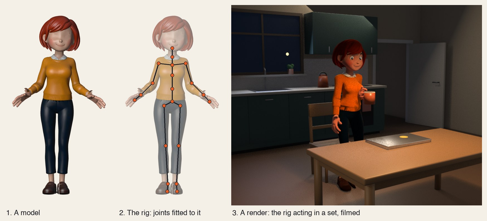

# Blender in the toolkit

Blender is an optional component. Nothing else in the toolkit needs it, and the real limit on using it is your
machine, not the tool: it renders in minutes with a GPU and slowly without one (`doctor` times a frame, and
[How long a render takes](#how-long-a-render-takes) has the numbers). The clay cast, the desk sets, the studio
stage and clips in a Remotion video are the settled part. Characters fitted from a generated 3D model, the
kitchen and the lecture hall are experimental: they have made two finished films on one machine, the fit still
wants its joints read off a picture by hand, and Windows is untested. Their checks also pass on Linux with
Blender 4.2.

With it installed, a JSON **shot spec** becomes a 3D scene: a rigged cartoon character acting at a desk, or a product stage with a phone, a floating card
or an imported model. The render is a finished film, a set of clips for another build (a Remotion video, a
moviepy timeline, a video job, an editor), or both from the same spec.

- **How to write a spec:** `.claude/skills/blender/SKILL.md`
- **A film from one spec:** `examples/blender-disk-panic`
- **Blender clips inside a Remotion video:** `examples/blender-in-remotion`
- **A product stage with no character:** `examples/blender-product-shot`
- **A fitted character on her feet in a kitchen (experimental):** `examples/blender-kitchen`

## Model, rig and render

Three things that are easy to run together, and most of the work is in the middle one.



1. **A model** is a shape and its colours: a mesh. It cannot move. The clay cast is built from a JSON description;
   a fitted character starts as a model from an image-to-3D service (this one is Mara, the invented character in
   `tests/fixtures/blender-fitted`).
2. **The rig** is what makes a model a character: the joints inside it, how much of the mesh each joint carries,
   a face and fingers, and the verbs that move them (`walk`, `sit_down`, `carry`, `sip`). It lives in
   `lib/blender` and is shared by every character, so a verb written once works on all of them, and a fault
   fixed in it is fixed for every film after. Fitting (`blender_render.py fit`) is the step that seats a model
   on the rig and saves the result as a `.blend` beside the character's JSON.
3. **A render** is one film: a spec puts the rigged character in a set, the verbs act on cue, cameras are placed
   and checked, and Blender draws every frame. Renders are slow (see the times below) and are thrown away and
   made again whenever the spec or the rig changes.

So a note on a film is one of two kinds. "Hold that look a second longer" is the spec: change a number, render
the shot again. "The mug goes through the table" is the rig: fix it in `lib/blender`, prove it on two bodies,
add a check, and then render. Rig work is slower the first time and free ever after.

**What is saved.** Every `check` and `render` writes `scene.blend` in the spec's `out/` folder: the built scene
with its keyed acting, to open and scrub in Blender when a number does not explain what a frame shows. It is
written again on each run, so copy one aside to keep it. A fitted character's `.blend` holds only its body
(`model_body`) and is made again by `fit`. Both kinds are build output and stay out of git.

## Setup

1. Install Blender 4.2 or later. The toolkit is made on 5.3 (see *What it has been run on*, below).

   | Platform | Command |
   |---|---|
   | macOS | `brew install --cask blender` |
   | Windows | `winget install BlenderFoundation.Blender` |
   | Linux | `snap install blender --classic`, or the tarball from [blender.org](https://www.blender.org/download/) |

2. Ask the toolkit whether it can see it, and how fast this machine renders:

   ```bash
   uv run tools/blender_render.py doctor
   ```

   ```
   ok    Blender 5.3.0 at /opt/homebrew/bin/blender
   ok    ffmpeg
   ok    Pillow (contact sheets, exposure)
   ok    test render: 1.62 s/frame at 1920x1080 (BLENDER_EEVEE; the first frame took 1.7 s)
         blender-disk-panic: 540 frames, about 15 min to render here
   ```

   `doctor spec.json` times your own spec. `--no-bench` skips the test render.

Blender is found on `PATH`, in `/Applications/Blender.app`, under `Program Files\Blender Foundation`, or in
`/usr/bin`, `/usr/local/bin`, `/snap/bin` and `/opt/blender`. Anywhere else, set `BLENDER=/path/to/blender`.

Blender runs headless (`blender -b`), so this works over SSH and in CI. No window opens and no add-on is needed.
`ffmpeg` joins the picture and the sound and encodes clips; transparent clips need its `libvpx-vp9` encoder, which
the Homebrew, winget and distro builds include.

## What it has been run on

| System | Blender | Result |
|---|---|---|
| macOS, Apple M4 | 5.3 | Everything: both engines, films, transparent clips, the tests |
| Linux x64, in a container with no GPU | 4.2 LTS | The disk-panic film, the product stage and both kitchen films build and pass `check` under Cycles (the two `blender-in-remotion` specs passed there at v0.28.0 and were not run again), both fitted characters fit and pass their walk-ins and kitchen films (the sleeve measure reads 3.8 and 3.6 there against 4.0 and 3.9 on the Mac, limit 4); the film, the clip and the transparent-clip paths render. EEVEE also runs, on Mesa's software OpenGL, slowly. The test file has not been run there: without a GPU one `check` takes 2 to 8 minutes |
| Windows | | Not run yet. The code finds Blender under `Program Files` and reads and writes UTF-8 throughout; treat it as untested |

Transparent WebM clips have been played in Remotion on the Mac only.

## How long a render takes

Measured on a MacBook with an Apple M4 (10 cores, 24 GB), Blender 5.3, EEVEE, 32 samples:

| What | Time |
|---|---|
| `check` (build the scene, verify every camera, 8 stills, contact sheet) | 5 s |
| `render` at 640x360, a draft to judge motion | 0.35 s a frame |
| `render` at 1280x720 | 0.9 s a frame |
| `render` at 1920x1080 | 1.6 s a frame |
| `render --clips --alpha` at 1920x1080 (no room to light) | 0.75 s a frame |
| `render --engine cycles` at 1920x1080 | 17 s a frame |
| The 22.5 s example film (`blender-disk-panic`, 540 frames) | 15 min |
| All four clips of `blender-in-remotion` (555 frames) | 10 min |
| A fitted character in a lit room at 1920x1080 (a kitchen, 13 clips, 45 s, 1,365 frames) | 2.1 to 2.4 s a frame, 55 min |
| The same clips at 640x360, a draft to judge motion | 0.8 s a frame |

**A character film takes hours, not minutes.** The table is one pass of rendering. A film with a fitted character
acting in a room is rendered more than once (a draft to judge the motion, the full pass, then the shots that
changed after the frames were read), and around the rendering sit the checks, the sound, the Remotion side and
the reading of the result. Measured on a 103 s trailer with 45 s of kitchen: the first build took about three
hours from the brief to the delivered file and the revision about two and a half, each as one unattended session,
with about an hour of each spent in Blender. Plan a film of this kind as an evening or an overnight run, start
the render queue in the background as soon as the specs pass `check`, and render one clip at a time: two renders
at once share the GPU and each frame takes longer. How the work is carried from one session to the next is in
[A film over several sessions](#a-film-over-several-sessions).

So iterate in `check`, which is seconds, and render when the contact sheet reads right. A render prints its
progress and time left every 30 seconds. The first Cycles frame also compiles GPU kernels, which takes minutes
once per machine.

Cycles uses the first GPU backend the machine has: Metal on a Mac, then OptiX, CUDA, HIP and oneAPI. With none, it
renders on the CPU, which gives the same picture more slowly. EEVEE wants a GPU with OpenGL 4.3, Metal or Vulkan.
On a Linux server without one it still runs if Mesa's software renderer is installed, but every frame is drawn on
the CPU, so it is slow; `--engine cycles` is the dependable choice there. Time either with `doctor` before
committing to a long render.

## What you get

```bash
uv run tools/blender_render.py check  spec.json     # checks.json, stills/, contact_sheet.png, scene.blend
uv run tools/blender_render.py render spec.json     # the film: <folder>.mp4 with sound
uv run tools/blender_render.py render spec.json --clips --alpha --to projects/my-video/public/blender
uv run tools/blender_render.py open   spec.json     # the built scene in Blender, to look round
```

`--clips` writes one clip per shot and a `clips.json` manifest instead of one film:

| Flag | Result |
|---|---|
| `--clips` | `<shot>.mp4` per shot (H.264), `<shot>.wav` with that shot's sound effects, `clips.json` |
| `--alpha` | transparent background: `<shot>.webm` (VP9 with alpha), which Chrome and Remotion read |
| `--prores` | also `<shot>.mov` (ProRes 4444) for Premiere, Resolve and Final Cut |
| `--shots A,B` | only these shots, for a re-render after one beat changed |
| `--to DIR` | copy the clips into a project's `public/` folder and add them to its `clips.json`. Several specs can share the folder: each clip records its own `fps`, `resolution` and `spec` |

## In a Remotion video

Set the spec's `fps` to the composition's (30 in the toolkit's templates), render the clips into the project, and
play them with `BlenderClip` from `lib/components`:

```tsx
import manifest from '../public/blender/clips.json';
import { BlenderClip, blenderClip } from '../../../lib/components';

const act = blenderClip(manifest, 'B1_act');
<Sequence from={345} durationInFrames={act.frames}>
  <BlenderClip clip={act} style={{ left: 560, top: 270, width: 1440 }} />
</Sequence>
```

The clip plays once, holds its last frame, and brings its own effects. `act.event('alert')` is the clip frame the
alert lands on, for a caption or a cut that should hit the same moment.

`crop={{ x, y, w, h }}` (the clip's own pixels) shows one part of a clip, scaled to fill the box, and
`background` draws a picture of the clip's backdrop behind it at the same crop: a presenter's head and chest in
a small inset while the camera is on a chart. Nothing draws outside the box. A hand-built inset that scaled a
layer round the clip left the clip at full size outside it, and the frame showed bare board.

What a longer video taught (a nine-minute lecture: six room shots, fourteen presenter clips, a Remotion board):

- **Every frame comes from its source, never from an earlier render.** A clip's start is the timeline's or the
  captions' (`cue()`), its length is `clips.json`'s, a sound's frame is `clip.event(...)`, and the spec generator
  reads the same timeline file the composition does. A room's end frame typed into a generator from the first
  cut put a clip 401 frames out when the script grew. `examples/blender-in-remotion` reads its cut frame from
  the spec's `skip_frames` and its lengths from `clips.json`.
- **Play shots by id, not by `clips.json` order.** A shot rendered again goes to the end of the manifest.
- **Clips that join start and end in the same pose,** head and eyes included, and share a `clock`.
- **Sounds for small props go in the video build.** A cup or a chalk tap that the clip's own WAV does not carry is
  laid on the clip's event frame in the composition and checked with `tools/sync_check.py` (a landing is
  `impact`; something picked up is `onset`).
- **One Blender render at a time.** Rendering is bound by the GPU: 0.69 s a frame alone, 0.9 s with three
  running side by side, so a queue finishes sooner than a fan-out.
- **Check the render, not the parts.** After the full render, on top of `qc.py --render`, tile one frame every
  10 s of the real file and read it: `uv run tools/contact_sheet.py out/video.mp4 --count 57 -o out/every-10s.png`
  (`--count` is the length in seconds over ten). An inset was empty in a render while every still of the board looked right, because the
  stills were of the board and the fault was in the layer over it.

It works in the other direction too. A spec's `set.screen.video` puts a Remotion render on the laptop in the
scene, and a `pull_out` shot starts with that picture covering the frame, so a flat scene can cut to itself in 3D.
`examples/blender-in-remotion` does both.

## In other builds

`render --clips` without `--alpha` writes an ordinary H.264 `.mp4` per shot, so a Blender shot goes wherever a
video file does: `VideoFileClip` in a moviepy build, a `file` scene in a `video_job.py` spec, `cutdown.py` for a
vertical cut. The clip is picture only; the shot's sound effects are the `.wav` beside it. `--prores` adds a
ProRes 4444 `.mov` for Premiere, Resolve and Final Cut (transparent with `--alpha`). `clips.json` lists each
clip's length and the frame of every sound event, for a build that wants to cut on the acting. A whole film
(`render` with no `--clips`) already has its sound, and takes a music bed from `addmusic.py`.

## Timing from the narration

A spec can also take its timing from the narration: list the scene's `.captions.json` under `voice`, and a beat's
time can be `"cue:disk is full"`, the moment those words are said.

A video on a screen (the laptop, a phone or a card) advances one of its frames per scene frame, so it must be
rendered at the spec's `fps`. One at another rate is refused before anything renders: `screen video scene.mp4 is
30 fps and the spec is 24 fps: render it at 24 fps, or set "fps": 30`.

## Characters

A cast member is a description in JSON, not a model file: a build, a face, hair, clothes and accessories, each a
named choice or a hex colour. An agent can write one from a sentence or a photo.

```json
{"id": "maya", "seed": 12,
 "body":    {"build": "slim", "skin": "brown"},
 "face":    {"shape": "oval", "eyes": "brown", "brows": "thin", "nose": "small", "beard": "none"},
 "hair":    {"style": "bob", "color": "grey"},
 "clothes": {"top": "shirt", "top_color": "#2E7D5B"},
 "accessories": ["glasses"]}
```

- Whatever is left out takes the default character's look, or, with a `seed`, is drawn from the seed: `{"id":
  "extra", "seed": 41}` is a whole person, and the same person on every machine.
- A character can live in its own file and be named with `"from"`; fields beside it override the file, so one
  video can change the costume and keep the person. A kit keeps its cast in `kits/<name>/cast/`
  (`kits/example/cast/maya.json`).
- A field that isn't one of its choices is a spec error that lists the choices.
- Every character is built on one rig, so every acting verb works on every character. They are caricatures in one
  cartoon style, not likenesses.

The full table of choices is in the skill.

### On their feet

A character sits at the desk unless the cast entry says `"posture": "stand"`, with `"at": [x, y]` and `"facing"`.
From there the verbs are `walk` (to a spot, turning into it and out of it), `turn`, `sit_down`, `stand_up`, and for
the set `open_door` and `pull_in`. The feet are planted: a foot on the floor stays where it is while the body
moves over it, and the report's `ik_max_error_m` says so (under a centimetre), naming the limb and the second if
a step was too far. Three shot types film someone standing: `full`, `feet` and `tilt_up`; `"follow": true` makes
any character shot travel with a walk (the camera glides: its path is the walker's, smoothed over about a second).
A walk is a straight line with a turn at each end unless it has `"curve": true`, which walks one bend, the body
leaning into it; `"heading"` is the way they are going as they arrive.
The clay cast gets its leg controls only when a spec uses one of these, so a desk-only spec renders exactly as it
did before they existed.

The posture verbs are built from the same few pieces, so they move alike: the eyes and head lead, the weight
shifts before a foot lifts, the chest follows the pelvis and the hands follow the chest, a move lands a little
past its mark and settles, and one side goes before the other. Hands are put on things (the knees, the desk's
edge, a door handle with `"by"` on `open_door`) and stay on them while the body moves.

Contact is measured on every frame and fails the check: a foot under the floor, a hand inside the body, the body
through furniture, a planted foot sliding, a hand off what it holds. The report says which, how far and when
(`body_problems`), and `moves` gives each posture verb's timing spread. The table is in the skill.

Two checks look for flicker. `check` fails a set where two objects of different materials have faces in one
plane that a camera sees (`set_problems`): the renderer draws one or the other from frame to frame. And `render`
reads the finished frames at points of the set that stand still: one that jumps for a frame and comes back, five
times on one object in a shot, fails the render (`render_checks.json`). The level is read at the point's exact
place in the frame, between pixels. Read at the nearest whole pixel, a slow push-in over a board with writing
on it stepped the reading a pixel at a time across the letters, and the lecture hall's board was reported as
flickering on 104 frames with nothing to see; a surface with a picture on it is now read as smoothly as a
plain one, and two faces in one plane are caught as before.

### A character from a generated 3D model (experimental)

The clay cast is built from a description. A fitted model is a 3D character made elsewhere, put on the same
rig, so the same verbs and shots work on it. The pattern, one step each:

1. **A character sheet.** One front view of the character standing in an A-pose (arms away from the body, legs
   apart), plain background. Draw it, or generate it: `flux2.py` for an invented character, `image_edit.py` then
   `flux2.py --input` to stylise a photo. For a character of a real person, take the photos with
   `uv run tools/reference_capture.py --out projects/my-character/reference`: a local page talks the sitter
   through eight poses (front, both three-quarters, both profiles, a smile, glasses off, full body), counts down
   aloud so they can look away from the screen, and keeps the sharpest frame of a short burst. It needs a browser
   and a camera, the photos stay on the machine, and the person in them decides where they go next: keep them
   out of a public repository.
2. **A model.** Any image-to-3D service that returns one textured GLB. Through the Blender MCP server's
   `generate_3d` it is one generation, a minute or three, and may cost a credit on that service: check before
   you run it.
3. **Fit it.** `uv run tools/blender_render.py fit --model lead.glb --fit fit.json --out lead.blend --preview fit/`
   binds the model to the rig in its own A-pose: nothing is re-posed or stretched. `fit.json`
   holds what the fit can't yet see by itself: the joints (shoulder, elbow, wrist, hip, knee, ankle...), where the
   clothes end and the head starts, and the eyes, brows and mouth, all in metres read off a front view. The
   painted eyes and brows are erased, because the rig's own are placed there and move. The face also takes
   `mouth` (where the lips meet: under a moustache, its lower edge), `mouth_width` (corner to corner; under 18%
   of the face's width fails the check as too small to read), `moustache` (true when the upper lip is under
   hair) and `chin` (the height of the chin's underside). From these the fit builds a lower lip, teeth and the
   dark of an open mouth on the model's own lip line, smile, frown and jaw shapes in the head's surface, and
   skin-coloured lids that close for a blink or a wink. A brow hidden under a fringe goes in `brows_hidden` (its
   index in `brows`, the character's right first): the rig still gives it a brow, and nothing is erased there.
   **Hands with fingers** are optional: `"hands": {"model": "lead_open.glb"}` names a second model made from
   the same sheet with the hands open and the fingers apart (one more generation). Only its hands are used.
   The fit finds each by its skin colour up to the cuff, finds the fingers and thumb, uses the better formed
   hand for both arms (mirrored for the other), seats it in the cuff with the palm toward the leg, and gives
   every finger two bones. A generated thumb stands off the palm on a thick wedge (its root about 40% of the
   hand's length out of the palm), so the fit presses what stands in front of the palm in towards it, until the
   thumb's root is 8% of the hand's length out: the wedge thins evenly, the cuff ring and the fingers do not
   move. The fit prints the depth before and after and how far any edge was stretched, and fails if the root
   still stands over 20% out (a hand like that rests on its thumb).
   A second generation of the same character comes with hands a fifth to a third too long, so the fit makes the
   donor's hand as long as the body's own, cuff to fingertip, and prints both lengths. `"scale": 0.7` in `hands`
   sets the donor's scale by hand instead (the fit then prints what would have matched). The wrist joint is put
   where the hand meets the cuff, whatever `fit.json` says: read off a still it lands some centimetres up the
   sleeve or inside the hand, and then the sleeve folds where there is no joint. A nub the generator left on a
   hand is smoothed flat with `"smooth": [[along, out_of_palm, across, radius]]`, in cm on the fitted hand from
   the middle of the knuckle row (the back of the hand is negative out of the palm).
4. **Name it.** A character file with `"model": "lead.blend"` beside it, and `"accessories": ["glasses"]` if they
   wear them. Keep the folder in a kit (`kits/<name>/cast/`).
5. **Look at it** before writing beats: a `check` of any spec with the cast entry swapped, and read the contact
   sheet. Arms up, hands on head and sitting show the skin weights at their worst.

What the fit does for you: legs that touch in the model (shoes generated as one piece) are parted, since a face
joining one leg to the other tears across the gap on the first step; weights come from a clean stand-in body on
the same joints, copied only between
surfaces that face the same way (so a sleeve does not take the chest's weights), and kept inside the sleeve, whose
thickness is measured round the upper arm and round the forearm on the side away from the body; bends
keep their volume; the seat is as high as the character's knees and the desk comes to its hands, so nobody is
stretched to fit furniture.

The furniture and the reaches come from the body's own measures, so a build the rig was not worked out on still
sits at its desk: the desk's underside stays over the thighs and a hand resting on them (long hands on short arms
hang deep under the wrist, and a desk set by the hands alone came down into the legs); the keys' near edge comes to
the fingertips, a hand's reach from where the wrist is comfortable; two hands on the keys lie 30% of a hand's
breadth apart, measured on the mesh (broad hands on narrow shoulders met in the middle); a hand on a thigh stands
off the leg's skin as it is posed on that frame. Pulling in to the desk, a hand takes the desk's edge only if it
can lie flat there in front of the shoulder; otherwise the hands lift off the lap while the desk is still far off
and wait over the keys.

To keep a model in a repository, reduce it no further than the fit's own size (`"faces"` in the fit file, 150,000
by default for a body): a body that passed every check at that size failed the sleeve check at 60,000 faces,
because the measure reads the mesh's edges and coarser cloth has longer ones. A character fitted at 60,000 from
the start (Mara) is measured at that size and is fine. Weld its UV seams before reducing it (the importer splits the vertices along
every seam, and a split mesh decimated opens into cracks along all of them, which show as torn cloth and shards
round the eyes). In Blender: merge by distance at 0.00001, then Decimate.

What it does not do: without a `hands` model the hands are whatever the model has (usually fists), on one
bone; generated hands are thick and cupped, so they read as mitts with finger grooves. A typing hand slopes down
from the wrist 20 degrees, as a typist's does, with the fingertips on the keys; a hand laid flat slopes just
enough for the heel of the hand and the fingers to rest together (a generated hand's heel is deep). A likeness
of a real person belongs in your own project folder, not in a repository. `tests/fixtures/blender-fitted` is a worked
example with an invented character: both models, the `fit.json` read off gridded stills, and a README saying how
each was made (her generated hands had the fingers joined, so the hands came from a second model).

How the hands are held is measured, not set: the rig poses the fingers in each shape, reads how far the hand's
underside is below its wrist (on a desk or the keys, the whole hand, heel and all), and holds the wrist that far over the desk, the keys or a thigh. The wrist is
turned from the arm as it is posed on each frame, so a palm faces the leg when the arm hangs and faces down
on a desk whatever the forearm is doing. `check` then measures what a still can't show: a fingertip inside the
body, the two hands into each other, a hand rolled off palm down on a table top, a hand still open on what it
holds (`grip_open`).

Typing hands are put on the keys where they are in the room, measured on each frame, not where the pose says (the
body's lean and how it sits put a pose's wrist a couple of centimetres off). On each beat one finger of one hand
lifts and comes down on the next one; the wrists hardly move. `typing` in `checks.json` says how far the
fingertips are over the keys and how far the fingers move.

A fitted model's arms hang from the shoulder: the elbow bent about 12 degrees, the arm tipped out only as far as
the relaxed hand needs to clear the hip (about a centimetre, measured on the mesh). In a walk the arm swings like
a pendulum, nearly straight behind and bending a little more in front, keyed along its arc so the elbow does not
fold between keys. `walks` in `checks.json` gives each walk's `arms`: the most the elbow bends, how near level
the forearm comes, how far a hand stands off the body (the middle value through the walk: a thigh swings out
from under the hand on every stride, and that is the leg moving, not the arm held out). `snap_m` is the furthest
the chest or a hand moves in one frame when it hardly moves in the frames either side (over 2 cm fails): a key
that landed beside another, or a hand held on one spot and then put on the next.

### Refining a rig: one spec, two bodies

How the fitted rig was worked up, and how to carry on with it or with your own. It has been run with Claude Fable
5.2 in Claude Code; other models are untested.

1. **Two characters, one spec.** Keep a second fitted character of a different build beside the first (the repo
   has Mara) and run every spec on both. A number tuned on one body passes on that body: nearly everything found
   in the session that made Mara pass came from her failing a film the first character passed.
2. **Look, then measure.** Render or `check`, tile every second or third frame of a shot, and look. When
   something is wrong, find the number behind it before changing anything: print it per frame, and compare it on
   both characters.
3. **Turn what was seen into a check.** Each fault becomes a number in `checks.json` with a limit and a test, so
   it cannot come back unseen. Prove a new check on the code as it was (it should fail there). The checks are
   the memory of the work; a note that says "watch the hands" is not.
4. **Fix the cause where it is measured.** A constant that made one character pass is replaced by a measure of
   the body (a length, a thickness, a reach), and the fix is right when both characters pass without a number
   of their own.
5. **Prove nothing else moved.** The clay cast's check stills are compared with a baseline, the tests run, and
   the film is rendered at full size with the flicker check before anyone is shown it.
6. **Carry it across sessions in one status file.** Each session ends by updating one file (what was done, what
   is open and in what order, what was spent) and writing the next session's prompt from it. A fresh session
   reads the file and the checks, not the old conversation. The same bridge carries a film between
   revisions: see [A film over several sessions](#a-film-over-several-sessions).

What could be better: the proof scripts (tiled stills, close cameras on a hand or a face, per-frame traces) live
in a project folder and are not yet tools in the toolkit; the fit still wants its joints read off a still by hand;
and two characters is the least that shows a tuned number, where three of different builds would show more.

## A product stage

Set kind `studio` is a backdrop that curves from floor to wall, with soft lights and no character. Its props are a
`phone` or a `card` showing a picture or a video, and a `model` (`.glb`, `.gltf`, `.obj`, `.fbx`, `.stl`) scaled to
a size in metres. Three shot types film them: `product` (a three-quarter view), `orbit` (round the prop) and
`reveal` (starts on a screen edge to edge, then pulls back). The camera's distance comes from the prop's size, and a
prop with a screen is checked for staying readable through the shot. With `--alpha` the backdrop is left out, for a
clip over a Remotion scene. `examples/blender-product-shot` is the worked example.

## Blender Python or a Blender MCP server?

The toolkit drives Blender with its own Python (`blender -b -P lib/blender/compile.py`), and that is the route to
build on:

- **The spec is the source.** The scene is rebuilt from JSON on every run, so a video can be re-rendered next
  month, by another agent, on another machine, and come out the same. A scene edited live has no such record.
- **It runs unattended.** No window, no add-on, no socket: it works in CI, over SSH and inside `video_job.py`.
- **Checks come back as data.** `check --json` says which camera failed and why, which is what an agent needs to
  fix a shot without looking at it.

A Blender MCP server (for example [blender-mcp](https://github.com/ahujasid/blender-mcp)) connects an agent to a
Blender window that is already open. That is useful for a different job: working out a look with a person
watching. Use it to try a pose, a light or a camera in `scene.blend`, to bring in a model from a library, or to
ask what an object in the scene is called. Then carry what you learned back into the spec or `lib/blender/`, where
it is kept. Don't treat the edited `.blend` as the result: the next `check` overwrites it.

The toolkit doesn't install or need an MCP server. `blender_render.py open spec.json` opens the built scene for
either a person or an MCP session to look at.

Installing `bpy` from PyPI is a third route. It pins a Python version and a 300 MB wheel into the toolkit's
environment for no gain over the Blender most people already have, so the toolkit calls the installed Blender.

### A kitchen

Set kind `kitchen` is a home kitchen at night round the desk room's table, chair and laptop: units with a sink
under a window, a fridge, a pendant lamp over the table. It adds a mug of tea to carry in and put down, a lid
that starts shut and is opened and shut by hand (`open_lid`, `close_lid` with `"by"`), and Claude: a beige CRT
on the worktop with a face on its screen, a tinfoil hat and two arms at a keyboard (`claude_type` gives a
`key_click` event per key, `claude_turn` turns him). The fields and a worked entrance are in the skill.

What building it taught, each now in the code or a check:

- **A lid is further off than a seated arm.** The far edge of an open laptop was 0.85 m from the shoulder of a
  character whose arm and hand reach 0.62 m. The first spec made up the difference with a 28 degree lean, and
  the check reported "3 cm into the table". That number was the measure's ceiling for a thin solid: both
  forearms and hands were through the table top, because hands hang from the chest and a lean takes them with
  it. Now the chest turns the reaching shoulder to the lid and leans only as far as the table's edge allows,
  solved from the reach on each frame; the fingertips take the lid's edge; and a hand lying on the table is
  held where it lies while the chest moves.
- **A set that replaces a piece of furniture keeps its edges.** The kitchen table was 10 cm deeper than the desk
  on the same centre, so its near edge was 5 cm nearer the chair than the fit's belly room allows for, and the
  chest was in the table at any lean. The table is deeper away from the chair now.
- **When a check says the same depth for many frames, find what is in the solid.** List the body's vertices
  inside its box by bone before changing anything: "the chest" was two forearms, then a hand still finishing the
  move before, then one little finger under a mug.
- **A beat that starts inside another's move** takes the hand from wherever it is on that frame, and the result
  is a one-frame jump or a hand left in the air. A hand's move runs about half a second past its beat.

What the first viewing taught ("I seem to be carrying a candle", and "some of the alignment is out"):

- **A prop is told by its outline, its colour and its size against the hand.** The first mug was a cream cylinder
  8 cm across, held from above with its handle inside the fist: a candle. Now it is 12 cm tall in the room's
  accent colour, with tea in it and a handle a hand fits, and it is held by that handle, out past the knuckles
  where a camera sees it.
- **What a hand carries needs its own checks.** The body's checks passed while the mug went through the table's
  edge: a carrying hand went to the thigh with the other one when he sat, and took the table's edge with it when
  he pulled the chair in. A carrying hand now keeps carrying through posture verbs and lifts clear of the table,
  and the check reports `carried_tilt_deg` (a full mug stays level) and `carried_through_m`.
- **A hand held one way in the room runs into the wrist's limit as the forearm swings**, and the mug tips with it.
  A hand that carries follows its own forearm and only stays level. An upright forearm has no level direction, so
  the elbow rises out to the side for a sip, as a drinker's does.
- **The straight line from the mouth to the table passes the shoulder.** The arm folded shut on the way and the
  hand swung right round. A hand with something in it comes down to where it carries first, and no point of its
  way is nearer the shoulder than a bent arm holds a mug.
- **Rotation keys are written in the order the verbs run, not the order of their frames.** Two neighbours can
  hold opposite signs of the same rotation, and the curve between them passes through zero: the hand spun 139
  degrees in six frames. Each carrying verb now ends by putting the hand's keys in order. On a frame between two
  keys the four numbers are not a unit rotation either; read without normalising, they keyed the hand a long way
  off for one frame. That was an old fault in every fitted hand, found by the new check.
- **A fitted face's brows are shaped, not slabs.** On a sculpted face a box read as a shelf over each eye, in the
  hair's colour, half hidden by the glasses. They taper, arch, follow the head, are a shade darker than the hair
  and clear the frames at rest. The clay cast keeps its slabs, which suit it.
- **Choose the camera for what the hands are doing.** Seated at an open laptop, a front `medium` shows a face
  over a lid: the lid hides the mug and both hands. A `closeup` turned to one side (`"az": -30`) shows the mug
  reach the lips, and a `side` shows the hand on the lid. `over_shoulder` is placed for the desk sets and lands
  under the kitchen table; `check` fails it, so read the contact sheet before believing a shot type.
- **A check that fails on one beat can be met by the spec while the rig catches up.** A full `sip` stretches a
  fitted sleeve past the limit (4.7x on Mara, limit 4); `"part": 0.45` raises the mug less far and passes. Say
  so where the spec lives (`examples/blender-kitchen` does), and never render past a failing check in something
  other people will copy.
- **Changing one beat moves the numbers of the next.** The same sip passed at one height in one shot and failed
  in another, because a `look` before it turned the chest. Run `check` after every edit, not after a batch.

## A film over several sessions

A film with a character in it is not finished in one sitting, and no session should try. What has worked, on two
films so far, is a run of separate sessions with a person's notes between them, each session started from a
prompt the session before it wrote. It has been run with Claude Fable 5.2 in Claude Code; other models are
untested.

1. **A brief starts the first session.** The person brings it: the idea, the script or the lines, the tone, the
   length. It can be written anywhere (the trailer's was worked out with another assistant, outside the
   toolkit, and pasted in). It also settles what the agent may not decide alone: the scope, the voice and
   whether new audio may be bought, whether anything is uploaded, and what stays off screen.
2. **A storyboard comes before any render.** The first session turns the brief into a board with one row per
   beat: the time, a frame, what happens, what is heard. The 3D frames are the stills `check` writes, so each
   costs seconds and already shows the real set, camera and character; flat scenes are a frame or a sketch of
   the scene. Under it go the questions the brief left open. The person reads the board, answers, and moves
   beats about while a change is still a line in a spec. This is the cheapest place to be wrong: the same
   change after the render is an hour.
3. **Then the build runs without supervision** for a few hours, and the agent writes every choice the brief and
   the board left open, with its reason, in a decisions file in the project.
4. **The session ends with three things.** The rendered film with its checks run and anything that failed said
   plainly; the decisions file; and a prompt for the next session, saved in the project and copied to the
   clipboard.
5. **The prompt is the bridge.** A new session has none of the old conversation, and should not need it. The
   prompt names the files to read and in what order, the render to keep, and the rules that still hold, and
   leaves a gap for the person's notes. It is short because the state lives in the files it points to.
6. **The person watches, then pastes.** They watch and listen to the film, write what they saw in their own
   words ("I seem to be carrying a candle", "the pacing in the middle worries me"), paste that into the gap and
   start a fresh session with it. A note can be loose: finding what "the alignment is out" means, by tiling the
   frames and looking, is the agent's job.
7. **Each revision keeps the last.** Before anything changes, the renders, clips, specs and source of the cut
   being revised are copied aside, so two cuts can be compared and a revision that went wrong costs nothing.
8. **What a revision teaches goes into the rig.** A fault seen in a film (a mug held like a candle, a hand through
   a table) is fixed in `lib/blender`, proven on two bodies, given a check, and written into this page and the
   `blender` skill before the film is rendered again, as in
   [Refining a rig](#refining-a-rig-one-spec-two-bodies). The next film starts with it.

**What a session checks before it hands over.** The agent does not judge the film by eye alone, and it cannot
hear it at all, so each kind of fault has a measure:

| Where | What is measured |
|---|---|
| `blender_render.py check`, before a frame is rendered | every camera (subject in frame, nothing in the way), and the body: a hand inside the body, a limb through furniture, a sliding foot, a missed touch, a jump in one frame, a stretched cuff, a carried thing tipped or through a table |
| `blender_render.py render` | flicker, read from still points in the finished frames |
| `qc.py --render` | loudness, a missing or silent track, black gaps, stretches where nothing moves, motion that stops dead |
| `qc.py --layout` | text off the canvas, low contrast, type too small for a phone |
| `sync_check.py --cues` | each sound against the movement it belongs to, within 0.1 s |
| Reading the frames | the render tiled every few seconds and looked at, and a shot tiled frame by frame where a check or a note points |

A check that fails and cannot be fixed in the session is not hidden: it is named in the report and the decisions
file with its number, and the agent can carry it into the next prompt as a suggested note, beside the gap for the
person's own. What no check covers is taste and sound: whether the music suits it, whether a line lands, whether
it is too long. Those are what the person's notes are for.

A prompt of this kind, as one session left it for the next:

```text
Revise "<film>" (projects/<film>) from my notes on revision 2.

Read in order: the status file, the playbook, then in the project DECISIONS.md ("Revision 2" at the end).
Revision 2 is out/<film>.mp4; keep it (copy renders, clips, specs and source to audition/v2 before changing
anything).

My notes on revision 2 (what I heard and saw):
<PASTE NOTES HERE>

Rules as before: local commits only; every choice I have not settled goes in DECISIONS.md under "Revision 3";
any change to lib/blender is run on two characters, gets a check or a test, and goes into the docs; run every
check and say plainly what did not meet it. I may not be available during the run.
```

Fresh sessions are deliberate. A revision fills a long conversation with frames and logs, and a session that
starts from the files reads what is true now, not what was tried three hours ago. Two to four sessions took each
film from a brief to a cut its author would publish.

## Limits today

9:16 works: set `"resolution": "1080x1920"` and read the contact sheet, since a `wide` shot crops the desk.
`check` builds its stills in the film's own shape (the spec's `resolution`, or `--res`), because where the solver
puts a camera depends on the shape of the frame.

One character per set; the clay cast's hands are one bone; a walk goes through furniture unless it is bent
round it; the sets are `desk_room`, `desk` (no room, for transparent renders), `lecture_hall`, `kitchen` and
`studio` (props and no character); a `lean` carries hands resting on a table down through it; a standing arm
does not reach a low table (sit first); a cartoon style; acting keyed from verbs, with no motion
capture; studio props stand still while the camera moves. EEVEE cannot render a shadow onto a transparent
background, so a transparent character or prop has no cast shadow on the Remotion scene. The room's light is dim
on the darkest skin tones in a `wide` shot: raise `look.exposure` a little or use a `medium`. A `pull_out` passes
close to the character's hand on its way back, inside the limit the check enforces but large in frame for a
moment.

The roadmap goes two ways. More from the spec: props that move, a tablet prop, cast shadows on transparent clips,
two characters in a set, hand shapes and props in the hand, a fit that finds the joints and face by itself, and a
`blender` visual kind in `video_job.py`. And more of Blender
itself: your own `.blend` as a set, a `script` hook that runs your Python between the build and the checks, and
imported rigs whose actions become verbs.

## Troubleshooting

| Symptom | Cause and fix |
|---|---|
| `Blender not found` | Install it, or set `BLENDER=/path/to/blender` (the program itself, not its folder) |
| `doctor` says the version is too old | 4.1 and earlier have the previous EEVEE and a different API. Install 4.2 or later |
| A shot is `FAIL: view blocked by ...` | Something is between the lens and the subject and the solver found no clear spot. Change the shot's `type`, `az` or `dist` |
| A shot is `FAIL: lens 0.16 m from dev_body` | A `pull_out` or `push_in` passes too close to the character. Give it a wider `az` or more `elev` |
| `BlenderClip ... was rendered at 24 fps` | The spec's `fps` isn't the composition's. Set it and render the clips again |
| The laptop's picture is dull or tinted | The default AgX view compresses colour. For a picture that must match a flat scene, set `"look": {"view": "Standard"}` |
| The transparent clip has a black background in a player | The player ignores VP9 alpha. Chrome and Remotion read it; use `--prores` for editors |
| EEVEE fails or crawls on a headless Linux box | No GPU. Install Mesa's software renderer for a slow EEVEE, or use `--engine cycles` |
| `screen video ... is 30 fps and the spec is 24 fps` | A screen plays one video frame per scene frame. Render the video at the spec's `fps`, or change the spec's |
| `cast member 'maya': hair.style is one of ...` | A character field that isn't one of its choices. Pick from the list in the message |
| A studio shot is `FAIL` with "faces the lens" | The orbit turns the screen away for more than half the shot. Narrow `az` to `az_to` |
| A studio shot fails with `exposure 0.73 outside (0.08, 0.7)` | A light backdrop fills the frame. Darken `palette.backdrop` a step, or raise the shot's `fill` |
