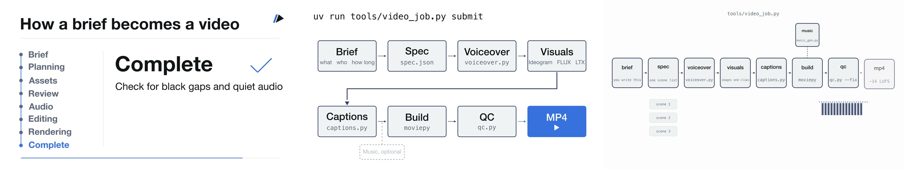

# One Manim explainer in Codex, Claude Code and OpenCode

Left to right: Codex, Claude Code, OpenCode. Watch them:
[Codex](https://demos.digitalsamba.com/video/agent-manim-codex.mp4),
[Claude Code](https://demos.digitalsamba.com/video/agent-manim-claude-code.mp4),
[OpenCode with Kimi K3](https://demos.digitalsamba.com/video/agent-manim-opencode.mp4).

## Why I ran it

The toolkit started life in Claude Code, and [#240](https://github.com/digitalsamba/agent-video-toolkit/issues/240)
asks whether it should work with other coding agents too. [AsharibAli's cycling test](../agent-video-comparison/README.md)
showed that other agents can plan a video job. I wanted to know something bigger: can another agent CLI pick up
the toolkit cold and make a whole video in a working session, using the docs, tools and skills the way Claude
Code does?

They can. All three made a finished, QC clean video from the same brief with no help from me, and none of them
touched anything outside its own project folder.

## What ran

Each agent got [the same brief](BRIEF.md) as the first message of a fresh session at the toolkit root, on the same
commit ([`0dbebf6`](https://github.com/digitalsamba/agent-video-toolkit/commit/0dbebf625f19d5b078a4f4aae71cc038ef6a4a70)),
on my Mac. The brief asks for a 45 to 60 second explainer of how a brief becomes a video, with the diagram drawn in
Manim and built on the narration, in the toolkit's own brand and voice, for at most $1 of paid services. I answered
questions but gave no help, and wrote down every time I stepped in.

| | Codex | Claude Code | OpenCode |
| --- | --- | --- | --- |
| Version and model | Codex 0.172.0, GPT-6.2-Sol, default effort | Claude Code 2.1, Opus 5.5, medium effort | OpenCode 2.4.1, Kimi K3 on OpenRouter, default effort |
| Time | about 7 min | about 15 min | about 40 min |
| Times I stepped in | one approval to reach the network | none | none |
| What it explained | the project lifecycle, planning to complete | the video job pipeline | the video job pipeline |
| Video | 51.7 s | 58.3 s | 46.3 s |
| QC | 0 errors, 0 warnings | 0 errors, 0 warnings | 0 errors, 0 warnings |
| Loudness | -15.1 LUFS, -1.4 dBTP | -14.3 LUFS, -1.4 dBTP | -14.3 LUFS, -1.4 dBTP |
| Paid services | $0.06 | about $0.14 | about $0.10 |
| The model itself | my subscription | my subscription | about $4.26 in tokens |

Every stage each video names is real and in the right order. Codex took its stages from the project lifecycle in
`CLAUDE.md`; the other two took theirs from the job pipeline in `docs/agent-video-jobs.md`. All three read
`docs/manim.md` before writing a scene, put their words through `tools/copy_lint.py` before voicing them, checked
their own frames and ran the toolkit's QC on the render.

## The three videos

**Codex** drew the lifecycle as a list that grows, each phase lighting up as the narration reaches it, with a few
words underlined as they are spoken. It is clean and easy to read, more slide than diagram, and it was by far the
fastest.

**Claude Code** drew a flow chart: two rows, a line back, music as a dashed branch, the stage being narrated in
blue, and an ending that swaps the title for the `video_job.py submit` command while a dot runs along the chain.
It is the most visual of the three. The small labels inside the boxes are too small, and for the first 20 seconds
most of the frame is empty.

**OpenCode with Kimi K3** voiced the narration first, took the word times from it, and timed the Manim scene to
those times, so each box lands on its word. When QC flagged three long still stretches, it gave each pause
something to do rather than cutting it. Its notes on the run were the most thorough of the three. The diagram is a
single row across the top half of the frame, plainer than Claude Code's. I was impressed by the effort; it was
also the slowest, and the only one I paid for by the token.

Why one video looks better than another is hard to pin down from one run each. The model, the harness, the effort
setting and plain luck all play a part, and testing every combination isn't practical. What the runs do show is
that the toolkit itself isn't tied to Claude Code.

## What the toolkit learned

Each agent wrote notes on what got in its way, and the real problems became issues:

| Issue | Found by |
| --- | --- |
| [#269](https://github.com/digitalsamba/agent-video-toolkit/issues/269) `qc.py --fix` can write a render that clips | Claude Code, OpenCode |
| [#270](https://github.com/digitalsamba/agent-video-toolkit/issues/270) `qc.py --project` has nothing to check on a project with no template | Codex |
| [#271](https://github.com/digitalsamba/agent-video-toolkit/issues/271) The video-toolkit brand has no `copy.json` | Codex, Claude Code |
| [#272](https://github.com/digitalsamba/agent-video-toolkit/issues/272) `docs/manim.md`: things a first scene trips on | Codex, Claude Code, OpenCode |
| [#273](https://github.com/digitalsamba/agent-video-toolkit/issues/273) `voiceover.py` writes no line to the spend log on its own | Claude Code, OpenCode |
| [#274](https://github.com/digitalsamba/agent-video-toolkit/issues/274) `captions.py`: exact word times from per-sentence files | Claude Code |

None of them stopped a run. Each agent worked around the problem and said so.

## Fair to say

- One run each. This is a sample, not a benchmark.
- Claude Code did the judging, including of its own run, so read the verdicts with that in mind. The measurements
  (time, QC, loudness, spend) don't depend on who reads them.
- The settings differ: Claude Code ran at medium effort and the other two at their defaults. Codex and Claude Code
  ran on my subscriptions; Kimi K3 is open weights, run here by hosted providers on OpenRouter (pinned to
  full precision hosts) and paid per token, not on my machine.
- Before their runs, Codex and OpenCode each had a separate session looking round the toolkit for problems. The
  fixes from Codex's look round were merged before any of the three runs, so all three met the same toolkit.

## Add your own run

If you'd like to try this on your own agent and model, I'd love to see it. Start a fresh session in your agent at
the toolkit root and give it [BRIEF.md](BRIEF.md) as the first message. It needs Manim
(`uv run tools/manim_render.py doctor`), an ElevenLabs key for the brand's voice, and FFmpeg. Expect about $0.15
of paid services, plus whatever your model costs.

Then share the video and the agent's `NOTES.md` on [#240](https://github.com/digitalsamba/agent-video-toolkit/issues/240)
or in [Show and tell](https://github.com/digitalsamba/agent-video-toolkit/discussions/categories/show-and-tell),
with the agent, model, effort setting and roughly what it cost. I'll add it to the table, and anything it finds
wrong in the toolkit becomes an issue like the ones above.
