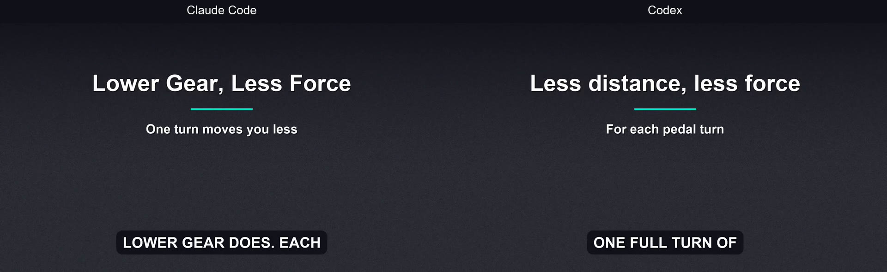

# One cycling brief in Claude Code, Codex and OpenCode

[Download the Claude Code and Codex comparison](https://demos.digitalsamba.com/video/agent-comparison-claude-codex.mp4). It has two audio tracks. Select Claude Code or Codex in your player, or play the individual clips below.



## What ran

Each agent received the [same brief](brief.txt) in its own directory and wrote a title, four scenes, narration and on-screen copy. Each plan went through `tools/video_job.py` on Windows at toolkit commit [`b3437fc`](https://github.com/digitalsamba/claude-code-video-toolkit/commit/b3437fcd462c23b3c46cfd28f8cb61b71039269b). I supplied the same settings for every render. The videos use 1080p at 30 fps, local text backgrounds, the ElevenLabs George voice, Scribe captions and a $0.15 cap per job. Music and the opening title card were disabled.

## Results

| Agent and model | Plan time | Video | Narrated words | Recorded media cost | QC warnings |
| --- | ---: | --- | ---: | ---: | ---: |
| Claude Code 2.1.327, `claude-sonnet-5-5` | 14.0 s | [39.30 s](https://demos.digitalsamba.com/video/agent-comparison-claude-code.mp4) | 92 | $0.1014 | 2 |
| Codex 0.166.0, `gpt-6.1-sol` with low reasoning effort | 16.7 s | [37.90 s](https://demos.digitalsamba.com/video/agent-comparison-codex.mp4) | 88 | $0.0990 | 0 |
| OpenCode 1.19.6, `opencode/deepseek-v4.1-flash-free` | 30.8 s | [37.13 s](https://demos.digitalsamba.com/video/agent-comparison-opencode.mp4) | 84 | $0.0989 | 2 |

Every MP4 decoded cleanly, passed the toolkit's QC with zero errors and had caption text that matched the narration word for word. Claude Code and OpenCode each had a fast scene and a dark transition flagged by QC. The dark transitions came from the template's scene joins rather than from either plan, and [#264](https://github.com/digitalsamba/claude-code-video-toolkit/pull/264) fixed them after this run. The [measurements and file hashes](results.json) are for this run. Media costs are the toolkit's recorded amounts for voice and captions.

Claude Code explains why shifting under load is rough on the chain. Codex gives the rider a rhythm to aim for while climbing. OpenCode starts with a rider halfway up the hill. The toolkit's copy check blocked one line in OpenCode's first draft before media generation. The hosted model reached its free usage limit during my retry, so I changed the phrase `and you keep moving forward` to `and your pedals keep turning` in scene 03. The saved spec includes that edit.

OpenCode also called `toolkit_video_estimate` over MCP. The [DeepSeek V4.1 Flash model weights](https://huggingface.co/deepseek-ai/DeepSeek-V4.1-Flash) are public. This run used OpenCode's hosted route.

## Reproduce the clips

Install `uv` and FFmpeg, then set `ELEVENLABS_API_KEY` for narration and captions. Run these commands from the toolkit checkout. They use the saved Claude Code spec. Repeat with `codex.json` or `opencode.json` for the other clips.

```bash
uv sync --locked
uv run --locked tools/video_job.py estimate --spec examples/agent-video-comparison/specs/claude-code.json --json
uv run --locked tools/video_job.py submit --spec examples/agent-video-comparison/specs/claude-code.json --max-usd 0.15 --json
uv run --locked tools/video_job.py status JOB_ID --json
uv run --locked tools/video_job.py result JOB_ID --json
```

Replace `JOB_ID` with the ID from `submit`. Wait for `status` to show `done` before reading the local MP4 path from `result`. Run one job at a time. To compare fresh plans, give each agent `brief.txt` and copy the returned `title` and `scenes` into a copy of a saved spec.
